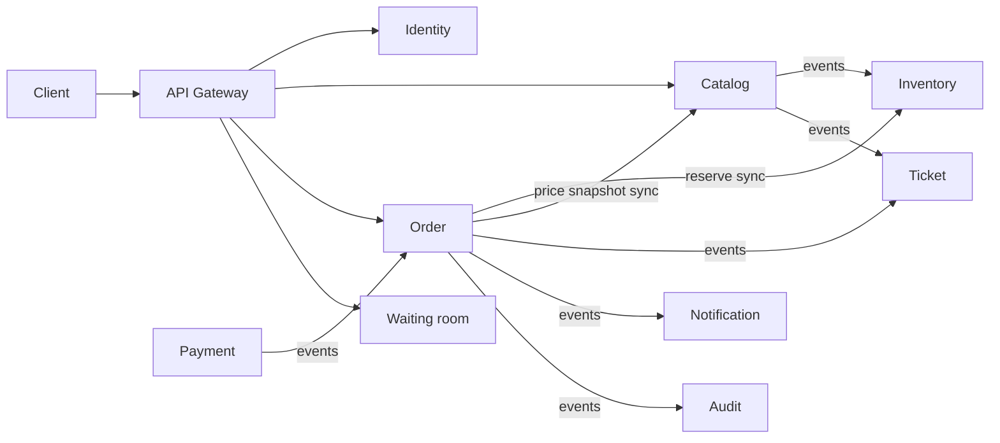

# Bounded contexts và ownership

| Bounded context | Ranh giới nơi thuật ngữ, quy tắc và ownership có nghĩa thống nhất | kiến trúc |
| Saga | Quy trình nhiều local transaction có điều phối và bù trừ | order |
| Outbox | Bảng lưu event cùng transaction với thay đổi nghiệp vụ | producer service |
| Inbox / processed_events | Dấu vết consumer đã xử lý event để chống lặp | consumer service |
| Idempotency key | Khóa đại diện cho một ý định request, retry không tạo kết quả mới | order/payment |
| Source of truth | Nguồn dữ liệu quyết định cuối cùng | PostgreSQL theo service |

**Phân biệt bắt buộc:** `Event` (sự kiện biểu diễn buổi biểu diễn/workshop) khác `domain event` (thông điệp nghiệp vụ). `Tier` mô tả sản phẩm bán ở catalog; `TierStock` quyết định còn vé ở inventory. `PaymentSucceeded` không có nghĩa ticket đã được phát hành.

## Context map và ownership

| Bounded context | Dữ liệu sở hữu | Không được làm |
|---|---|---|
| Identity | users, credentials, roles, organizer profiles, refresh tokens | Không giữ event/ticket |
| Catalog | events, tiers, review, staff assignment | Không tự trừ tồn kho |
| Waiting room | queue, admission | Không quyết định stock |
| Inventory | stock, hold, expiry, purchase counters | Không tính giá từ catalog DB |
| Order | orders, order items, saga state, price snapshot | Không tự sửa stock/payment DB |
| Payment | payment, webhook, refund | Không phát hành ticket |
| Ticket | ticket, QR, check-in | Không quyết định payment |
| Notification | notification/delivery | Không làm hỏng checkout nếu lỗi gửi |
| Audit | append-only audit records | Không sửa nguồn nghiệp vụ |
| API Gateway (technical edge) | route, request metadata, authN coarse, rate limit | Không sở hữu dữ liệu nghiệp vụ |

**[SOURCE]** Mỗi service có DB và DB user riêng; không cross-DB join/FK. Tham chiếu qua UUID, API hoặc local read model cập nhật từ event.

**Quy tắc tách context [SOURCE]:** không tách pricing/search/venue thành service riêng; không tạo shared JPA entities; không sync call vòng; gateway không được thành business orchestrator. Phase 0 chỉ code Gateway + Hello, những context khác là bản đồ định hướng.
