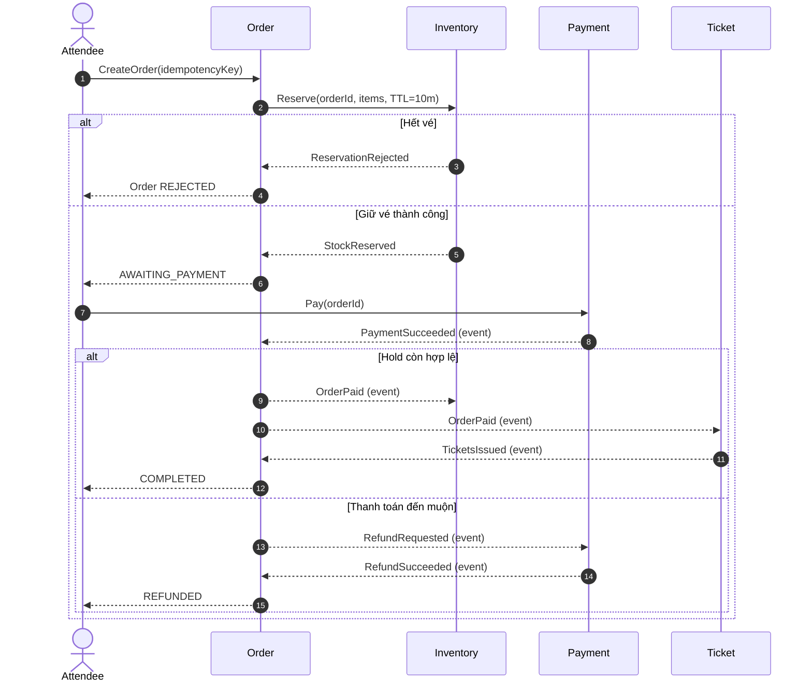

# Event storming checkout

Luồng dưới đây mô tả thiết kế checkout cho các phase nghiệp vụ của QFlow.

## Actors và external systems

| Actor | Hành động | Quyền/phạm vi |
|---|---|---|
| GUEST | Xem sự kiện công khai | Không mua vé |
| ATTENDEE | Vào hàng chờ, tạo order, thanh toán, xem vé | Chỉ dữ liệu của mình |
| ORGANIZER | Tạo sự kiện/tier, gửi duyệt, quản lý sự kiện sở hữu | Không tự duyệt |
| MODERATOR | Duyệt/từ chối sự kiện | Không xử lý tiền |
| EVENT_STAFF | Check-in vé của sự kiện được gán | Không đọc dữ liệu thanh toán |
| ADMIN | Quản trị và xử lý vận hành | Có audit |
| SYSTEM | Worker expire/reconcile/replay | Machine identity, không mượn token user |
| Mock Payment Provider | Gửi webhook kết quả thanh toán | Hệ thống ngoài, phải xác thực chữ ký |

## Timeline command → event → owner

| Bước | Command/trigger | Domain event (đã xảy ra) | Aggregate / owner |
|---|---|---|---|
| 1 | Organizer tạo event | `EventCreated` | Event / catalog |
| 2 | Organizer submit | `EventSubmittedForReview` | Event / catalog |
| 3 | Moderator approve | `EventPublished` | Event / catalog |
| 4 | Scheduler mở bán | `EventSaleStarted` | Event / catalog |
| 5 | Attendee join queue (phase sau) | `QueueJoined` | QueueEntry / waiting-room |
| 6 | Waiting room admit | `AttendeeAdmitted` | Admission / waiting-room |
| 7 | Attendee tạo order | `OrderCreated` | Order / order |
| 8 | Order yêu cầu reserve | `StockReserved` hoặc `ReservationRejected` | TierStock + Hold / inventory |
| 9 | Order nhận reserve OK | `OrderAwaitingPayment` | Order / order |
| 10 | Attendee yêu cầu thanh toán | `PaymentCreated` | Payment / payment |
| 11 | Provider webhook thành công | `PaymentSucceeded` | Payment / payment |
| 12 | Order tiếp nhận payment | `OrderPaid` | Order / order |
| 13 | Inventory commit hold | `StockCommitted` | Hold / inventory |
| 14 | Ticket phát hành | `TicketsIssued` | Ticket / ticket |
| 15 | Order hoàn tất | `OrderCompleted` | Order / order |
| 16 | Notification/Audit nghe event | `NotificationCreated`, `AuditEntryRecorded` (tên đề xuất) | Notification / audit |

**Lưu ý:** bảng là **event storming toàn sản phẩm**, không phải yêu cầu phải code những event này trong Phase 0. Tên `QueueJoined`, `AttendeeAdmitted`, `NotificationCreated`, `AuditEntryRecorded` là **[ĐỀ XUẤT BỔ SUNG]**; blueprint chỉ chốt một số topic và event chính.

## Nhánh lỗi quan trọng

1. **Hết vé:** inventory atomic reserve thất bại → `ReservationRejected` → order `REJECTED`; không tạo payment. Không được đọc số vé cache rồi coi đó là quyết định.
2. **Hold hết hạn:** hold `ACTIVE → EXPIRED`, tồn kho được nhả đúng một lần; order `EXPIRED`. Nếu `PaymentSucceeded` đến muộn, **[CHỐT THIẾT KẾ]** không hồi sinh order; phát yêu cầu hoàn tiền và chuyển `REFUND_PENDING → REFUNDED` khi refund thành công.
3. **Order crash sau reserve:** inventory đã có hold nhưng order chưa chuyển `AWAITING_PAYMENT`; reconciler hỏi lại trạng thái theo `orderId`, khôi phục hoặc để hold hết hạn/giải phóng theo trạng thái. Không reserve lần hai với ID khác.
4. **Webhook trùng:** dedupe bằng `provider_event_id`, xử lý idempotent; cùng payment không được phát `PaymentSucceeded` nhiều lần về mặt nghiệp vụ.
5. **Kafka down:** payment/order ghi DB + outbox trong cùng transaction; relay gửi bù sau, không dual-write trực tiếp.
6. **Ticket-service down:** order có thể ở `PAID` trong thời gian chờ; retry/DLQ/reconciliation, không tạo vé trùng; nếu không thể hoàn tất thì compensation theo chính sách.

**Pain points cần giữ cho các phase sau:** contention stock, duplicate click, webhook duplicate, crash giữa hai transaction, late payment, Kafka outage, stale read model, consumer retry. **Phase 0 chỉ ghi nhận thiết kế.**
