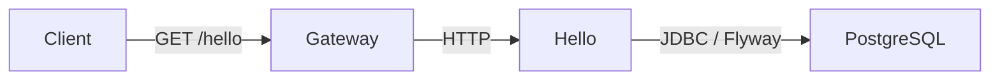

# Kiến trúc Phase 0

Gateway nhận request, gắn correlation ID và chuyển tiếp `/hello` tới Hello. Hello chạy Flyway trên `hello_db` khi khởi động. `GET /hello` trả JSON cố định để kiểm tra đường đi qua Gateway. Redis và Kafka chạy sẵn trong Compose cho các phase sau.

Compose công bố Gateway ở `127.0.0.1:8080` và PostgreSQL ở `127.0.0.1:15432`. Bên trong mạng Compose, Gateway gọi `http://hello:8081`. Identity hiện có DB được khởi tạo để chuẩn bị cho Phase 1.

- [Event storming checkout](event-storming-checkout.md)
- [Bounded contexts và ownership](context-map.md)
- [Quyết định kiến trúc](../decisions/README.md)
- [Thiết kế Phase 0 đầy đủ](../diagrams/phase-0-skeleton/QFLOW-PHASE-0-COMPLETE.md)
