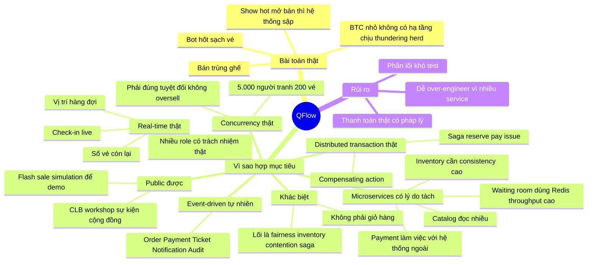
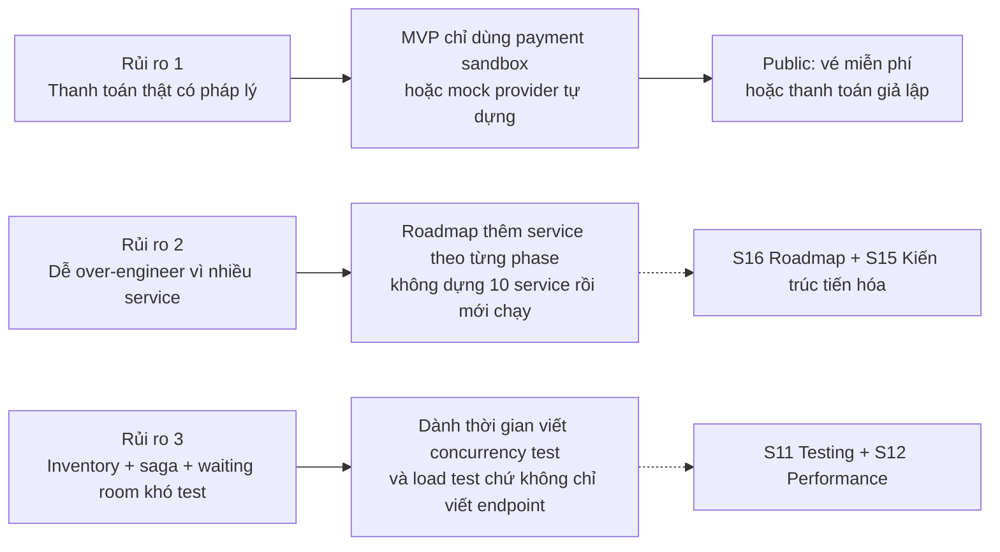

# S00 — Vì sao chọn đề tài này

> Nguồn: mục "0. VÌ SAO CHỌN ĐỀ TÀI NÀY" của QFLOW_PROJECT_BLUEPRINT.

## A. Mục tiêu
- Giải thích đề tài QFlow giải quyết bài toán thật nào và vì sao hợp mục tiêu Fresher → Junior.
- Làm rõ 3 rủi ro ngay từ đầu để các phase sau không đi lệch.
- Liên hệ: S01 (product), S22 (những thứ KHÔNG nên build), S16 (roadmap giảm rủi ro).

## B. Overview diagram

### S00-D1 — Bản đồ lý do chọn đề tài

## C. Detailed diagrams

### S00-D2 — Rủi ro → cách giảm thiểu mà source đã chốt

## D. Giải thích sơ đồ
- **D1** đi từ "vấn đề ngoài đời" đến "vì sao đề tài này dạy được nhiều kiến thức backend". Mỗi nhánh của "Vì sao hợp mục tiêu" tương ứng một dòng trong bảng tiêu chí của source; nhánh *Khác biệt* nhấn mạnh QFlow không phải e-commerce clone.
- **D2** là quan hệ nguyên nhân → biện pháp: mỗi rủi ro có đúng một biện pháp được source nêu. Nhánh đứt nét trỏ tới mục sẽ hiện thực hóa biện pháp đó.

## E. Những điều phải nhớ
- Payment trong MVP là **mock/sandbox**, không tích hợp tiền thật.
- Chuỗi Order → Payment → Ticket → Notification → Audit là event thật, không phải "Kafka cho có".
- Rủi ro "khó test" nghĩa là: không xem phase inventory/saga là xong khi chưa có concurrency test.
- **SOURCE CHƯA QUY ĐỊNH:** ngưỡng đo cụ thể cho "đủ tải"; chỉ có ví dụ 5.000 người / 200 vé.

## F. Liên kết
- Đầu vào: không có. Đầu ra: nền cho S01–S02, S16, S22.

## G. Checklist đối chiếu
- [x] Bài toán thật (4 ý)  - [x] 8 tiêu chí trong bảng  - [x] 3 rủi ro và biện pháp
