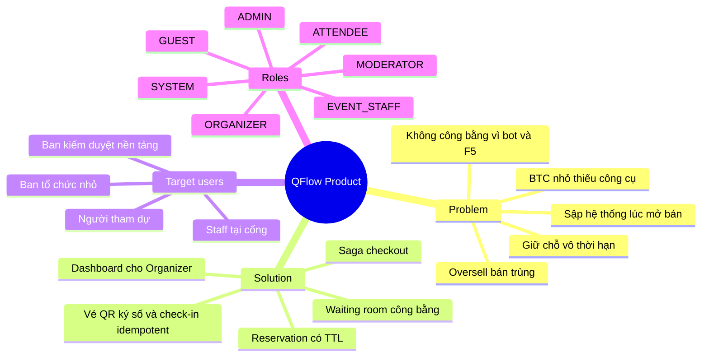
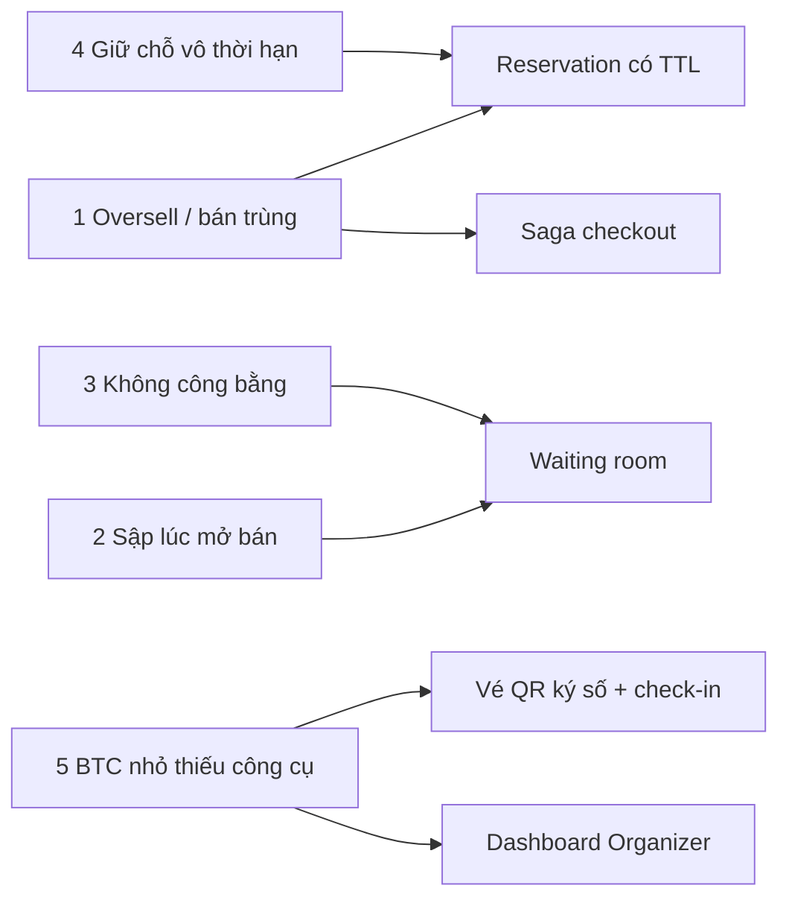
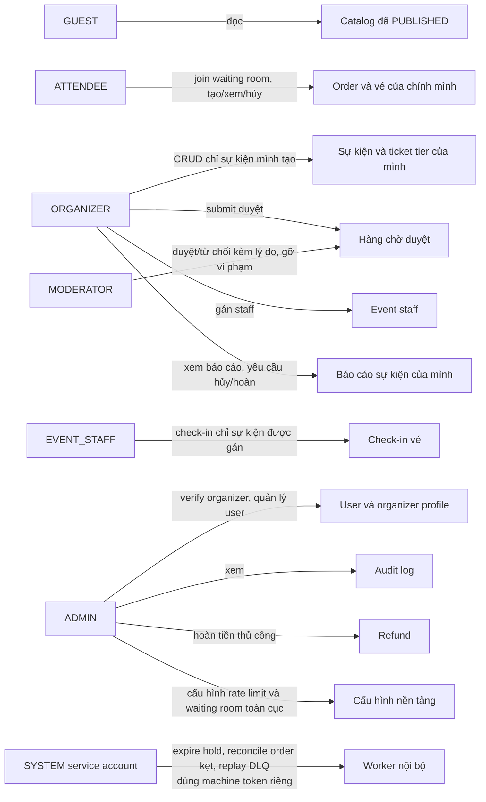
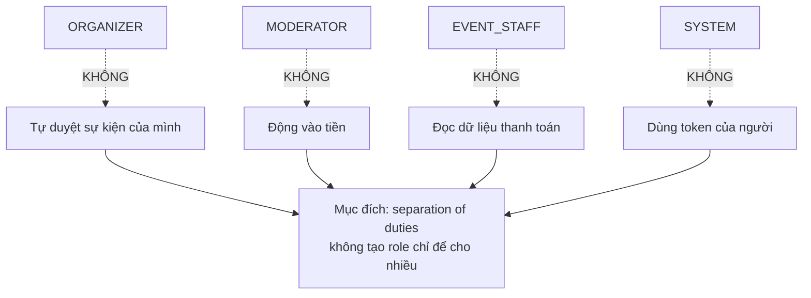

# S01 — Product (Problem, Solution, Target users, User roles)

> Nguồn: mục "1. PRODUCT" (1.1–1.4).

## A. Mục tiêu
- Chốt vấn đề, giải pháp, nhóm người dùng và **7 role** với trách nhiệm nghiệp vụ thật.
- Là nền cho phân quyền (S07), state machine (S04), frontend theo role (S08).

## B. Overview diagram

### S01-D1 — Product map

## C. Detailed diagrams

### S01-D2 — Vấn đề → giải pháp
> **ĐỀ XUẤT BỔ SUNG:** source liệt kê vấn đề và giải pháp thành hai danh sách riêng; các mũi tên ánh xạ dưới đây là suy luận từ nội dung, không phải bảng ánh xạ chính thức của source.

### S01-D3 — Role và trách nhiệm

### S01-D4 — Separation of duties (những điều bị cấm)

## D. Giải thích sơ đồ
- **D1** gom 4 khối của mục 1 và danh sách role.
- **D2** cho thấy vì sao có waiting room (sập + không công bằng) và vì sao hold phải có TTL (giữ chỗ vô thời hạn). Một giải pháp có thể phục vụ nhiều vấn đề.
- **D3** thể hiện "ai làm được gì trên tài nguyên nào". Cạnh ghi đúng ràng buộc sở hữu: ATTENDEE chỉ với dữ liệu **của mình**, ORGANIZER chỉ với sự kiện **mình tạo**, STAFF chỉ với sự kiện **được gán**.
- **D4** là 4 điều cấm source nêu: người tạo nội dung không tự duyệt, người duyệt không đụng tiền, người ở cổng không thấy dữ liệu tiền, worker nội bộ không mượn danh người dùng.

## E. Những điều phải nhớ
- Mỗi role phải có trách nhiệm nghiệp vụ thật; không thêm role cho đẹp.
- Quyền "chỉ của mình / chỉ event mình tạo / chỉ event được gán" phải kiểm ở **service** (ownership), không chỉ ở gateway (xem S07).
- **SOURCE CHƯA QUY ĐỊNH:** quy tắc kết hợp khi một user có nhiều role (bảng `user_roles` cho phép nhưng source không nêu); GUEST không phải entity trong DB.

## F. Liên kết
- Đầu vào: S00. Đầu ra: S04 (ai chuyển state), S07 (RBAC), S08 (trang theo role), Phase 1.

## G. Checklist
- [x] 5 vấn đề  - [x] 5 giải pháp  - [x] 4 nhóm user  - [x] 7 role + trách nhiệm + quyền chính  - [x] separation of duties
