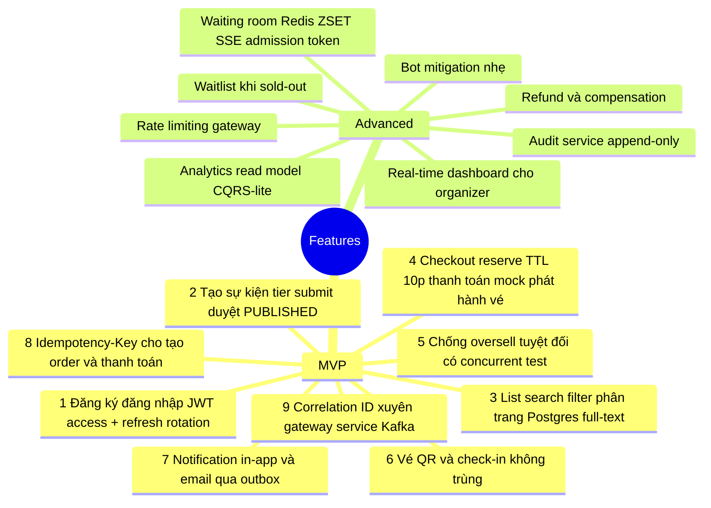
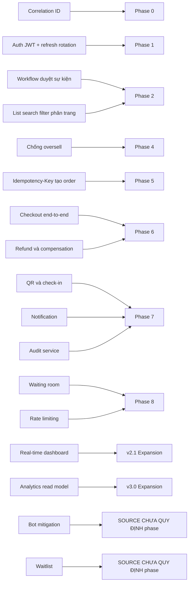

# S02 — Features (MVP và Advanced)

> Nguồn: mục "2. FEATURES" (2.1 MVP, 2.2 Advanced).

## A. Mục tiêu
- Chốt phạm vi MVP chạy end-to-end và danh sách nâng cấp.
- Liên hệ: S16 (feature nào build ở phase nào), S22 (Feature prioritization), S23 (mở rộng).

## B. Overview diagram

### S02-D1 — MVP và Advanced

## C. Detailed diagrams

### S02-D2 — Feature → phase xây dựng
> **ĐỀ XUẤT BỔ SUNG:** source không có bảng "feature → phase" trực tiếp. Ánh xạ dưới đây suy ra từ nội dung Phase 0–8 và mục Expansion; mục chưa có phase rõ ràng gắn nhãn **SOURCE CHƯA QUY ĐỊNH**.

## D. Giải thích sơ đồ
- **D1** giữ nguyên 9 mục MVP và 8 mục Advanced của source.
- **D2** cho thấy phần lớn MVP xây dần qua Phase 0–7; Advanced tập trung ở Phase 8 và các version mở rộng. `Bot mitigation` và `Waitlist` source chỉ liệt kê feature (Waitlist có độ ưu tiên P2) mà không gán phase.

## E. Những điều phải nhớ
- MVP "chạy được end-to-end": đăng ký → duyệt sự kiện → mua → vé → check-in.
- Chống oversell là tiêu chí **tuyệt đối**, không phải "cố gắng".
- Real-time dashboard và analytics không thuộc MVP.

## F. Liên kết
- Đầu vào: S01. Đầu ra: S16, S22, S23.

## G. Checklist
- [x] 9 MVP  - [x] 8 Advanced  - [x] ánh xạ phase (đánh dấu đề xuất)
