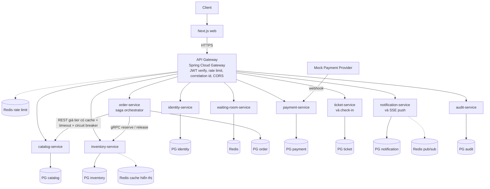
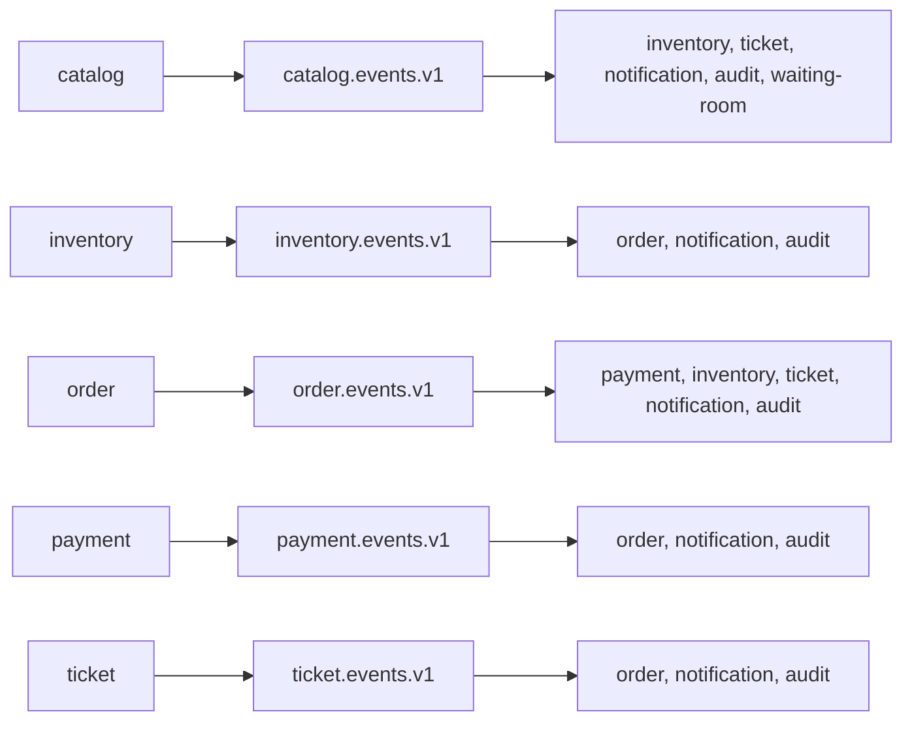
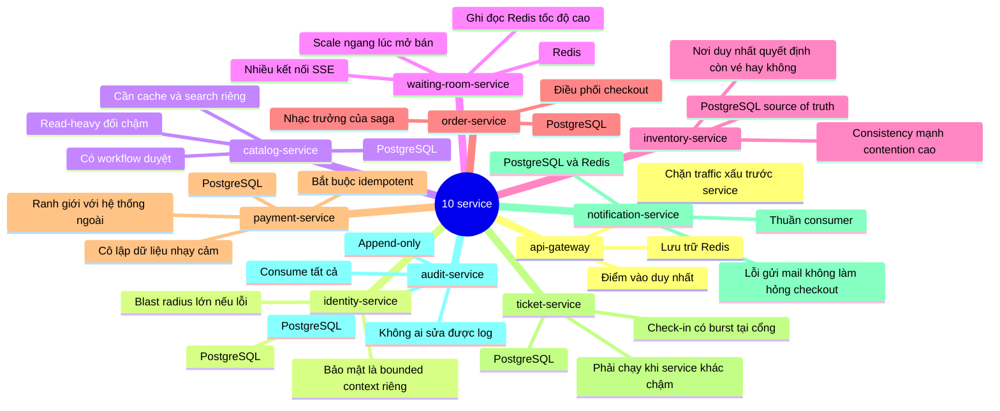
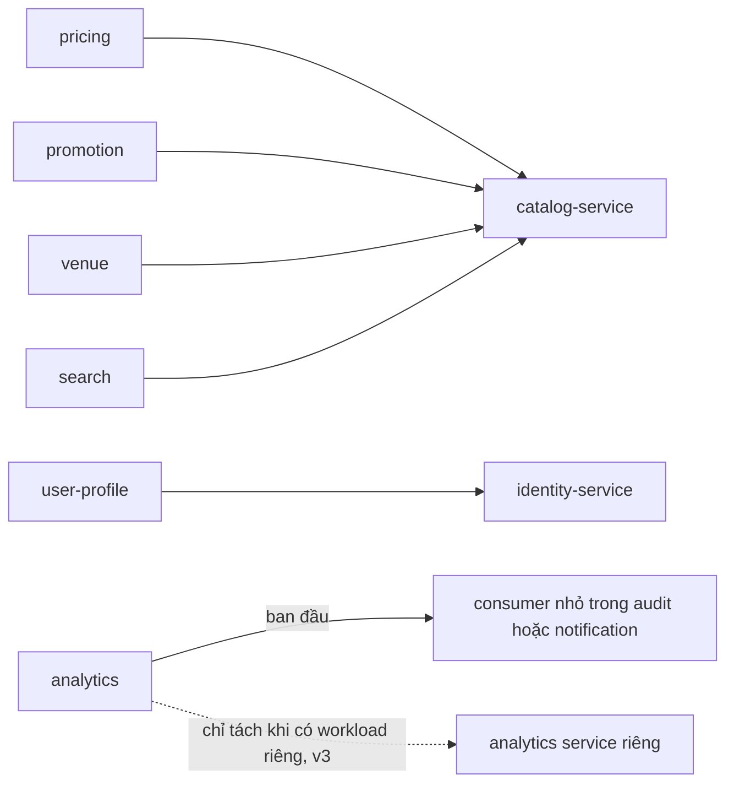
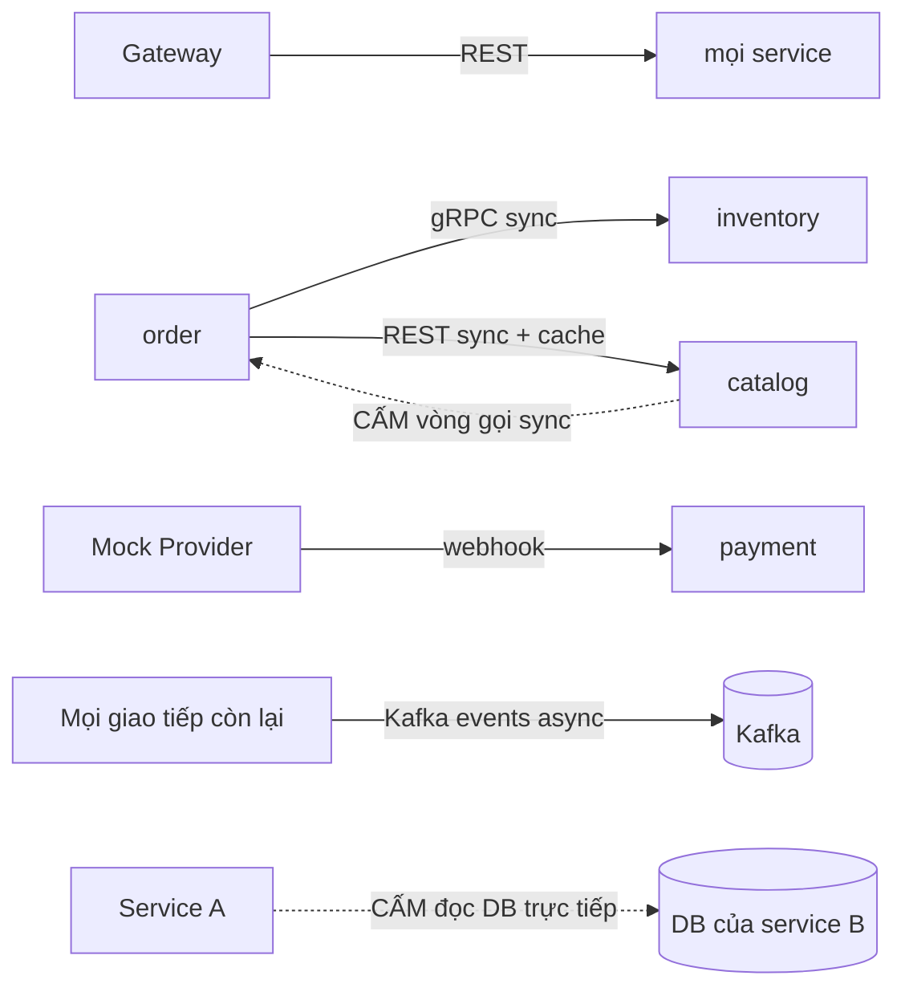
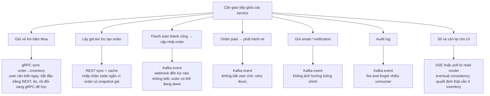
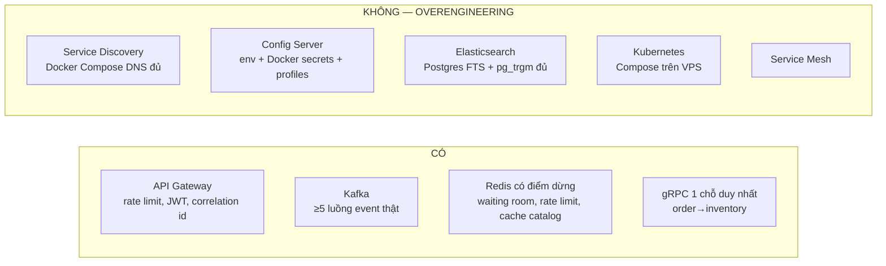
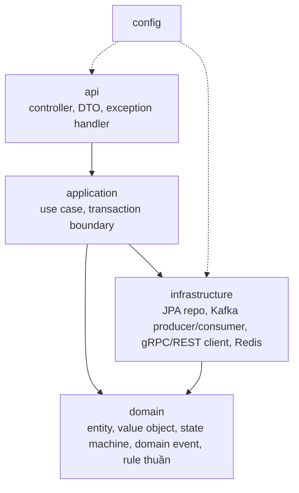
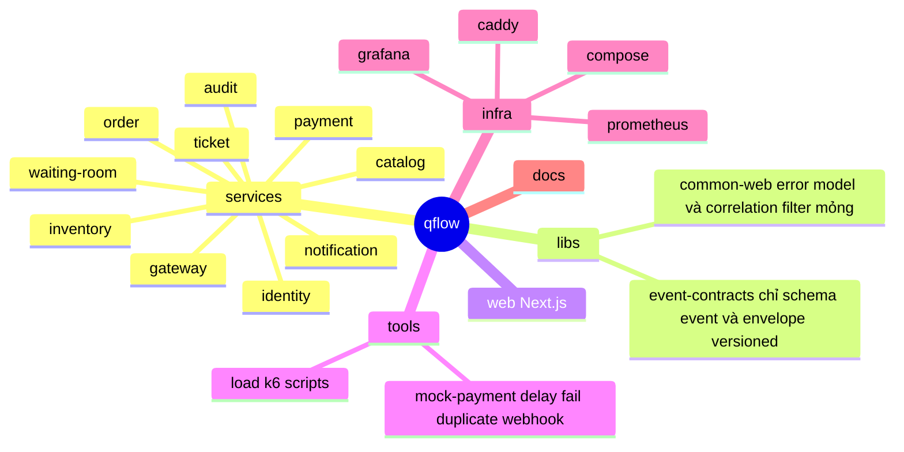

# S03 — Kiến trúc Backend (3.1–3.7)

> Nguồn: mục "3. KIẾN TRÚC BACKEND" (3.1 Tổng quan, 3.2 Ranh giới service, 3.3 Ai gọi ai, 3.4 Sync vs Async, 3.5 Có cần không, 3.6 Cấu trúc code, 3.7 Monorepo).

## A. Mục tiêu
- Xác định 10 service, ranh giới, quyền sở hữu dữ liệu, ai được gọi ai và kiểu giao tiếp.
- Giải thích vì sao tách / không tách và thành phần nào KHÔNG dùng.
- Liên hệ: S05 (database), S06 (event), S07 (bảo mật), S15 (tiến hóa), S22 (cảnh báo overengineering).

## B. Overview diagram

### S03-D1 — Đường đi request (container view)

## C. Detailed diagrams

### S03-D2 — Event backbone (Kafka)
Chi tiết topic ở S06; sơ đồ này chỉ cho thấy phụ thuộc bất đồng bộ.

### S03-D3 — Vì sao mỗi service phải tách

### S03-D4 — Cố ý KHÔNG tách

### S03-D5 — Ai được gọi ai

Bốn quy tắc cứng (source):
1. Service **không** đọc DB của service khác; cần dữ liệu thì gọi API hoặc giữ local read model cập nhật qua event.
2. Không có vòng gọi sync (ví dụ `catalog → order → catalog`).
3. Ghi vào 2 nơi (DB + Kafka) **bắt buộc** qua Outbox.
4. Consumer **bắt buộc** idempotent (bảng `processed_events`).

### S03-D6 — Chọn sync hay async

### S03-D7 — Thành phần: có cần không

Ghi chú source: Redis **không** làm source of truth tồn kho ở bản đầu.

### S03-D8 — Cấu trúc code trong mỗi service (Hexagonal-nhẹ)

### S03-D9 — Monorepo

## D. Giải thích sơ đồ
- **D1:** mọi request ngoài đi qua **một** cổng (gateway). Gateway xác thực thô và giới hạn tốc độ rồi chuyển tới service; mỗi service chỉ nói chuyện với DB của mình. Hai đường sync nội bộ duy nhất: `order → inventory` (gRPC) và `order → catalog` (REST có cache/timeout/circuit breaker). Webhook từ provider đi thẳng vào payment.
- **D2:** thay vì gọi nhau, các service công bố sự kiện lên topic của mình; consumer đăng ký theo bảng 6.1. Nhờ đó notification/audit chậm hoặc chết không ảnh hưởng checkout.
- **D3–D4:** mỗi service tách vì **workload, tính nhất quán, failure domain hoặc ranh giới ngoài** khác nhau; thứ chưa đủ lý do (pricing, search…) nằm trong service đã có để tránh quá nhiều service.
- **D5:** cạnh đứt nét là các điều **bị cấm**: vòng gọi sync và truy cập DB chéo; cả hai đều dẫn tới distributed monolith.
- **D6:** nguyên tắc: người dùng cần câu trả lời ngay → sync; việc phụ hoặc việc có thể trễ → event.
- **D7:** chỉ dùng thành phần mà bài học thực sự cần; còn lại ghi rõ là overengineering.
- **D8–D9:** cấu trúc code/monorepo giữ mỏng; `libs/` chỉ chứa schema event và tiện ích web, **không** chứa logic nghiệp vụ.

## E. Những điều phải nhớ
- Distributed monolith = `libs/` phình to hoặc service đọc DB của nhau.
- Domain không import annotation Spring/JPA nặng nề nếu tránh được, nhưng **đừng** tách "domain model ≠ JPA entity" ngay từ đầu (abstraction quá sớm).
- Dev dùng 1 instance Postgres nhiều database/schema nhưng **tách logic nghiêm ngặt**.
- **SOURCE CHƯA QUY ĐỊNH:** đường đi của webhook qua gateway hay trực tiếp (sơ đồ source vẽ trực tiếp); phạm vi API công khai của inventory/audit dù source nói "Gateway → mọi service"; cách xác thực service-to-service ngoài việc nhắc machine token cho SYSTEM.

## F. Liên kết
- Đầu vào: S01, S02. Đầu ra: S04 (luồng nghiệp vụ trên các service), S05 (ownership dữ liệu), S06 (topic), S07 (trust boundary), S15, S21.

## G. Checklist
- [x] 3.1 tổng quan  - [x] 3.2 bảng 10 service + "không tách"  - [x] 3.3 ai gọi ai + 4 quy tắc  - [x] 3.4 bảng sync/async  - [x] 3.5 bảng có cần không  - [x] 3.6 hexagonal-nhẹ  - [x] 3.7 monorepo
