# S04 — Business Logic & State Machine (4.1–4.5)

> Nguồn: mục "4. BUSINESS LOGIC & STATE MACHINE" (4.1 Event, 4.2 Order, 4.3 Hold, 4.4 Luồng checkout, 4.5 Race conditions).

## A. Mục tiêu
- Định nghĩa vòng đời Event / Order / Hold, ai được chuyển state và điều kiện.
- Mô tả luồng checkout 9 bước, 7 điểm đau (failure path) và 4 race condition chính.
- Liên hệ: S01 (role), S03 (service tham gia), S05 (bảng), S06 (outbox/inbox), S10 (failure scenarios).

## B. Overview diagram

### S04-D1 — Ba state machine và liên hệ giữa chúng
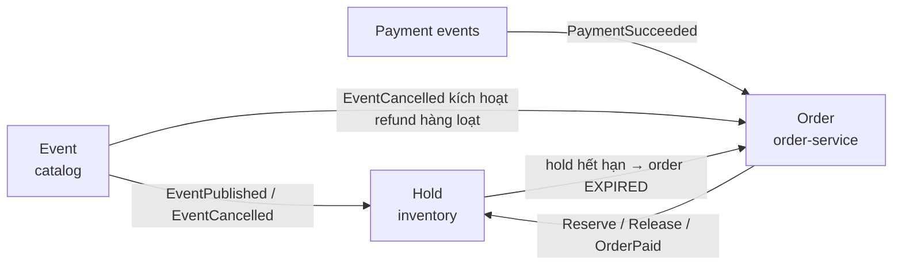

## C. Detailed diagrams

### S04-D2 — State machine: Event (catalog)
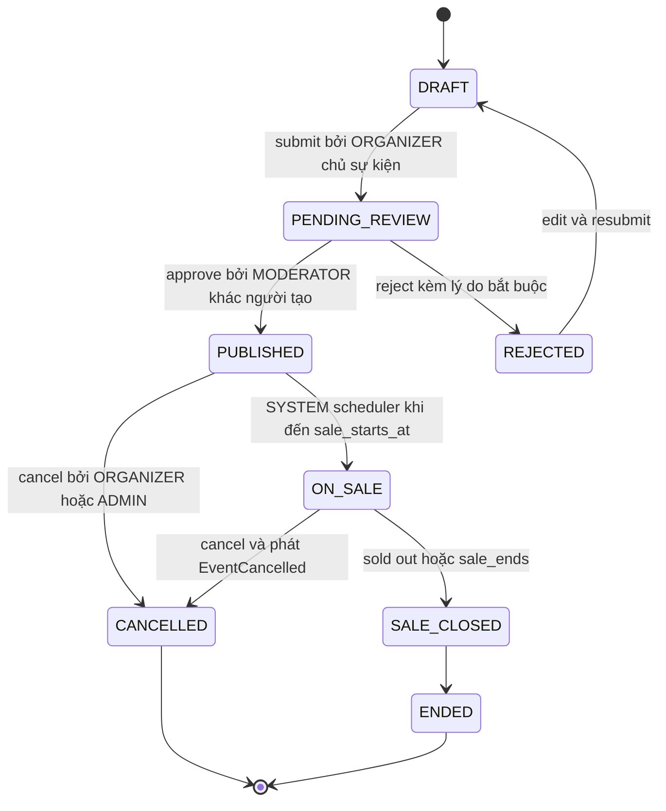
Điều kiện submit: đủ field, ≥1 tier, giờ hợp lệ, organizer đã VERIFIED.

### S04-D3 — State machine: Order (orchestrated saga)
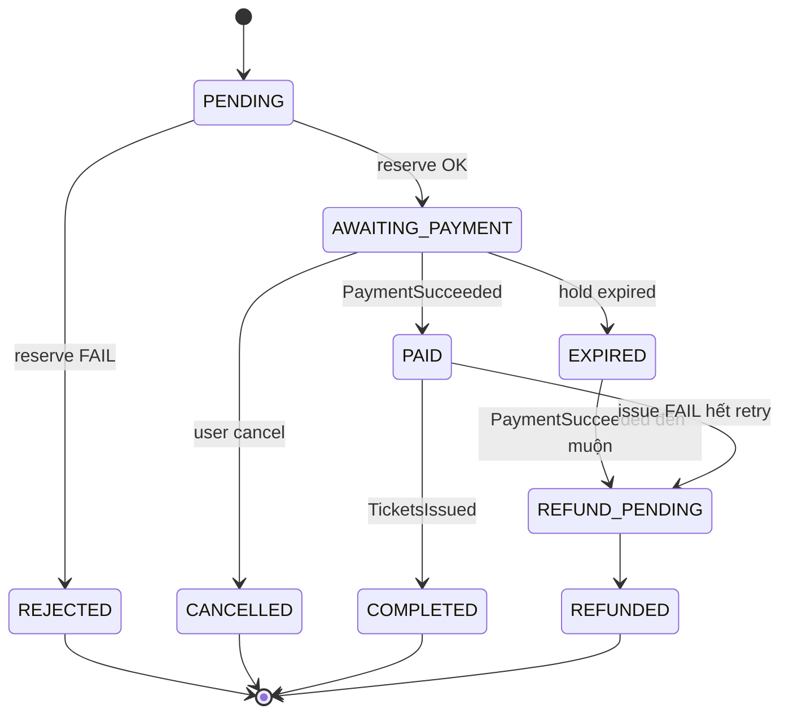

### S04-D4 — State machine: Hold (inventory)
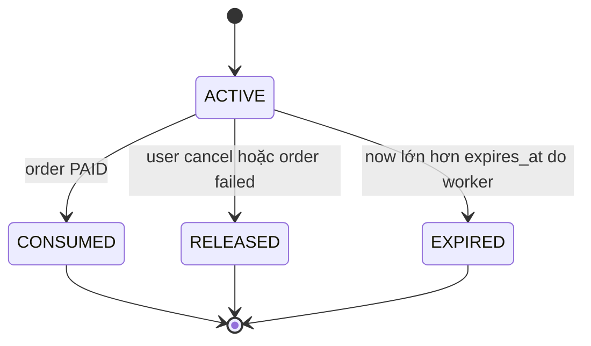
Thời gian dùng để so sánh hết hạn là **thời gian DB** (`now()`), không phải thời gian ứng dụng (xem S10 #17).

### S04-D5 — Checkout happy path (9 bước)
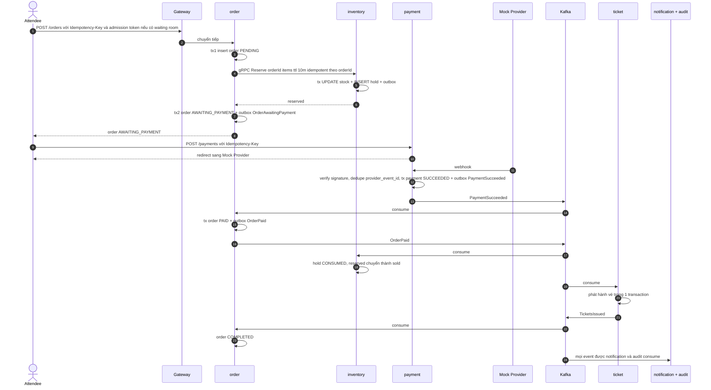

### S04-D6 — Failure #1: order crash sau reserve, trước update (điểm đau 1)
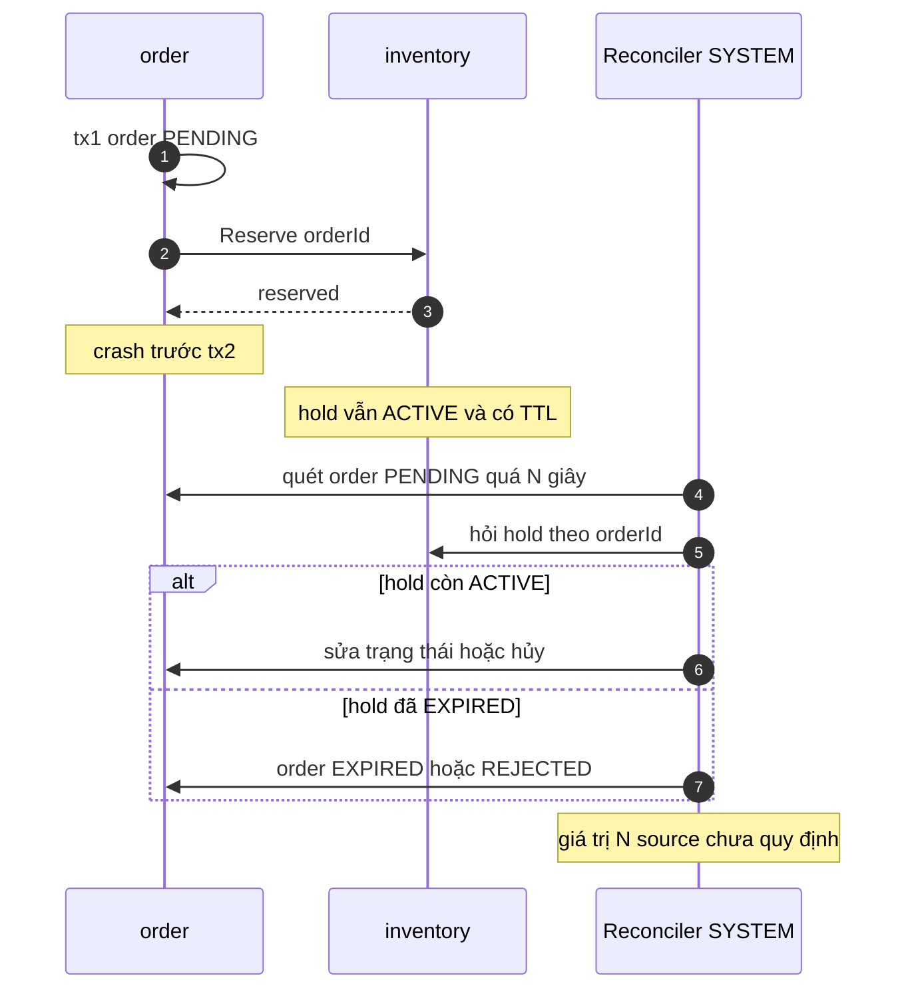

### S04-D7 — Failure #2: webhook gửi nhiều lần (điểm đau 2)
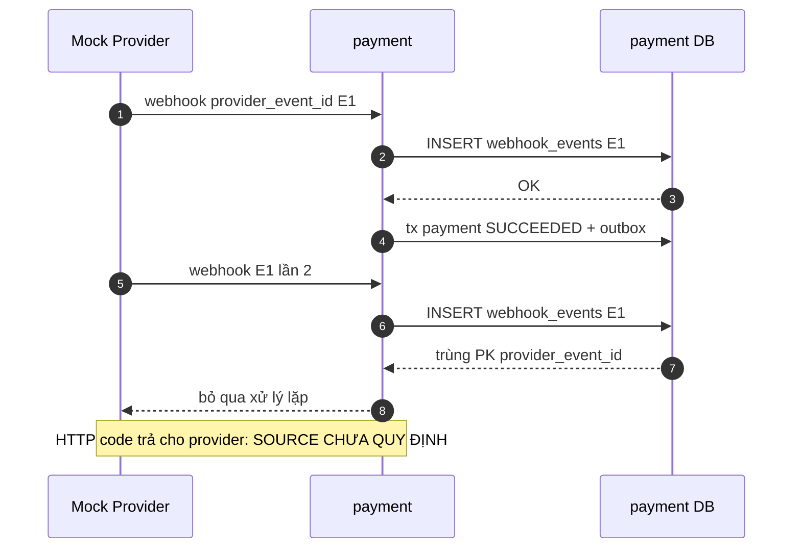

### S04-D8 — Failure #3: PaymentSucceeded đến sau khi order EXPIRED (điểm đau 3)
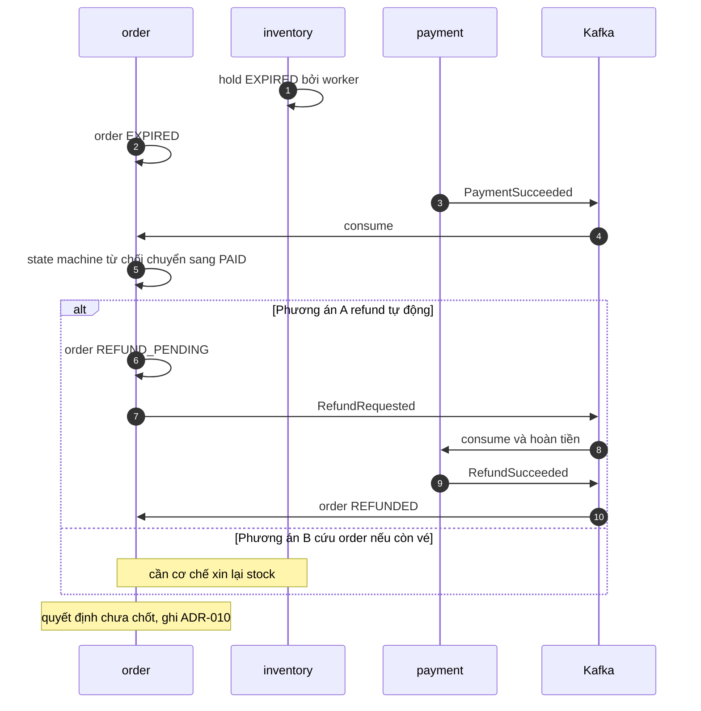

### S04-D9 — Failure #4: ticket-service down sau khi đã thu tiền (điểm đau 7)
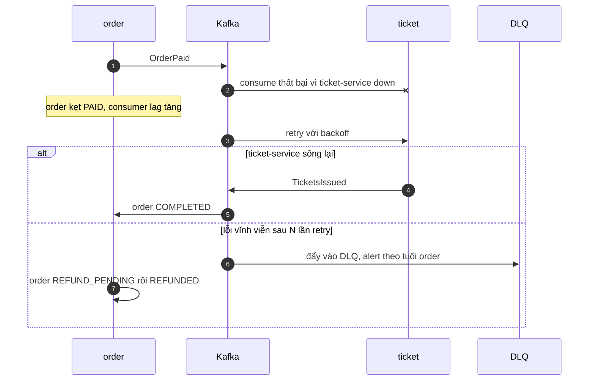

### S04-D10 — Bảy điểm đau → cơ chế phòng thủ
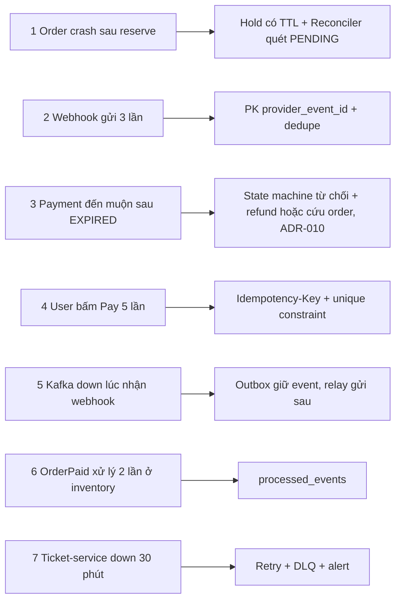

### S04-D11 — Race conditions chính
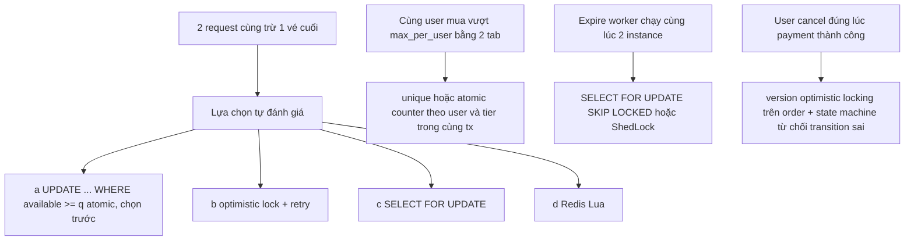

## D. Giải thích sơ đồ
- **D2 Event:** hai điều kiện quan trọng — người duyệt khác người tạo, reject bắt buộc có lý do. `PUBLISHED → ON_SALE` là việc của SYSTEM (scheduler), không phải người. Hủy sự kiện đã có vé bán phát `EventCancelled` kích hoạt refund hàng loạt.
- **D3 Order:** nhánh `EXPIRED → REFUND_PENDING` là trường hợp thanh toán đến muộn; `PAID → REFUND_PENDING` là khi phát hành vé thất bại hết retry. Cả hai kết thúc ở `REFUNDED`, đóng vòng bù trừ (compensation).
- **D4 Hold:** hold chỉ rời `ACTIVE` theo đúng 3 cách; đây là nguồn của "nhả vé tự động".
- **D5:** mỗi ghi DB đi kèm **outbox** cùng transaction; các bước 5–9 hoàn toàn bất đồng bộ qua Kafka nên không bắt user chờ. Bước reserve là sync vì user cần biết "giữ được vé hay không".
- **D6–D9:** mỗi sơ đồ là một failure path trong bảng 7 điểm đau; chúng đều quay về cùng nguyên tắc: *idempotent + TTL + outbox + state machine từ chối chuyển state sai*.
- **D11:** bốn race đều quy về "kiểm tra điều kiện và ghi phải là **một thao tác nguyên tử**" (hoặc có version) chứ không phải đọc-rồi-ghi ở tầng ứng dụng.

## E. Những điều phải nhớ
- Invariant: `reserved + sold ≤ total` (được bảo vệ bằng CHECK constraint, xem S05).
- Chỉ chuyển state theo đúng ma trận; transition sai trả `409/422` có mã lỗi (Phase 2 DoD).
- Order lưu **price snapshot**; đổi giá tier sau đó không ảnh hưởng order cũ.
- Không giữ transaction DB mở khi gọi gRPC (Phase 5).
- **Câu hỏi source để bạn tự nghĩ (chưa có đáp án):** Organizer sửa giá tier khi sự kiện ON_SALE? Đổi `total_quantity` xuống thấp hơn `sold`?
- **SOURCE CHƯA QUY ĐỊNH:** từ state nào được `CANCELLED` (bảng nói `*→CANCELLED`, sơ đồ ASCII chỉ vẽ từ PUBLISHED; D2 vẽ PUBLISHED và ON_SALE); ngưỡng N giây của reconciler; mã HTTP trả cho webhook trùng; quyết định refund vs cứu order (ADR-010).

## F. Liên kết
- Đầu vào: S01 (role), S03 (service). Đầu ra: S05 (schema hỗ trợ state/hold/outbox), S06 (event), S10 (kịch bản lỗi), Phase 4–6.

## G. Checklist
- [x] 4.1 Event  - [x] 4.2 Order  - [x] 4.3 Hold  - [x] 4.4 luồng 9 bước  - [x] 7 điểm đau (D6–D10)  - [x] 4.5 bốn race
