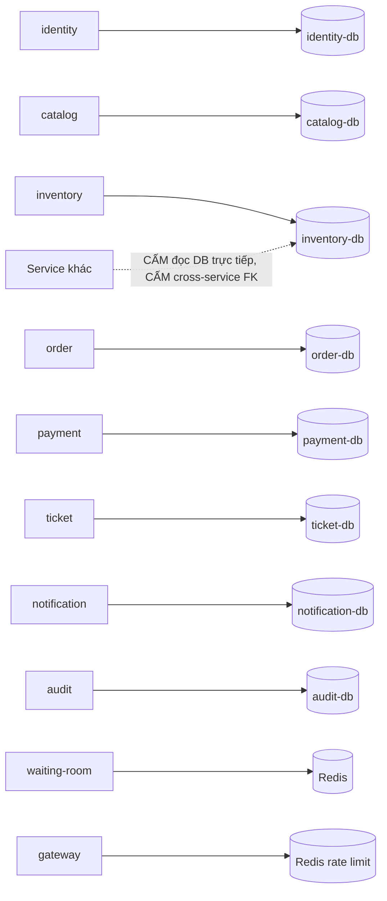
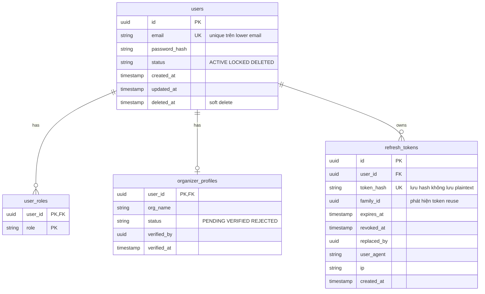
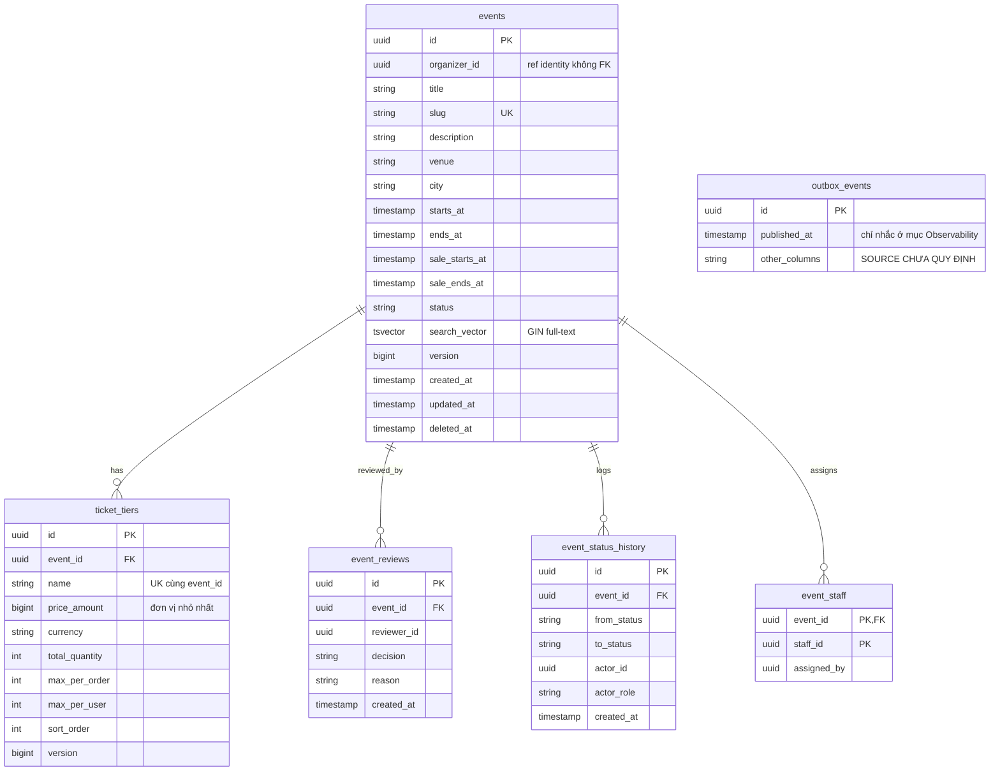
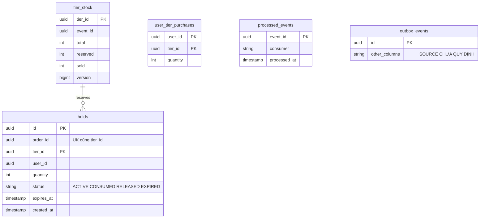
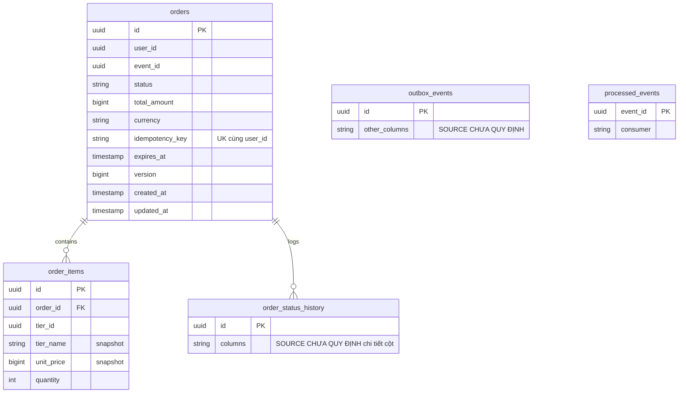
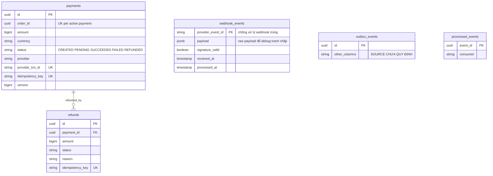
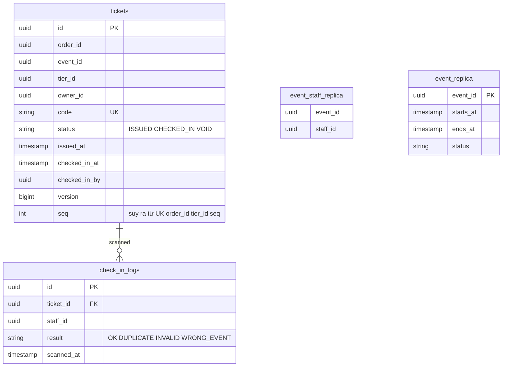
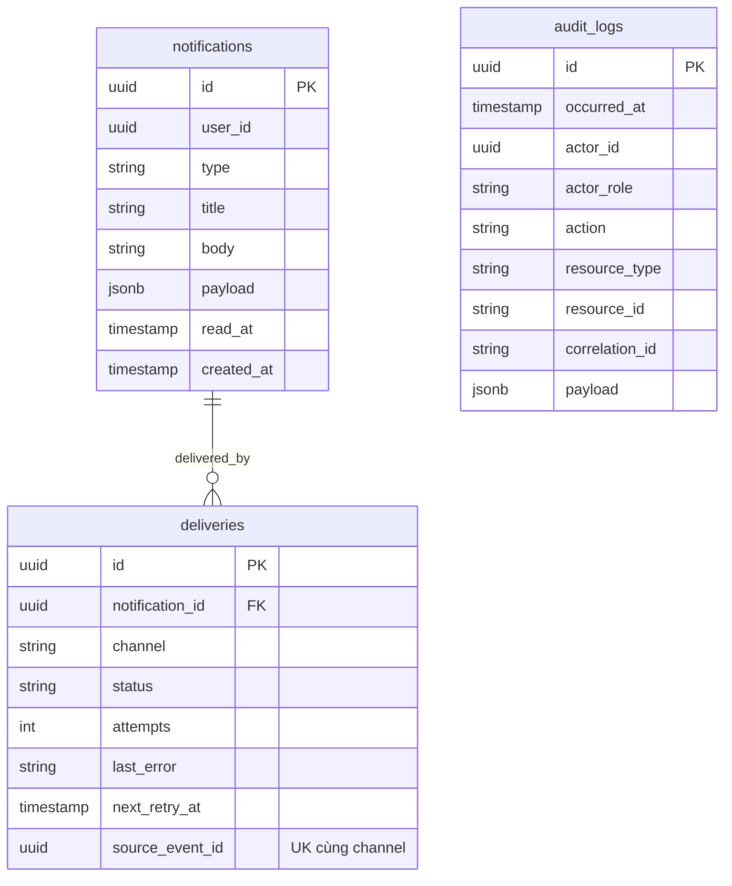
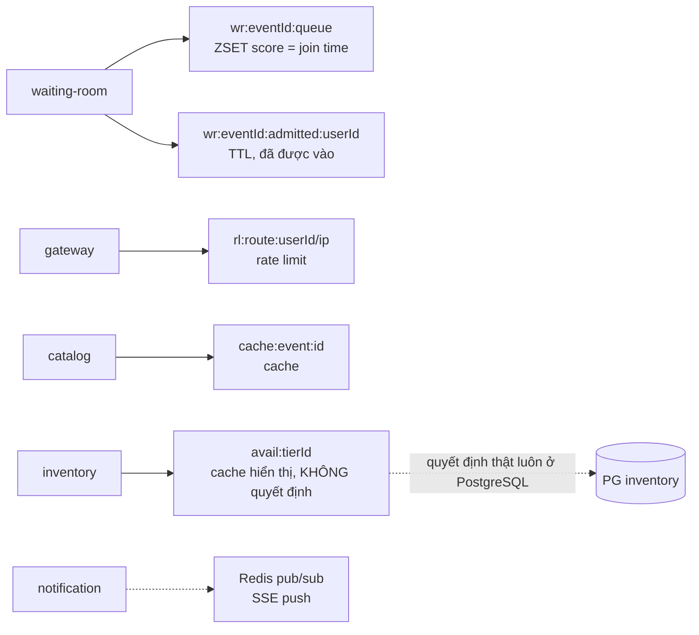

# S05 — Database Design (5.1–5.8)

> Nguồn: mục "5. DATABASE DESIGN (mỗi service 1 DB riêng)".

## A. Mục tiêu
- Mô tả schema, ràng buộc, index và **quyền sở hữu dữ liệu** của từng service, kèm lý do thiết kế.
- Giải thích vì sao không có cross-service FK và vì sao service không đọc DB của nhau.
- Liên hệ: S03 (ownership), S04 (state/hold/outbox cần cột nào), S06 (outbox/inbox), S07 (refresh token family).

## B. Overview diagram

### S05-D1 — Database ownership

Quy ước chung: `id uuid` (UUIDv7 nếu thư viện hỗ trợ), `created_at`, `updated_at`, `version bigint` ở bảng có cạnh tranh; tiền lưu `bigint` đơn vị nhỏ nhất; dùng **Flyway** cho mọi migration; dev dùng 1 Postgres nhiều database nhưng tách logic nghiêm ngặt.

## C. Detailed diagrams
> Quan hệ **giữa các service** chỉ là ID tham chiếu (không FK), nên ER dưới đây chỉ vẽ quan hệ **trong** từng service; cột tham chiếu ngoài được chú thích.

### S05-D2 — identity-db (5.1)

### S05-D3 — catalog-db (5.2)

### S05-D4 — inventory-db (5.3)

### S05-D5 — order-db (5.4)

### S05-D6 — payment-db (5.5)

### S05-D7 — ticket-db (5.6)

`event_staff_replica` và `event_replica` là **local read model** cập nhật từ event của catalog.

### S05-D8 — notification-db và audit-db (5.7)

`audit_logs` append-only: REVOKE UPDATE/DELETE; partition theo tháng là mức ADVANCED.

### S05-D9 — Redis dùng cho gì (5.8)

### Bảng ràng buộc và index được source quy định (bổ trợ cho ER)
| DB | Ràng buộc / index | Lý do |
|---|---|---|
| identity | `INDEX(user_id)`, `INDEX(family_id)` trên refresh_tokens; email unique trên `lower(email)` | tra token theo user/family; tránh trùng hoa-thường |
| catalog | `INDEX(status, starts_at)`; `INDEX(organizer_id, status)`; `GIN(search_vector)`; `UNIQUE(event_id, name)` trên tier | list công khai; dashboard organizer; full-text |
| inventory | `CHECK(reserved >= 0 AND sold >= 0 AND reserved + sold <= total)`; `UNIQUE(order_id, tier_id)`; partial `INDEX(expires_at) WHERE status='ACTIVE'` | lớp phòng thủ cuối chống oversell; reserve idempotent; index nhỏ cho expiry worker |
| order | `UNIQUE(user_id, idempotency_key)`; `INDEX(user_id, created_at DESC)`; `INDEX(status, expires_at)` | idempotency; list order; reconciler tìm order kẹt |
| payment | `provider_event_id` PK; `provider_txn_id` UNIQUE; `idempotency_key` UNIQUE | chống webhook trùng ở tầng DB |
| ticket | `UNIQUE(order_id, tier_id, seq)`; `INDEX(event_id, status)` | phát hành idempotent |
| notification | `UNIQUE(source_event_id, channel)`; `INDEX(user_id, created_at DESC)` | không gửi trùng |
| audit | append-only, partition theo tháng (ADVANCED) | không ai sửa được log |

## D. Giải thích sơ đồ
- **D1:** mỗi service có DB riêng; nếu service A đọc bảng của B thì schema của B bị đóng băng, mất deploy độc lập và thành distributed monolith.
- **D2:** lưu **hash** refresh token (lộ DB không lộ token); `family_id` + `replaced_by` phục vụ phát hiện token reuse (S07). Soft delete cho user vì audit/order cần tham chiếu.
- **D3:** `price_amount` chỉ là giá hiện tại; order lưu snapshot riêng. `event_status_history` phục vụ audit/tranh chấp.
- **D4:** `CHECK` là lớp cuối chống oversell kể cả khi code sai; `UNIQUE(order_id, tier_id)` làm reserve idempotent; partial index chỉ index hold `ACTIVE`.
- **D5–D6:** `idempotency_key` + unique chặn tạo trùng; snapshot tên/giá trong `order_items`; `webhook_events` PK chặn xử lý trùng và giữ raw payload để debug.
- **D7:** replica cho phép check-in tại cổng mà **không gọi catalog**, đánh đổi bằng eventual consistency.
- **D9:** Redis chỉ để tăng tốc/điều tiết; **không** là source of truth tồn kho ở v1.

## E. Những điều phải nhớ
- Không cross-service FK; chỉ lưu ID.
- Mọi migration qua Flyway và phải backward compatible (S21: expand → migrate → contract).
- Tiền không dùng float.
- **SOURCE CHƯA QUY ĐỊNH:** cột chi tiết của `outbox_events` ở mọi service; cột của `order_status_history`; `processed_events` ở ticket/notification/audit (source chỉ nêu rõ ở inventory, order, payment dù các consumer khác cũng bắt buộc idempotent); `outbox_events` ở ticket (ticket phát `TicketsIssued` nhưng 5.6 không liệt kê bảng outbox); cột `seq` của tickets chỉ xuất hiện trong UNIQUE; schema chi tiết cho waiting-room Postgres (source nói "Redis, + Postgres nhỏ nếu cần").

## F. Liên kết
- Đầu vào: S03 (ownership), S04 (state, hold). Đầu ra: S06 (outbox/inbox), S07 (refresh_tokens), Phase 1–6 (migration đầu tiên mỗi service).

## G. Checklist
- [x] 5.1 identity  - [x] 5.2 catalog  - [x] 5.3 inventory  - [x] 5.4 order  - [x] 5.5 payment  - [x] 5.6 ticket  - [x] 5.7 notification + audit  - [x] 5.8 Redis  - [x] ownership + lý do thiết kế
