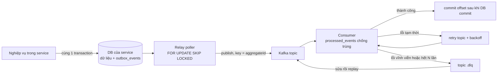
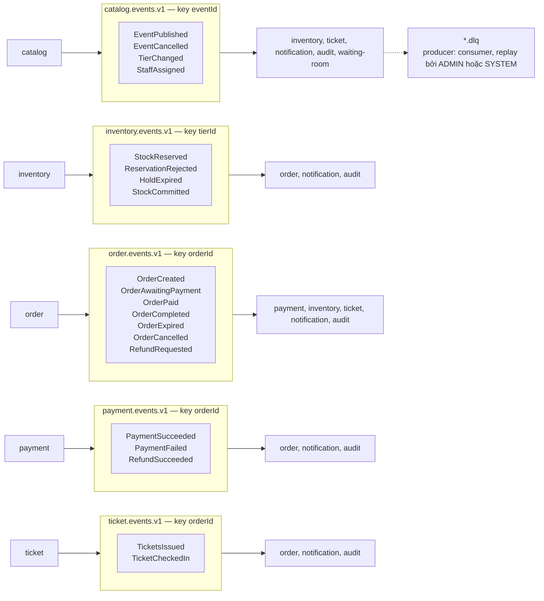
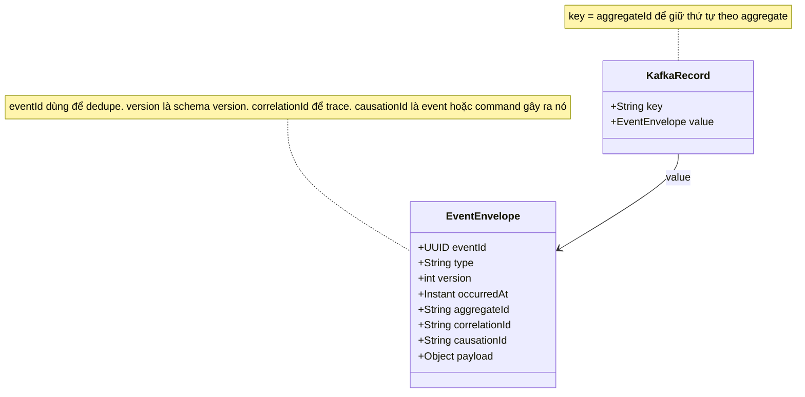
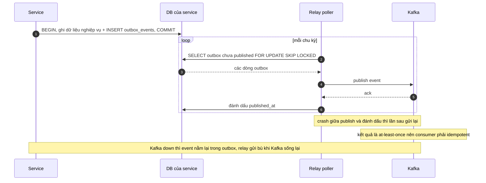
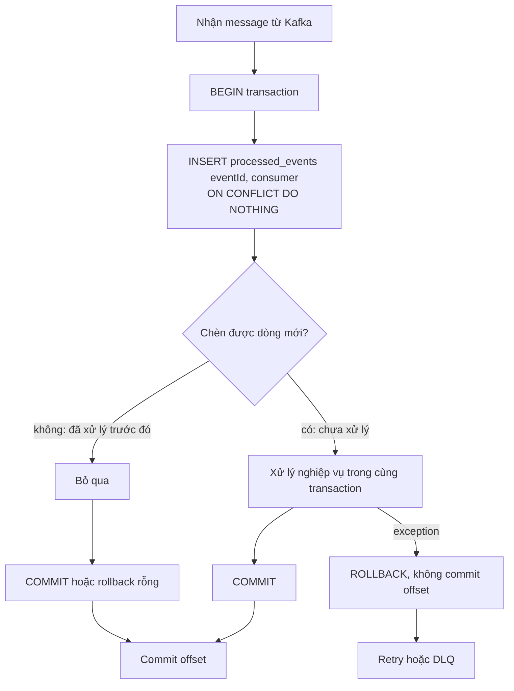
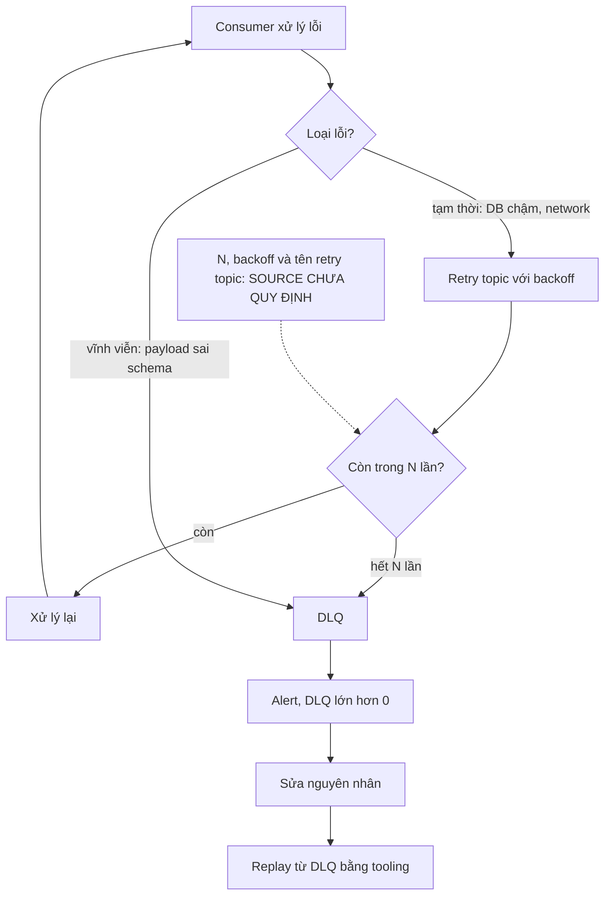
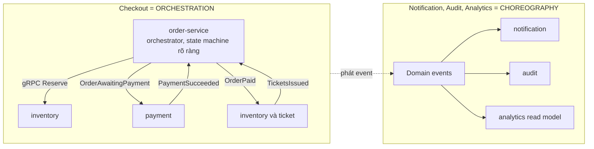
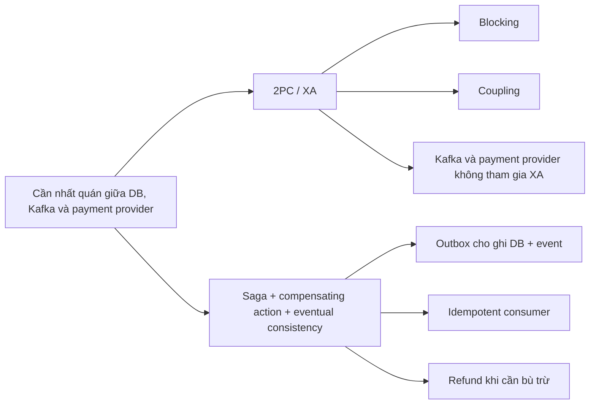

# S06 — Message / Event Architecture (6.1–6.4)

> Nguồn: mục "6. MESSAGE / EVENT ARCHITECTURE" (6.1 Topics, 6.2 Envelope, 6.3 Bắt buộc, 6.4 Saga: orchestration hay choreography).

## A. Mục tiêu
- Xác định topic, key, event, producer/consumer và quy tắc bắt buộc (Outbox, Inbox, retry, DLQ, at-least-once).
- Giải thích vì sao checkout dùng orchestration, side-effect dùng choreography, và vì sao không dùng 2PC/XA.
- Liên hệ: S03 (D2 event backbone), S04 (saga), S05 (bảng outbox/processed_events), S10 (duplicate, poison, lag).

## B. Overview diagram

### S06-D1 — Đường đi của một event (từ ghi DB đến DLQ)

## C. Detailed diagrams

### S06-D2 — Danh mục topic, key và event (6.1)

### S06-D3 — Envelope của mọi event (6.2)

### S06-D4 — Transactional Outbox (6.3)

### S06-D5 — Consumer idempotent bằng processed_events (Inbox)

### S06-D6 — Retry và DLQ

### S06-D7 — Orchestration cho checkout, choreography cho side-effect (6.4)

### S06-D8 — Vì sao không dùng 2PC/XA

## D. Giải thích sơ đồ
- **D1** tóm tắt toàn bộ cơ chế: event luôn đi qua DB (outbox) trước khi lên Kafka; mất Kafka không làm mất event.
- **D2** key = aggregate id giữ thứ tự **theo aggregate** (cùng orderId vào cùng partition); không đảm bảo thứ tự giữa các aggregate hay giữa các topic.
- **D3** `eventId` phục vụ dedupe, `version` phục vụ tiến hóa schema (chỉ thêm field optional), `correlationId`/`causationId` phục vụ truy vết.
- **D4** vì relay có thể crash sau khi publish, event có thể đi 2 lần → at-least-once; đó là lý do D5 bắt buộc.
- **D5** ghi dấu "đã xử lý" và xử lý nghiệp vụ trong **cùng transaction**, nên service chết giữa chừng thì cả hai cùng rollback; offset chỉ commit sau khi DB commit.
- **D6** phân biệt lỗi tạm thời (retry) và vĩnh viễn (DLQ ngay).
- **D7** orchestration cho thấy checkout đang kẹt ở bước nào; choreography cho các consumer chỉ nghe, không điều khiển ai.
- **D8** 2PC không khả thi vì thành phần tham gia không hỗ trợ XA và blocking; thay bằng saga.

## E. Những điều phải nhớ
- Delivery = **at-least-once**; đừng tin "exactly-once". Idempotent consumer mới là đáp án.
- Outbox bắt buộc ở **mọi** producer; Inbox bắt buộc ở **mọi** consumer.
- Schema event phải backward compatible; không đổi nghĩa field cũ.
- Dùng 1 partition rồi nói "có thứ tự" là lỗi phổ biến (Phase 6).
- Gửi Kafka trong `@Transactional` không làm nó atomic với DB.
- **SOURCE CHƯA QUY ĐỊNH:** số lần retry N, backoff, đặt tên retry topic/DLQ chi tiết, số partition, chính sách dọn `outbox_events`/`processed_events`, schema registry (chỉ nhắc ở v4.1), giữ thứ tự giữa các topic khác nhau.

## F. Liên kết
- Đầu vào: S03 (D2), S04 (saga), S05 (bảng). Đầu ra: S10 (#3, #7, #13, #14, #15), S11 (test duplicate/kill consumer), Phase 6.

## G. Checklist
- [x] 6.1 bảng topic  - [x] 6.2 envelope  - [x] 6.3 Outbox, Inbox, retry, DLQ, at-least-once, schema compat  - [x] 6.4 orchestration vs choreography, vì sao không 2PC
