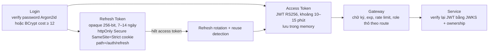
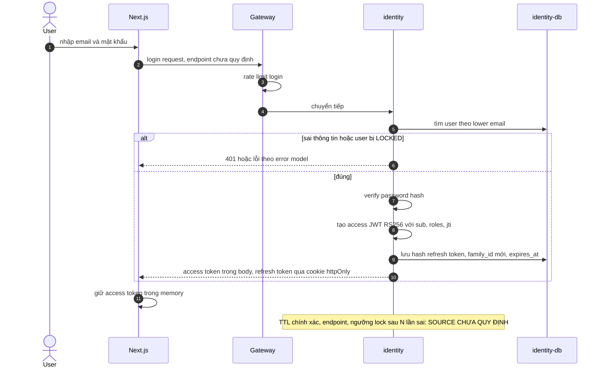
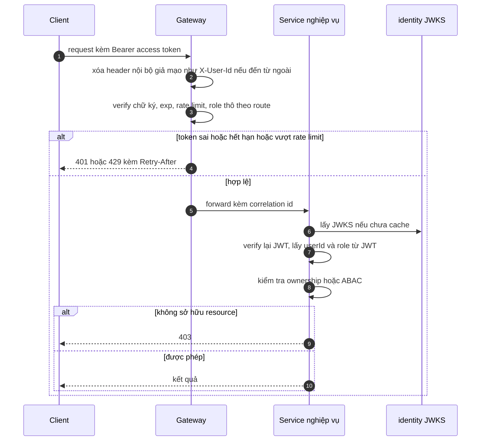
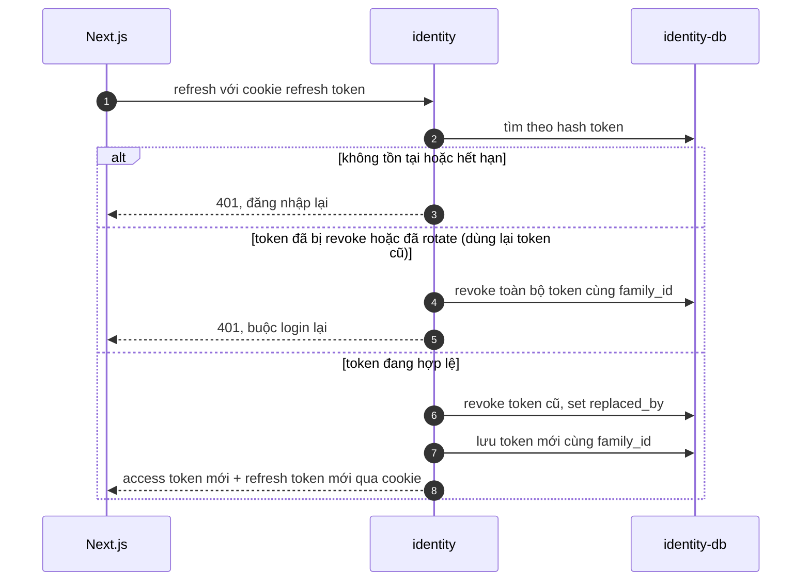
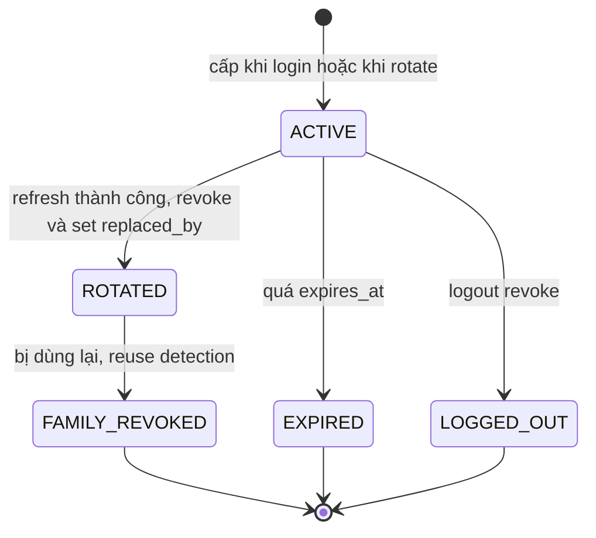
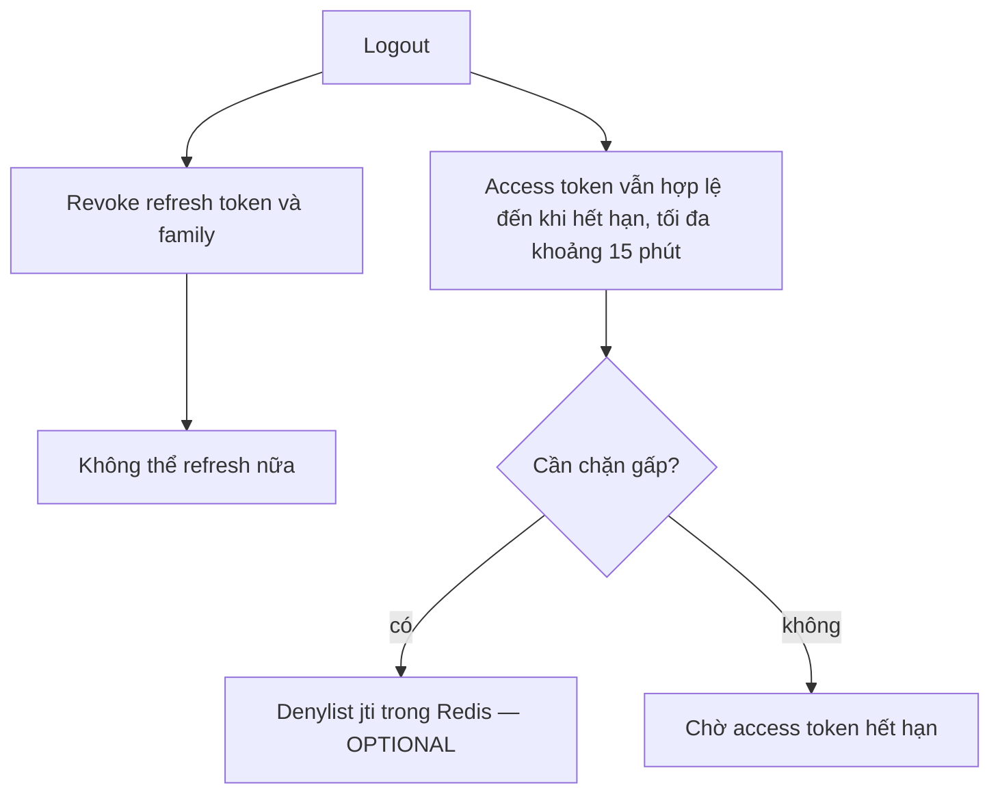
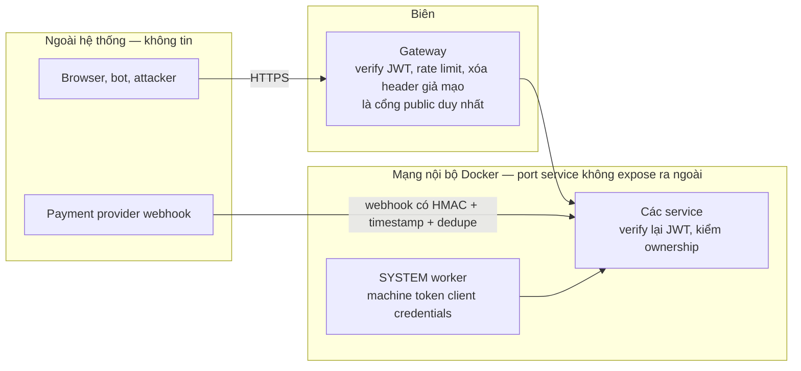
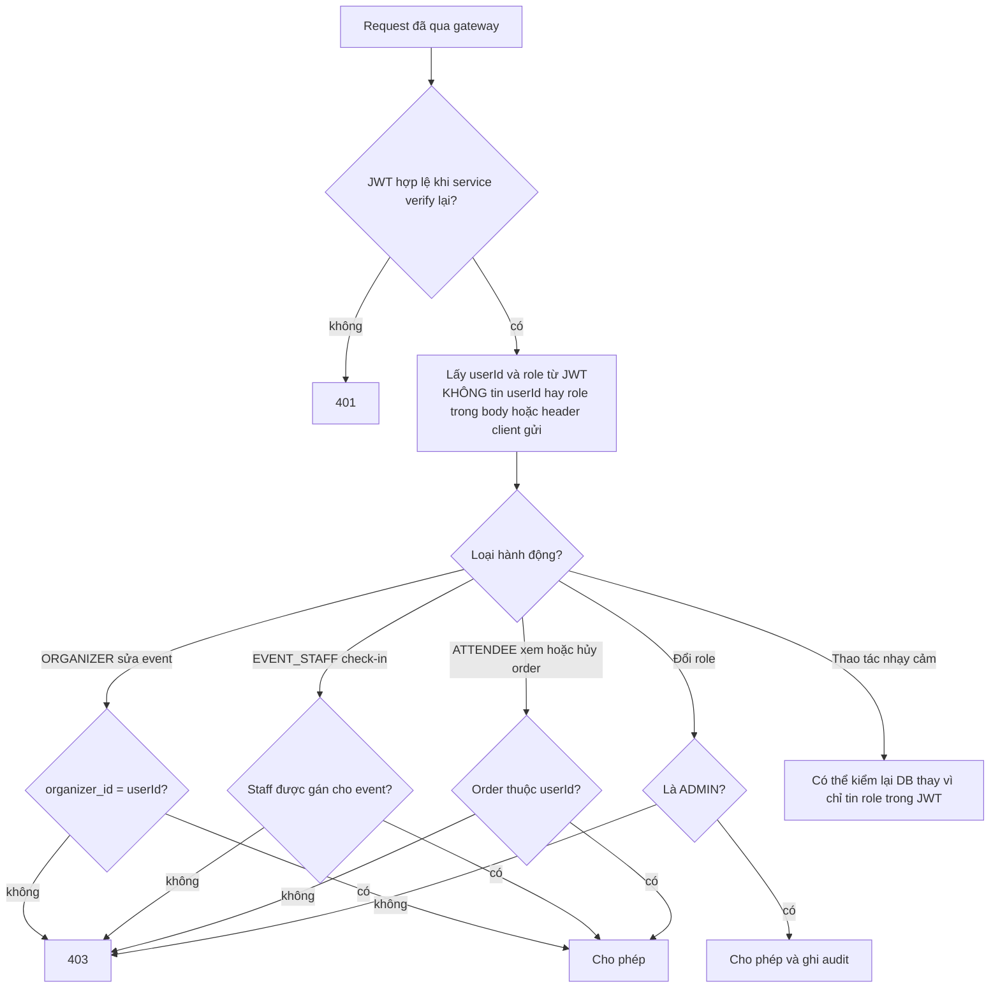
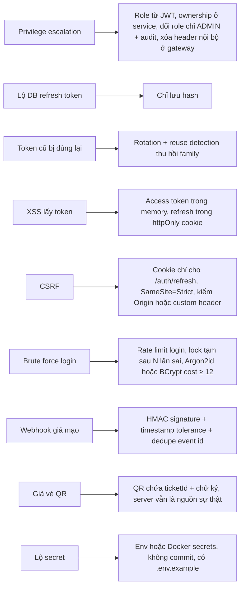

# S07 — Security Architecture

> Nguồn: mục "7. SECURITY ARCHITECTURE" (luồng Login → Access → Refresh → Authz và bảng 10 câu hỏi quyết định).

## A. Mục tiêu
- Mô tả token lifecycle, nơi lưu token, refresh rotation + reuse detection, logout, phân quyền hai lớp (gateway/service) và chống leo thang quyền.
- Là nền cho **Phase 1 — Identity + Gateway** và mọi kiểm tra ownership ở các phase sau.
- Liên hệ: S01 (role), S05 (refresh_tokens), S08 (frontend lưu token), S10 (#10 webhook giả mạo, #19 bot).

## B. Overview diagram

### S07-D1 — Chuỗi bảo mật tổng quát

## C. Detailed diagrams

### S07-D2 — Login

### S07-D3 — Request có xác thực đi qua hai lớp kiểm tra

### S07-D4 — Refresh rotation và reuse detection

### S07-D5 — Vòng đời một refresh token
> **ĐỀ XUẤT BỔ SUNG:** tên state là cách mô hình hóa từ các cột `revoked_at`, `replaced_by`, `expires_at` và `family_id` của source; source không định nghĩa state machine này.

### S07-D6 — Logout và hiệu lực thu hồi

### S07-D7 — Trust boundary

### S07-D8 — Quyết định phân quyền

### S07-D9 — Mối đe dọa → biện pháp

## D. Giải thích sơ đồ
- **D1:** access token ngắn hạn giữ trong memory để giảm hậu quả XSS; refresh token dài hạn nằm trong cookie httpOnly nên JavaScript không đọc được.
- **D2:** server chỉ phát refresh token dạng opaque ngẫu nhiên và chỉ lưu **hash** của nó cùng `family_id`.
- **D3:** hai lớp: gateway làm kiểm tra **thô** (có token hợp lệ không, route cần role gì, rate limit); service luôn kiểm **tinh** (có sở hữu resource không). Gateway bị bypass thì service vẫn tự bảo vệ.
- **D4–D5:** mỗi lần refresh sinh token mới, token cũ bị revoke; nếu token cũ xuất hiện lại thì coi là bị đánh cắp và thu hồi cả family.
- **D6:** logout bằng JWT stateless chỉ thật sự chặn được **refresh**; access token sống đến hết hạn trừ khi dùng denylist (OPTIONAL).
- **D7–D9:** header như `X-User-Id` chỉ đáng tin khi do gateway tự gắn sau khi xóa bản từ bên ngoài.

## E. Những điều phải nhớ
- Không lưu JWT trong localStorage; không lưu refresh token plaintext; không tin role trong body; không để JWT sống lâu.
- Phân quyền chỉ ở UI là **không** phải bảo mật (S08).
- IDOR là lỗi điển hình: staff check-in sự kiện không được gán, user xem order người khác (bug #10, S18).
- **SOURCE CHƯA QUY ĐỊNH:** endpoint login/register/logout/refresh chi tiết (chỉ có path cookie `/auth/refresh`), TTL chính xác, ngưỡng rate limit và lock tài khoản, đường dẫn JWKS, cách xoay khóa RS256, danh sách header nội bộ đầy đủ, cách service lấy và cache JWKS, claim ngoài `sub`/`roles`/`jti`.
- Mâu thuẫn nhỏ cần để ý: bảng nói "Argon2id (hoặc BCrypt cost ≥ 12)" nên thuật toán chưa chốt.

## F. Liên kết
- Đầu vào: S01 (role), S05 (refresh_tokens). Đầu ra: **Phase 1**, S08 (token phía client), S10, S18 (bug auth).

## G. Checklist
- [x] token lưu đâu  - [x] refresh xử lý  - [x] logout  - [x] expiration  - [x] password hashing  - [x] gateway check gì  - [x] service check gì  - [x] chống privilege escalation  - [x] service-to-service, secret, webhook, QR
