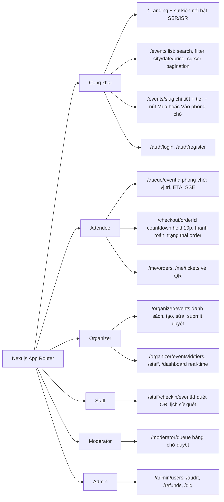
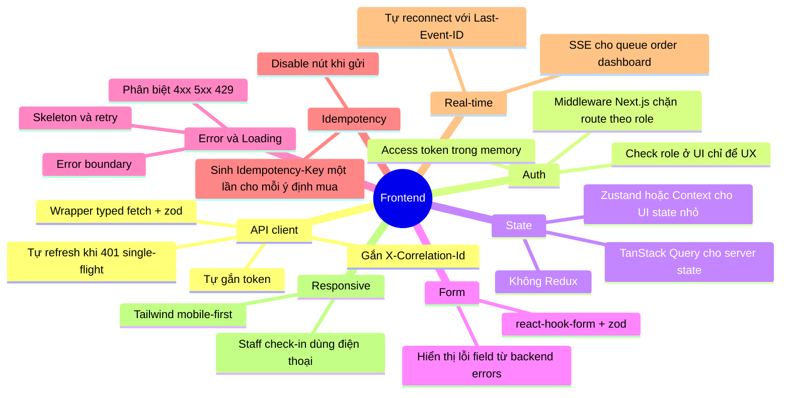
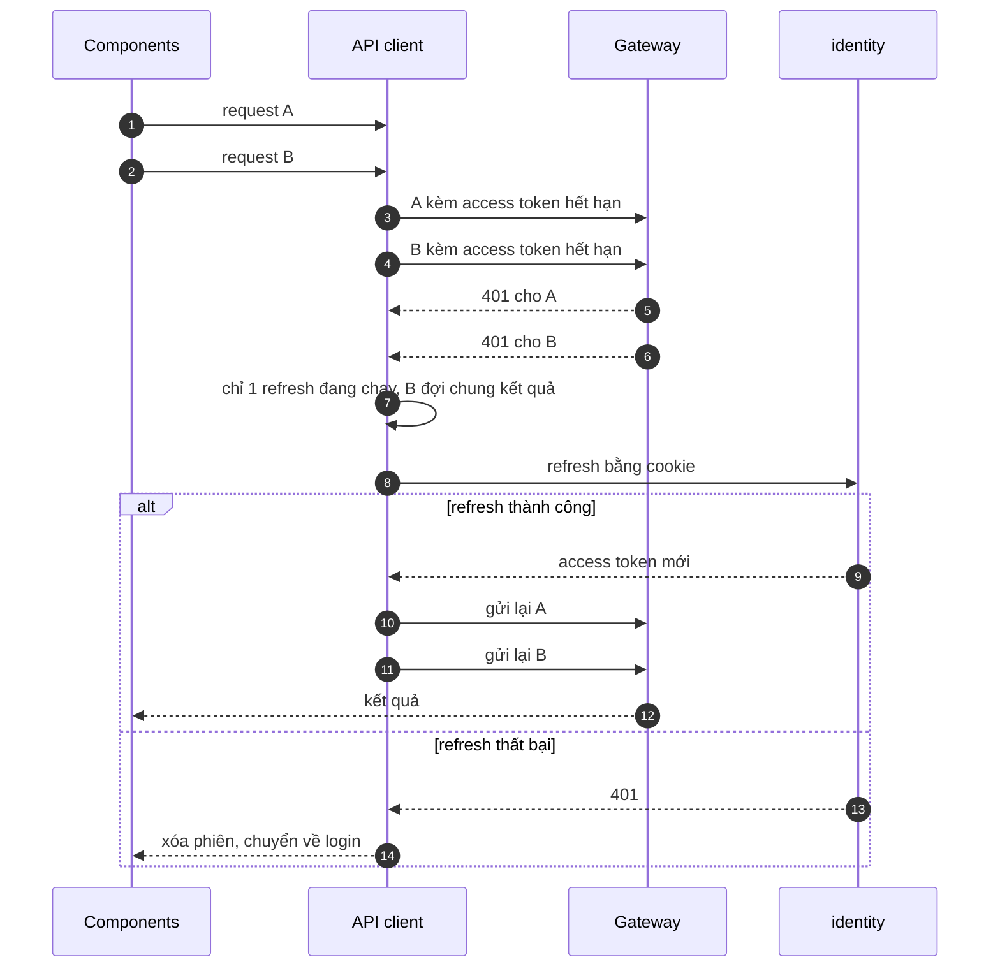
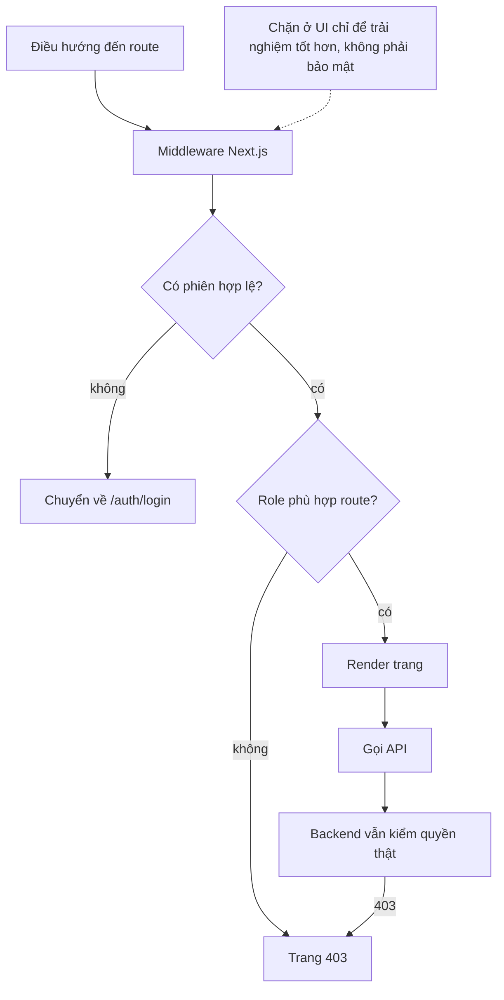
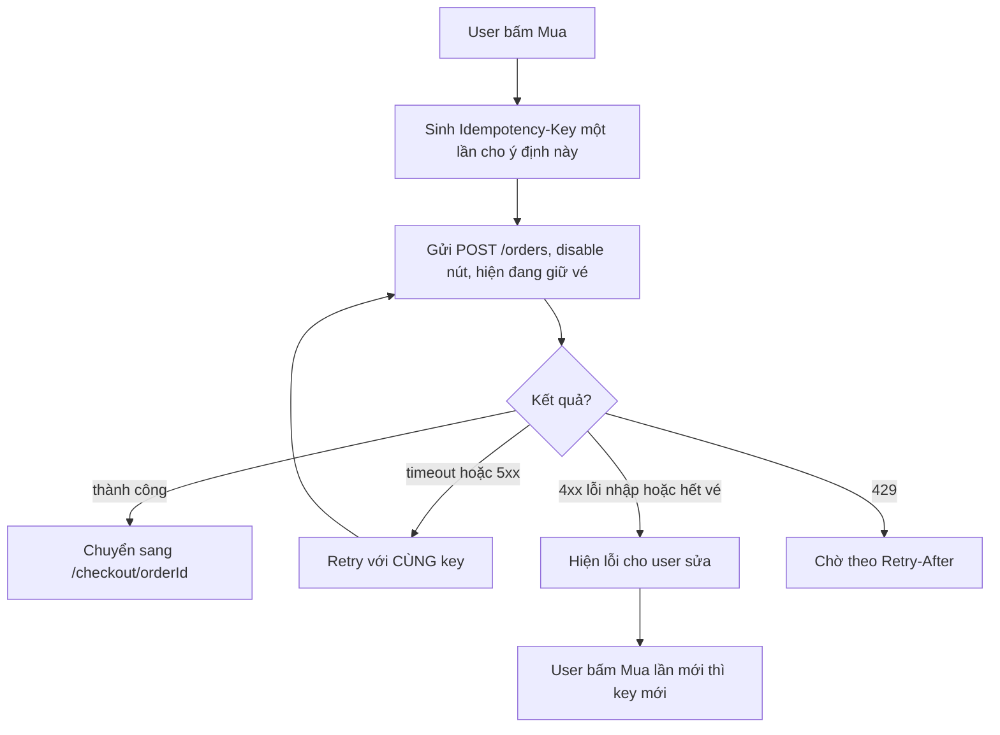
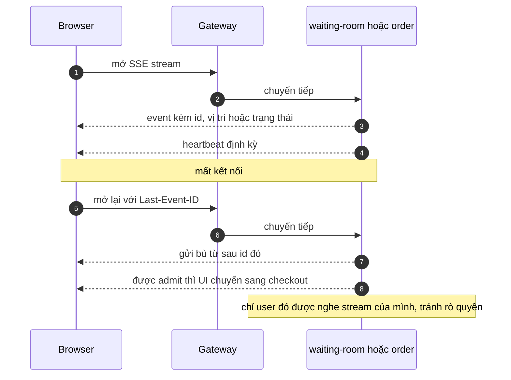
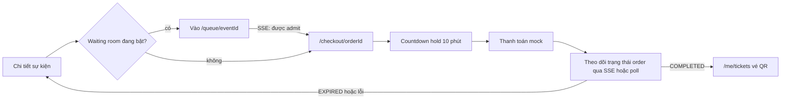
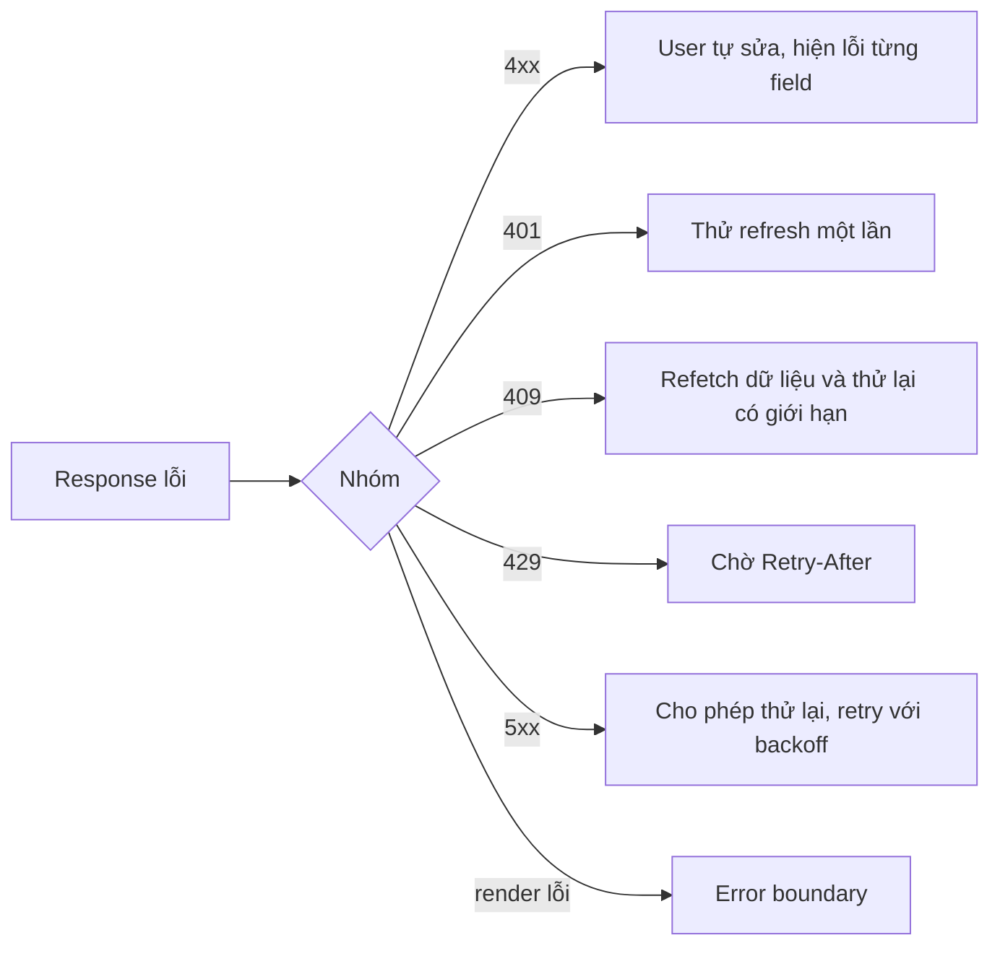

# S08 — Frontend (Next.js + React + TypeScript)

> Nguồn: mục "8. FRONTEND" (8.1 Page structure, 8.2 Kỹ thuật cần thể hiện).

## A. Mục tiêu
- Thiết kế UI vừa đủ nhưng giao tiếp với backend như hệ thống thật: auth, refresh, idempotency, SSE, xử lý lỗi.
- Liên hệ: S01 (role/trang), S07 (token), S04 (checkout), Phase 3 (frontend nền), Phase 7–8 (SSE).

## B. Overview diagram

### S08-D1 — Sitemap theo role

## C. Detailed diagrams

### S08-D2 — Kỹ thuật cần thể hiện

### S08-D3 — Silent refresh single-flight

### S08-D4 — Bảo vệ route

### S08-D5 — Idempotency-Key trong ý định mua

### S08-D6 — SSE: vị trí hàng đợi và trạng thái order

### S08-D7 — Hành trình người mua trên UI

### S08-D8 — Xử lý lỗi theo nhóm mã

## D. Giải thích sơ đồ
- **D1** chia trang theo role; mỗi trang tương ứng một nhóm API ở backend.
- **D3** "single-flight" tránh việc nhiều request cùng 401 rồi cùng gọi refresh (với rotation + reuse detection, refresh song song có thể bị coi là reuse và làm mất phiên).
- **D5** Idempotency-Key gắn với **ý định mua**, không phải mỗi lần gửi request: retry dùng lại key, ý định mới dùng key mới.
- **D6** SSE một chiều server→client là đủ (ADR-007); reconnect bằng `Last-Event-ID`.
- Không optimistic UI cho inventory: UI chỉ hiển thị "đang giữ vé…"; quyết định thật ở inventory.

## E. Những điều phải nhớ
- Mục tiêu là giao tiếp backend thật, không phải animation; UI không quá 25% thời gian (S22).
- Check quyền ở frontend chỉ để UX.
- Khi dữ liệu eventual, UI phải có trạng thái trung gian rõ ràng.
- **SOURCE CHƯA QUY ĐỊNH:** mã lỗi và schema `errors[]` cụ thể (source chỉ nói hiển thị lỗi field từ backend và error model problem+json ở S13), chiến lược polling thay thế khi SSE không dùng được, giao diện quét QR (thư viện camera), kích thước trang cursor, cách chọn ETA trong phòng chờ.

## F. Liên kết
- Đầu vào: S01, S04, S07. Đầu ra: Phase 3 (UI nền), Phase 7 (SSE), Phase 8 (/queue), Phase 11 (landing + simulator).

## G. Checklist
- [x] 8.1 page structure  - [x] 8.2 API client, auth, state, form, error/loading, idempotency, real-time, optimistic, responsive
