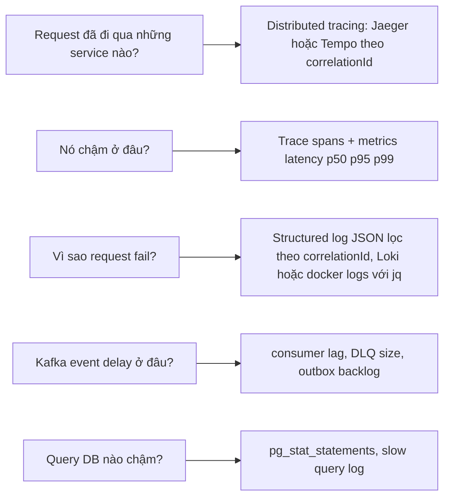
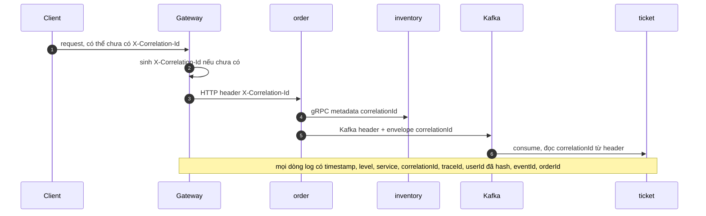
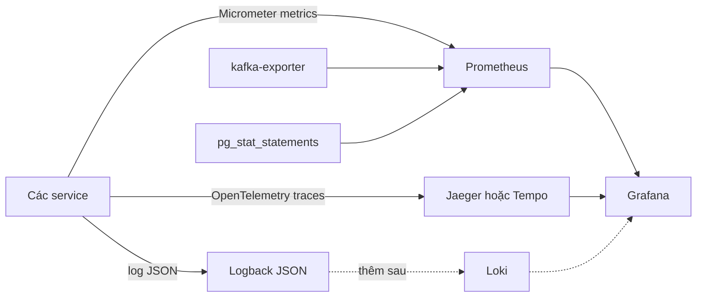
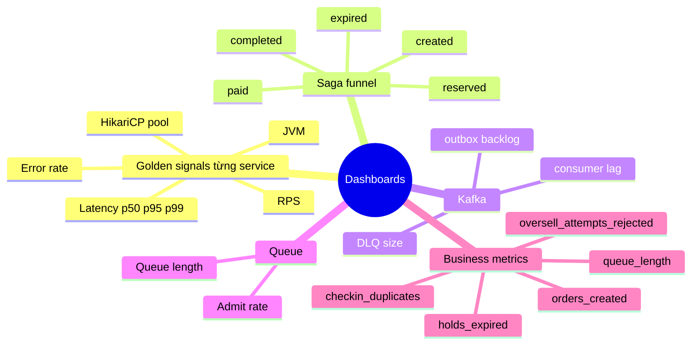
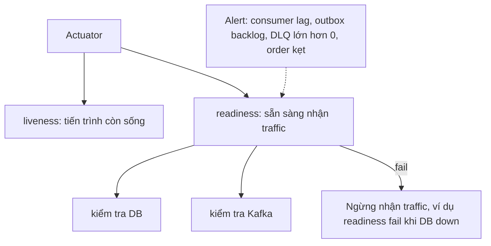

# S09 — Observability

> Nguồn: mục "9. OBSERVABILITY".

## A. Mục tiêu
- Từ một `correlationId` truy ra hành trình request; trả lời 5 câu hỏi: đi qua service nào, chậm ở đâu, vì sao fail, Kafka delay ở đâu, query nào chậm.
- Liên hệ: S03 (gateway sinh correlation id), S06 (header Kafka), S10 (detect), Phase 9.

## B. Overview diagram

### S09-D1 — Năm câu hỏi → công cụ trả lời

## C. Detailed diagrams

### S09-D2 — Lan truyền Correlation ID

### S09-D3 — Pipeline telemetry

Để Compose nhẹ, bắt đầu bằng Prometheus + Grafana + Jaeger; Loki thêm sau.

### S09-D4 — Dashboard tối thiểu và business metrics

### S09-D5 — Health check

## D. Giải thích sơ đồ
- **D1** biến 5 câu hỏi của source thành "nhìn ở đâu"; nếu một câu hỏi không có công cụ trả lời thì phase 9 chưa xong.
- **D2** correlationId phải đi qua **cả ba** môi trường: HTTP header, gRPC metadata, Kafka header; thiếu một chỗ là đứt trace.
- **D3** hạ tầng quan sát gồm ba trụ: log, metric, trace.
- **D4** funnel saga là chỉ báo nghiệp vụ nhanh nhất cho thấy order kẹt ở đâu.

## E. Những điều phải nhớ
- Không log PII hoặc token (Phase 9 mistakes); userId hash.
- Không dùng userId làm label metric (cardinality bùng nổ).
- Health + metrics cơ bản bật từ Phase 1; logging JSON + correlation id từ Phase 0; dashboard/tracing đầy đủ ở Phase 9.
- **SOURCE CHƯA QUY ĐỊNH:** ngưỡng alert cụ thể, thời gian giữ log/metric, tên metric chính xác ngoài các business metric đã liệt kê, cách sampling trace, định dạng log field cụ thể.

## F. Liên kết
- Đầu vào: S03, S06. Đầu ra: S10 (Detect), S12 (Measure), S18 (debug), Phase 9.

## G. Checklist
- [x] structured logging  - [x] correlation/request id  - [x] metrics  - [x] health/readiness/liveness  - [x] tracing  - [x] 5 câu hỏi  - [x] 4 dashboard  - [x] business metrics
