# S10 — Real-World Failure Scenarios

> Nguồn: mục "10. REAL-WORLD FAILURE SCENARIOS" (19 tình huống, mỗi tình huống theo Problem → Why → Detect → Prevent → Recover → Trade-off).

## A. Mục tiêu
- Chuyển 19 tình huống lỗi thành sơ đồ chuỗi nguyên nhân–phát hiện–phòng–phục hồi–đánh đổi để dùng khi thiết kế, test (S11) và debug (S18).
- Liên hệ: S04 (failure sequence #5, #9, #11 đã vẽ ở S04-D6, D8, D9), S06 (outbox/inbox/DLQ), S07 (#10, #19), S09 (Detect), S12 (#16).

## B. Overview diagram

### S10-D0 — 19 tình huống theo nhóm
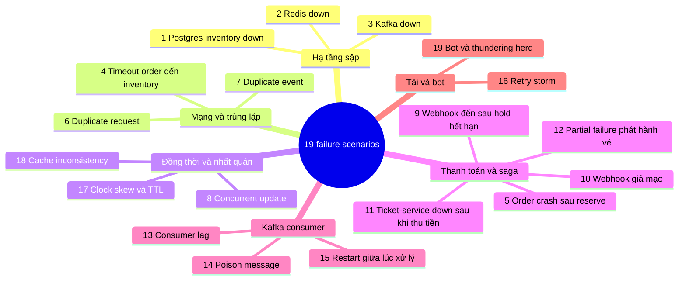

## C. Detailed diagrams
Mỗi sơ đồ nhóm dưới đây giữ **đủ 6 trường** của từng tình huống theo đúng bảng source. Chỗ nào source ghi `—` thì ghi là "source không nêu".

### S10-D1 — Nhóm G1: Hạ tầng sập
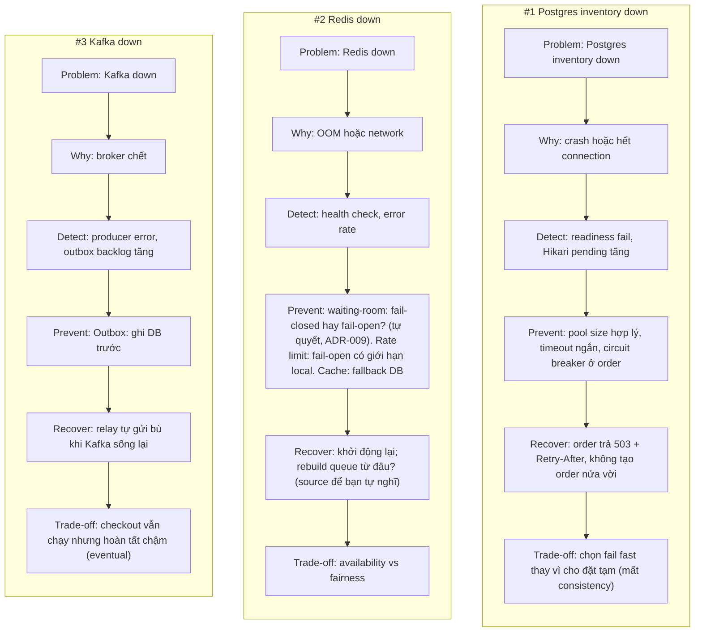

### S10-D2 — Nhóm G2: Mạng và trùng lặp
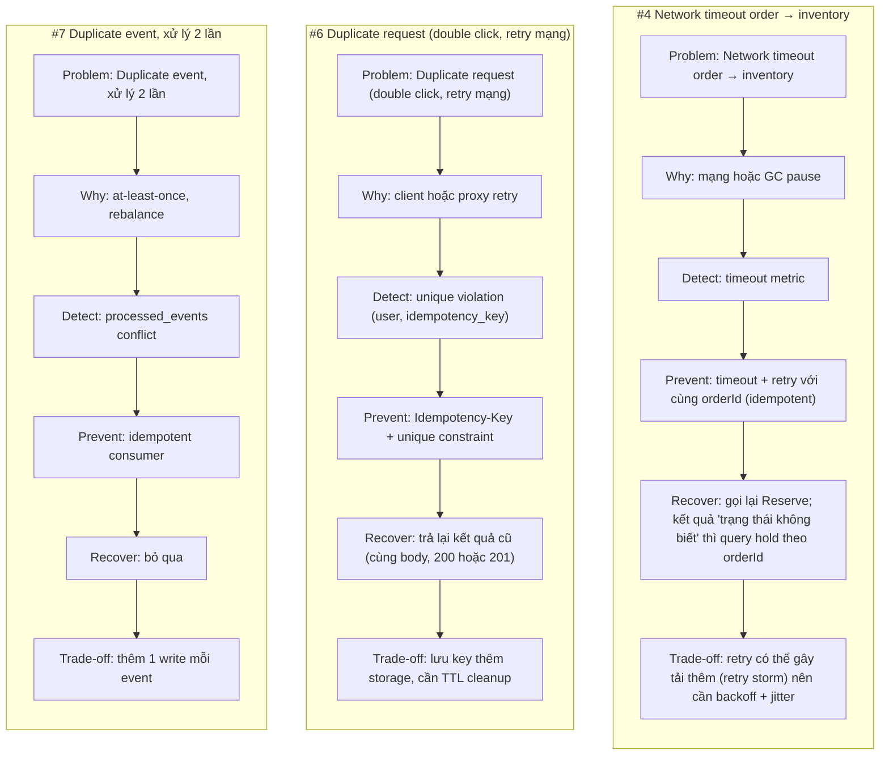

### S10-D3 — Nhóm G3: Đồng thời và nhất quán dữ liệu
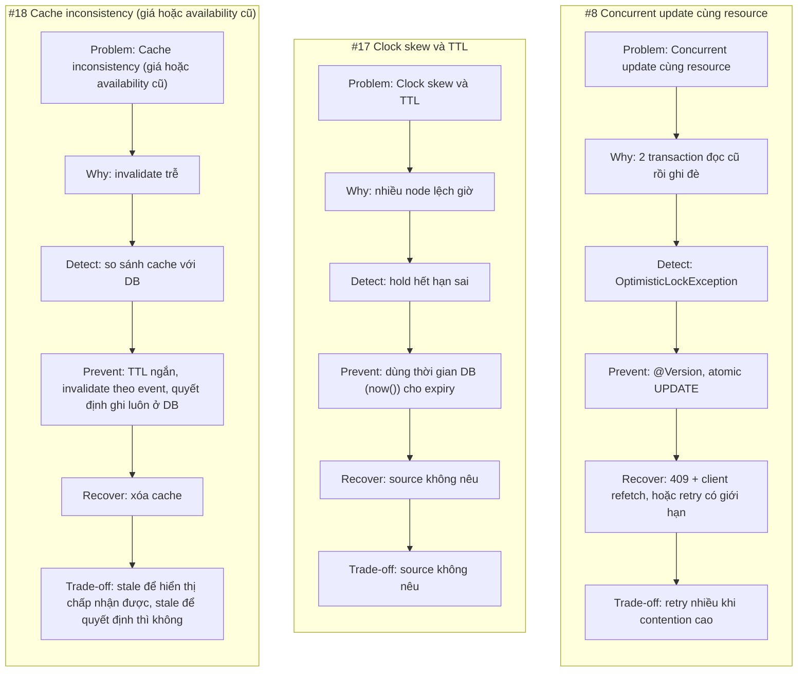

### S10-D4 — Nhóm G4: Thanh toán và saga
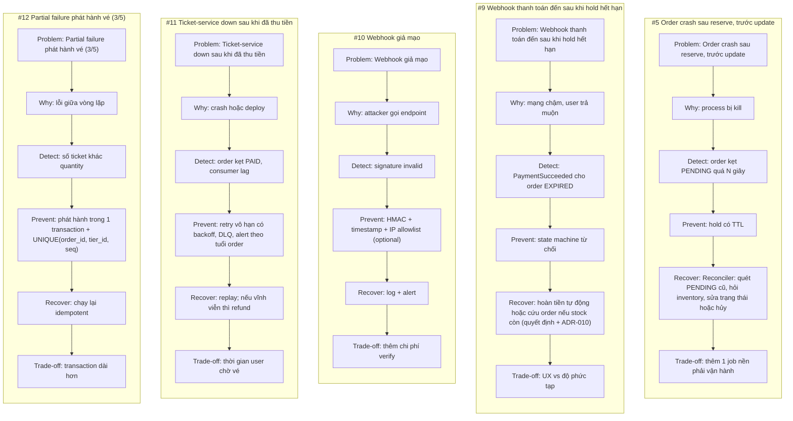

### S10-D5 — Nhóm G5: Kafka consumer
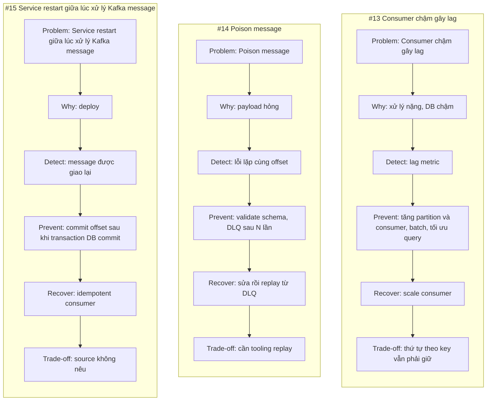

### S10-D6 — Nhóm G6: Tải và bot
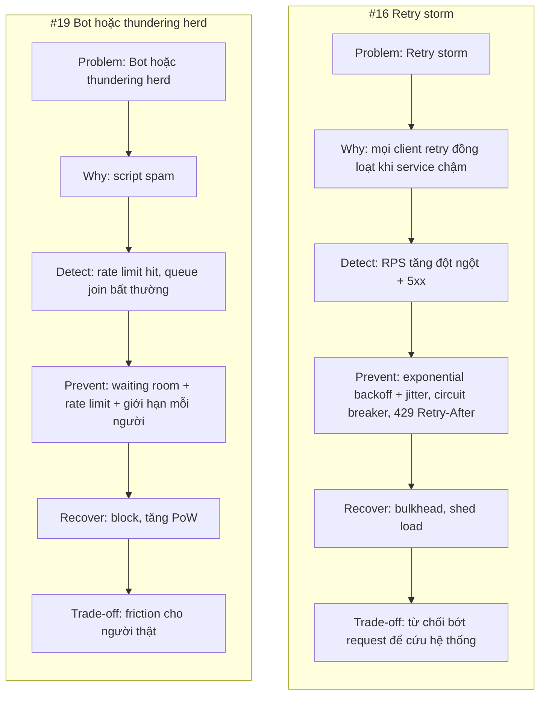

### S10-D7 — #4 Timeout order → inventory và retry cùng orderId
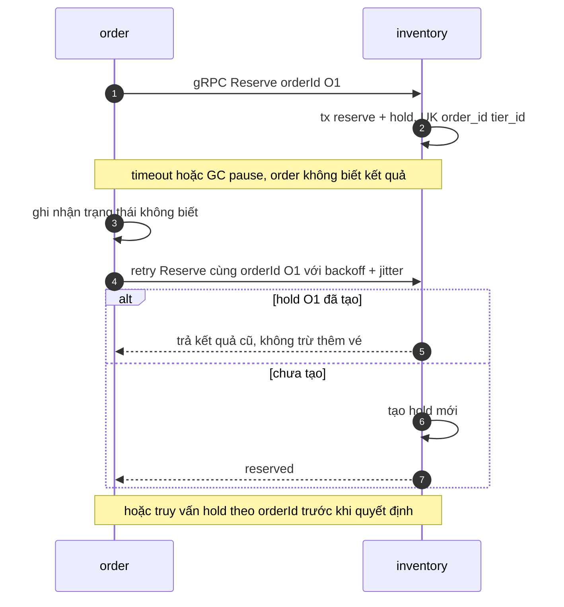

### S10-D8 — #6 Duplicate request được chặn bằng Idempotency-Key
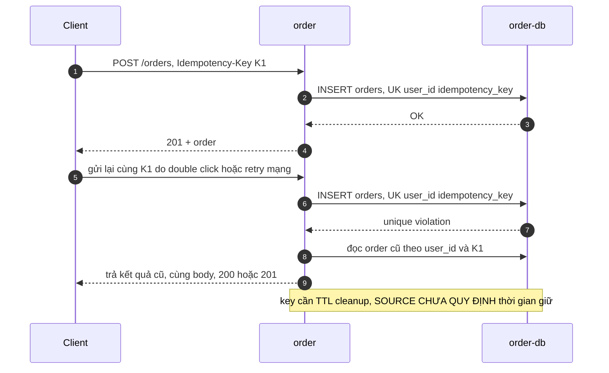

### S10-D9 — #7 Duplicate event và rebalance
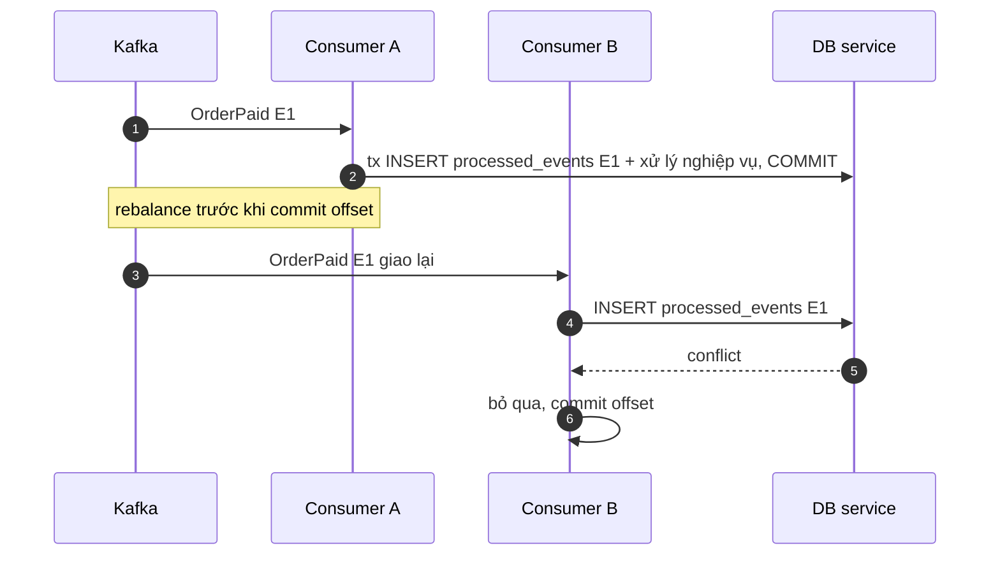

### S10-D10 — #12 Partial failure phát hành vé (3 trên 5)
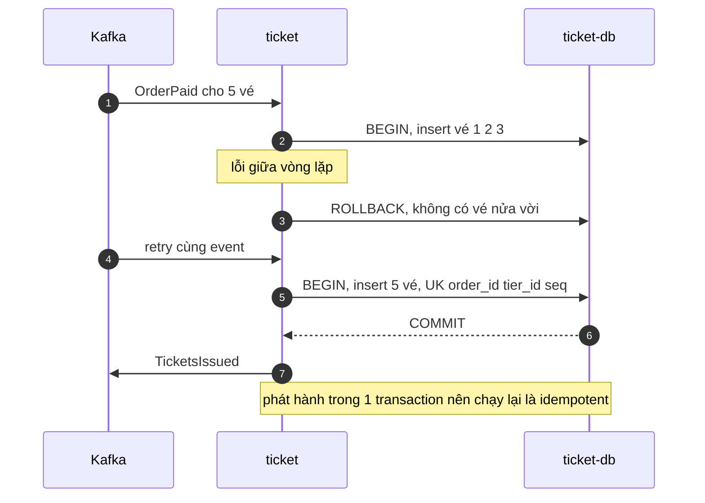

### S10-D11 — #16 Retry storm và cách cắt vòng phản hồi
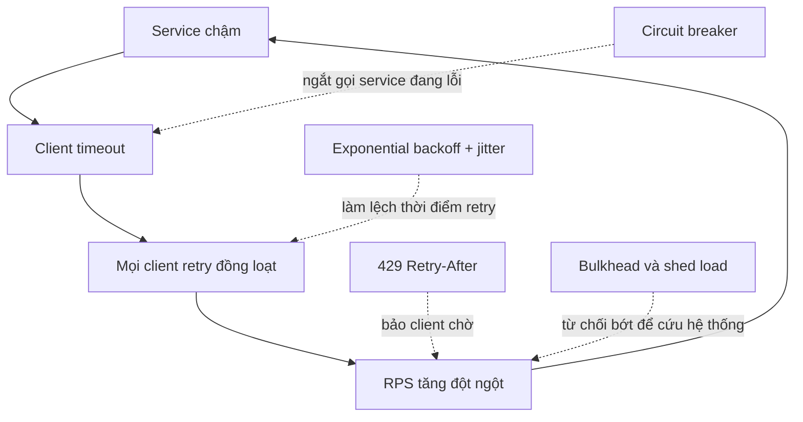

### Các tình huống đã có sequence ở S04
- **#5** Order crash sau reserve → xem S04-D6.
- **#9** Webhook đến sau khi hold hết hạn → xem S04-D8.
- **#11** Ticket-service down sau khi thu tiền → xem S04-D9.
- **#10** Webhook giả mạo → S07-D7 và S07-D9 (HMAC + timestamp + dedupe).

## D. Giải thích sơ đồ
- Đọc mỗi chuỗi từ trái sang phải như một ca postmortem: *sự cố → nguyên nhân → làm sao biết → làm sao phòng → làm sao hồi phục → cái giá phải trả*.
- Mẫu chung xuyên suốt: **idempotency, timeout có giá trị rõ ràng, outbox, state machine từ chối chuyển trạng thái sai, thời gian DB làm chuẩn, và alert dựa trên tuổi/lag**.
- Cột Trade-off nhắc rằng mọi biện pháp đều có giá (thêm job nền, thêm storage, tx dài hơn, friction cho người thật).

## E. Những điều phải nhớ
- **Hai quyết định chưa chốt:** #2 waiting room fail-open hay fail-closed (ADR-009); #9 refund hay cứu order (ADR-010). Source không chọn hộ bạn.
- Source cũng để mở "rebuild queue từ đâu khi Redis chết".
- Mọi retry phải có cùng khóa idempotent (orderId, Idempotency-Key, eventId).
- Dùng **thời gian DB** (`now()`) cho expiry để tránh clock skew.
- **SOURCE CHƯA QUY ĐỊNH:** giá trị N giây ở #5, thời gian giữ Idempotency-Key, số lần retry/DLQ N ở #14, ngưỡng alert cho lag/outbox/DLQ, cơ chế "cứu order" ở #9, Recover và Trade-off của #15 và #17 (source ghi —).

## F. Liên kết
- Đầu vào: S04, S06, S07, S09. Đầu ra: S11 (chaos/duplicate/concurrency test), S12 (#16), S18 (bug lab), Phase 4–10.

## G. Checklist
- [x] 19 tình huống đủ 6 trường  - [x] 5 sequence bổ sung (#4, #6, #7, #12, #16)  - [x] tham chiếu S04 cho #5, #9, #11  - [x] hai quyết định mở
