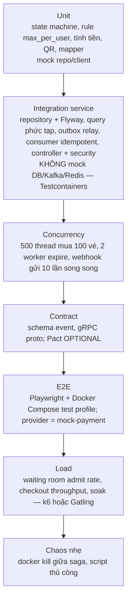
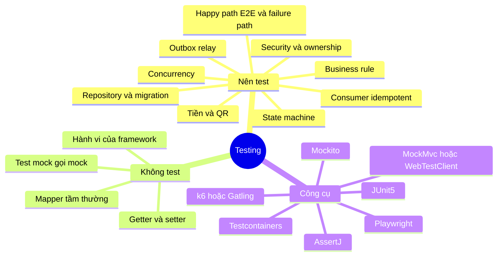
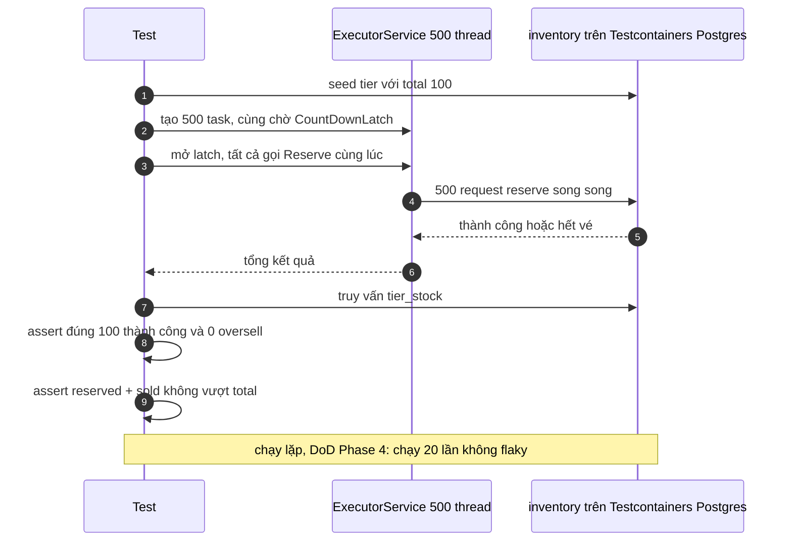
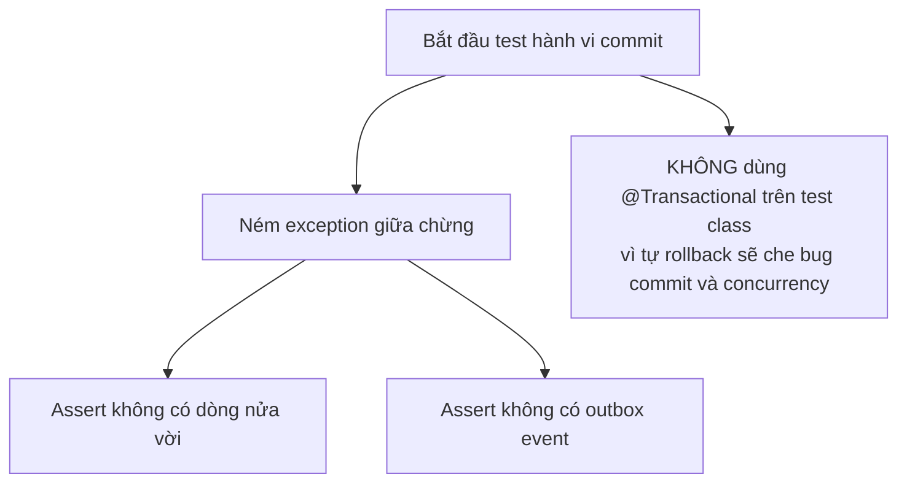
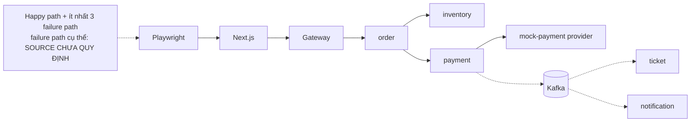

# S11 — Testing Strategy

> Nguồn: mục "11. TESTING STRATEGY" (bảng 7 tầng, danh sách "không test", cách test transaction).

## A. Mục tiêu
- Xác định test cái gì, không test cái gì, mock ở đâu, dùng hạ tầng thật ở đâu, và cách test transaction/concurrency.
- Liên hệ: S04 (race/saga), S06 (idempotent consumer), S10 (kịch bản lỗi), S12 (load), Phase 4–6 (DoD gắn với test).

## B. Overview diagram

### S11-D1 — Bảy tầng test

## C. Detailed diagrams

### S11-D2 — Test gì, không test gì

### S11-D3 — Concurrency test chống oversell

### S11-D4 — Test transaction và rollback

### S11-D5 — Phạm vi E2E

## D. Giải thích sơ đồ
- **D1** đi từ rẻ và nhanh đến đắt và chậm; mock chỉ ở unit. Integration dùng **hạ tầng thật** vì bug thật nằm ở ranh giới DB/Kafka/Redis.
- **D3** `CountDownLatch` làm mọi thread xuất phát cùng lúc để tạo contention thật; kiểm tra bất biến cuối cùng (đúng 100, không oversell).
- **D4** test rollback bằng cách phá giữa chừng và kiểm tra không rò dữ liệu/event; không bọc test trong transaction vì sẽ che hành vi commit.
- **D5** mock-payment là công cụ trong repo (`tools/mock-payment`: delay, fail, duplicate webhook).

## E. Những điều phải nhớ
- Không mock đến mức test "mock gọi mock".
- Concurrency test phải ổn định, nếu flaky thì chính nó là bug cần điều tra.
- Test duplicate event ×10, kill consumer giữa chừng, thanh toán đến muộn (Phase 6).
- **SOURCE CHƯA QUY ĐỊNH:** ngưỡng coverage, 3 failure path E2E cụ thể, có dùng Pact hay không (OPTIONAL), cấu hình CI chạy chaos.

## F. Liên kết
- Đầu vào: S04, S06, S10. Đầu ra: DoD các phase 4–6, S12 (load), S21 (CI).

## G. Checklist
- [x] unit/integration/concurrency/contract/E2E/load/chaos  - [x] không test  - [x] test transaction  - [x] Testcontainers, JUnit, Mockito
