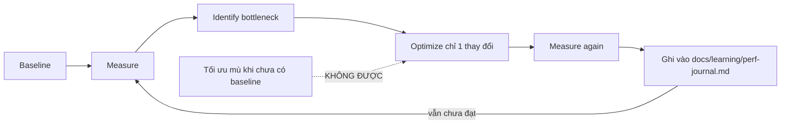
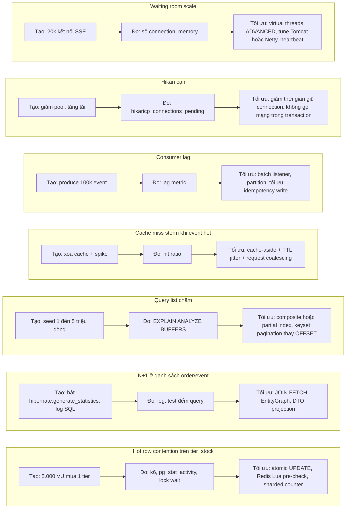
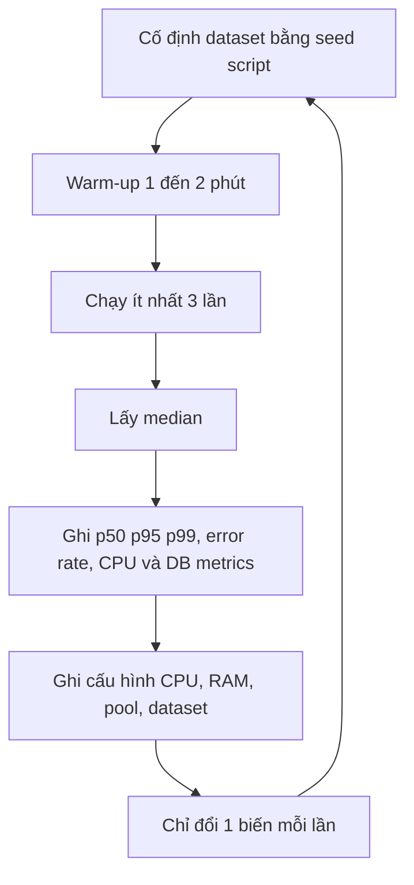
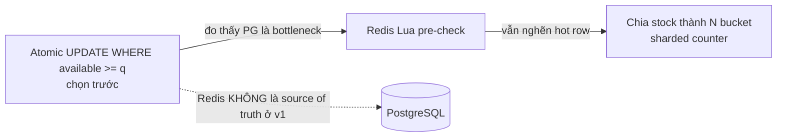

# S12 — Performance Strategy

> Nguồn: mục "12. PERFORMANCE STRATEGY" (quy trình đo, bảng 7 bài toán, benchmark methodology).

## A. Mục tiêu
- Tối ưu có phương pháp: đo trước, xác định bottleneck, tối ưu một thứ, đo lại, ghi nhật ký.
- Không bịa số: mọi benchmark do bạn đo trên máy bạn.
- Liên hệ: S09 (công cụ đo), S10 (#13, #16), S11 (load test), Phase 10.

## B. Overview diagram

### S12-D1 — Vòng tối ưu bắt buộc

## C. Detailed diagrams

### S12-D2 — Bảy bài toán: tạo → đo → tối ưu

### S12-D3 — Benchmark methodology

### S12-D4 — Thang tối ưu cho hot row inventory

## D. Giải thích sơ đồ
- **D1** là kỷ luật cốt lõi: mỗi lần chỉ một thay đổi để biết thay đổi nào có tác dụng.
- **D2** mỗi bài toán có đủ ba phần: cách **tạo** vấn đề, cách **đo**, và hướng **tối ưu chỉ sau khi đo**.
- **D3** giúp kết quả lặp lại được và so sánh công bằng giữa các lần.
- **D4** mỗi nấc chỉ lên khi nấc trước đã được đo là chưa đủ.

## E. Những điều phải nhớ
- Không bịa benchmark; chỉ ghi số bạn đo cùng cấu hình môi trường.
- Redis Lua và sharded counter là NICE TO HAVE, không làm trước khi đo.
- Không gọi mạng trong transaction (liên quan Hikari cạn).
- **SOURCE CHƯA QUY ĐỊNH:** ngưỡng mục tiêu (p95, RPS), cấu hình máy/dataset chuẩn, số VU cho từng kịch bản ngoài các ví dụ trong bảng.

## F. Liên kết
- Đầu vào: S09, S10, S11. Đầu ra: Phase 8 (waiting room load), Phase 10 (perf journal ≥ 4 bài), checklist Performance.

## G. Checklist
- [x] vòng đo  - [x] 7 bài toán  - [x] methodology  - [x] cảnh báo không bịa số
