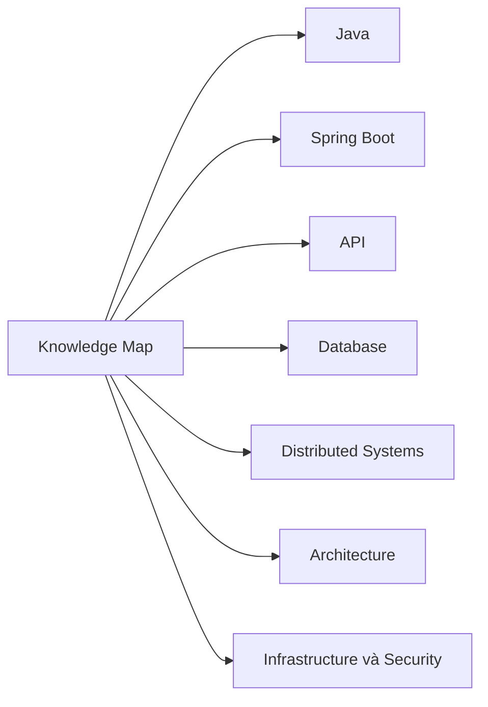
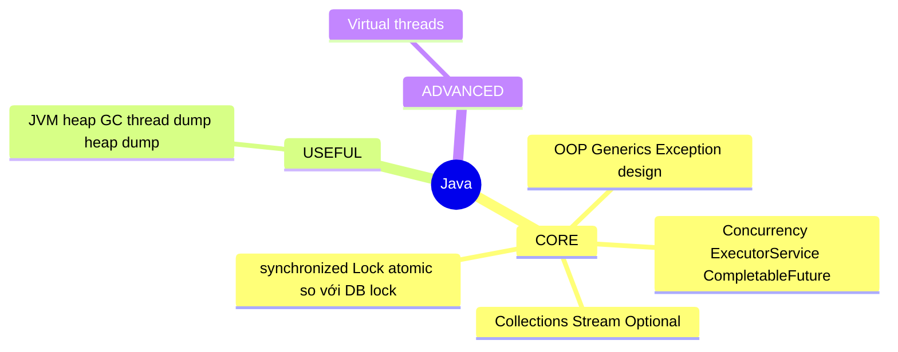
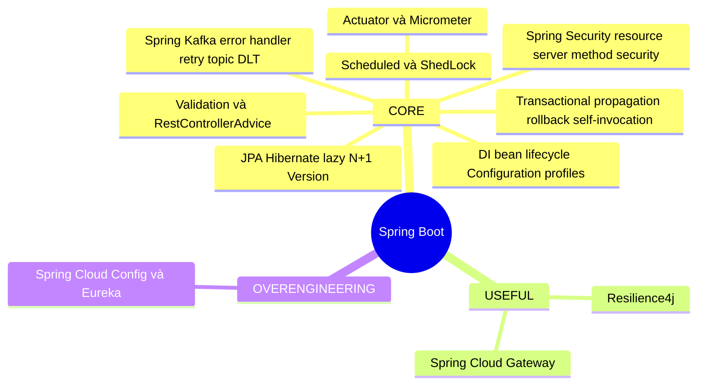
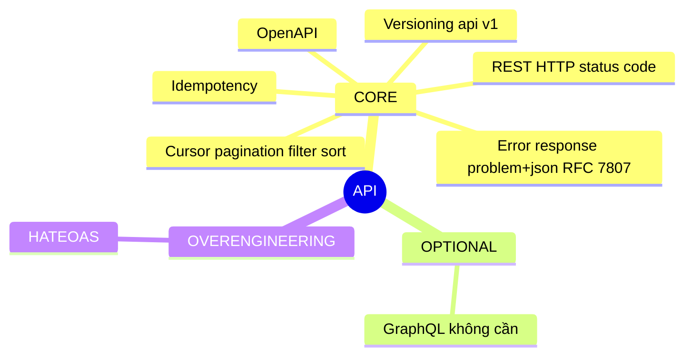
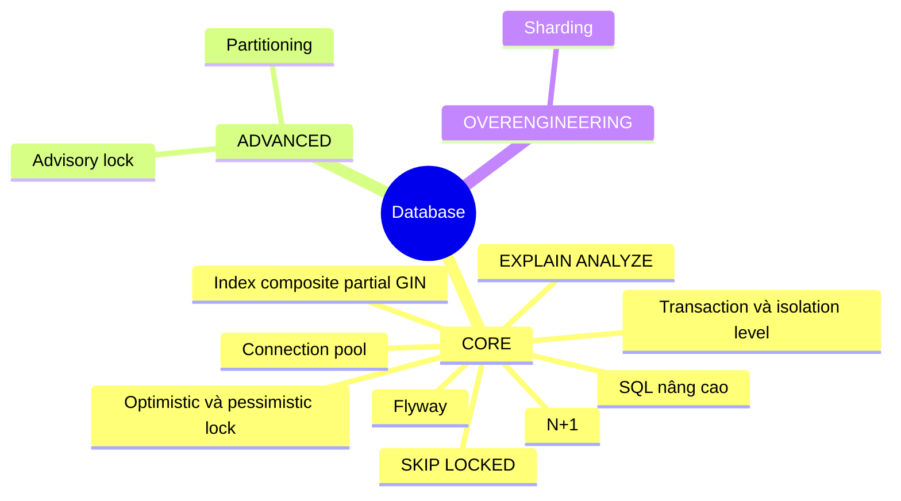
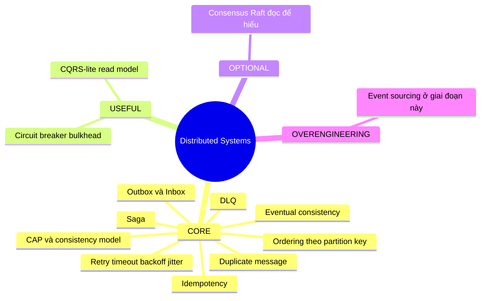
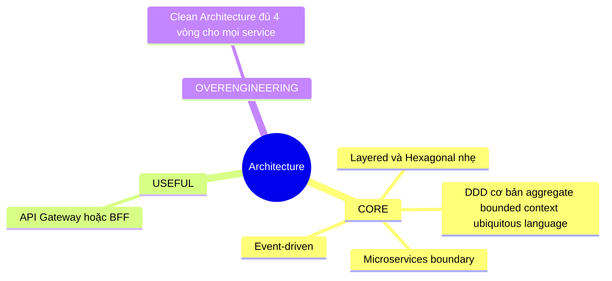
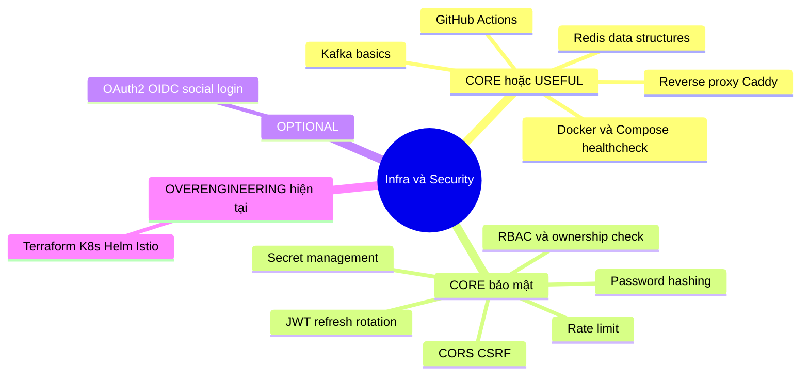

# S13 — Knowledge Map

> Nguồn: mục "13. KNOWLEDGE MAP (map kiến thức → feature)". Nhãn: `CORE` · `USEFUL` · `ADVANCED` · `OPTIONAL` · `OVERENGINEERING`.

## A. Mục tiêu
- Biết kiến thức nào là bắt buộc, đáng học, nâng cao, tùy chọn hay là over-engineering, và học nó ở đâu trong project.
- Liên hệ: S16 (phase), S22 (MUST/SHOULD/NICE/DO NOT BUILD), checklist cuối tài liệu.

## B. Overview diagram

### S13-D0 — Bảy nhóm kiến thức

## C. Detailed diagrams

### S13-D1 — Java

| Kiến thức | Nhãn | Học ở đâu |
|---|---|---|
| OOP, Generics, Exception design | CORE | domain model, error hierarchy |
| Collections, Stream, Optional | CORE | mapping, aggregation báo cáo |
| Concurrency, ExecutorService, CompletableFuture | CORE | concurrency test, outbox relay, parallel call có timeout |
| `synchronized`/`Lock`/atomic vs DB lock | CORE | hiểu vì sao lock JVM vô dụng khi có nhiều instance |
| JVM: heap/GC, thread dump, heap dump | USEFUL | debug memory leak (bug #4) |
| Virtual threads | ADVANCED | waiting-room SSE |

### S13-D2 — Spring Boot

| Kiến thức | Nhãn | Ở đâu |
|---|---|---|
| DI, bean lifecycle, `@Configuration`, profiles | CORE | mọi service |
| Validation, `@RestControllerAdvice` | CORE | error model chuẩn |
| Spring Security (resource server, method security) | CORE | identity + mọi service |
| `@Transactional` (propagation, rollback rule, self-invocation) | CORE | order/inventory |
| JPA/Hibernate (lazy, N+1, `@Version`) | CORE | catalog/order |
| `@Scheduled` + ShedLock | CORE | expire hold, reconciler, outbox |
| Actuator, Micrometer | CORE | observability |
| Spring Cloud Gateway | USEFUL | gateway |
| Spring Kafka (error handler, retry topic, DLT) | CORE | consumers |
| Resilience4j (timeout, retry, CB, bulkhead) | USEFUL | order→catalog/inventory |
| Spring Cloud Config/Eureka | OVERENGINEERING | — |

### S13-D3 — API

### S13-D4 — Database

### S13-D5 — Distributed Systems

### S13-D6 — Architecture

### S13-D7 — Infrastructure và Security

## D. Giải thích sơ đồ
- Mỗi nhánh gom kiến thức theo **nhãn** để bạn thấy ngay đâu là bắt buộc. Cột "học ở đâu" (bảng Java, Spring) trỏ kiến thức tới feature cụ thể của project.
- `CORE` nghĩa là thiếu thì chưa đạt Junior; `OVERENGINEERING` nghĩa là đừng đưa vào project ở giai đoạn này (xem S22).

## E. Những điều phải nhớ
- Không ép mọi thứ vào project; học theo nhãn và theo phase.
- Lock JVM (`synchronized`) vô dụng khi nhiều instance; phải dùng ràng buộc/lock ở DB.
- **SOURCE CHƯA QUY ĐỊNH:** thứ tự học từng kiến thức trong từng phase (chỉ có "học ở đâu" cho Java và Spring); mục "Infrastructure & Security" gom "CORE/USEFUL" mà không nêu từng mục thuộc nhãn nào.

## F. Liên kết
- Đầu vào: S03, S04–S12. Đầu ra: S16 (phase), S22, Skill Checklist.

## G. Checklist
- [x] Java  - [x] Spring Boot  - [x] API  - [x] Database  - [x] Distributed  - [x] Architecture  - [x] Infra & Security  - [x] đủ 5 nhãn
