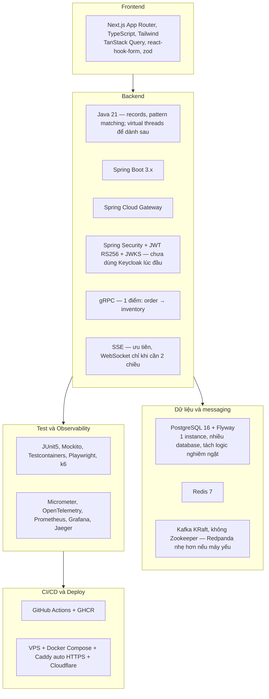

# S14 — Technology Stack

> Nguồn: mục "14. TECHNOLOGY STACK".

## A. Mục tiêu
- Chốt công nghệ từng lớp và lý do; tránh công nghệ làm project phức tạp vô nghĩa.
- Liên hệ: S03 (có cần không), S13, S21 (deploy), S22.

## B. Overview diagram

### S14-D1 — Stack theo lớp

## C. Detailed diagrams
Không có sơ đồ chi tiết riêng: S14-D1 đã chứa toàn bộ bảng stack của source; quy trình triển khai chi tiết nằm ở S21.

## D. Giải thích sơ đồ
- Các lớp đi từ trên xuống: frontend gọi backend, backend dùng dữ liệu/messaging; test và observability phục vụ backend; CI/CD triển khai tất cả lên một VPS.
- Quyết định đáng chú ý: **không** dùng Keycloak ở đầu để bạn tự hiểu auth; SSE thay WebSocket (ADR-007); Kafka KRaft bỏ Zookeeper cho nhẹ.

## E. Những điều phải nhớ
- Một Postgres nhiều database trong dev nhưng tách logic nghiêm ngặt (S05).
- **SOURCE CHƯA QUY ĐỊNH:** phiên bản chính xác của từng thư viện ngoài Java 21, Spring Boot 3.x, PostgreSQL 16, Redis 7; build tool (Maven hay Gradle — source chỉ nhắc cache Maven/Gradle ở Phase 0); chọn Kafka hay Redpanda cuối cùng.

## F. Liên kết
- Đầu vào: S03, S13. Đầu ra: S21 (deploy), Phase 0 (dựng repo).

## G. Checklist
- [x] 12 lớp trong bảng stack  - [x] ghi chú lựa chọn
