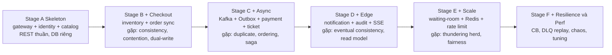
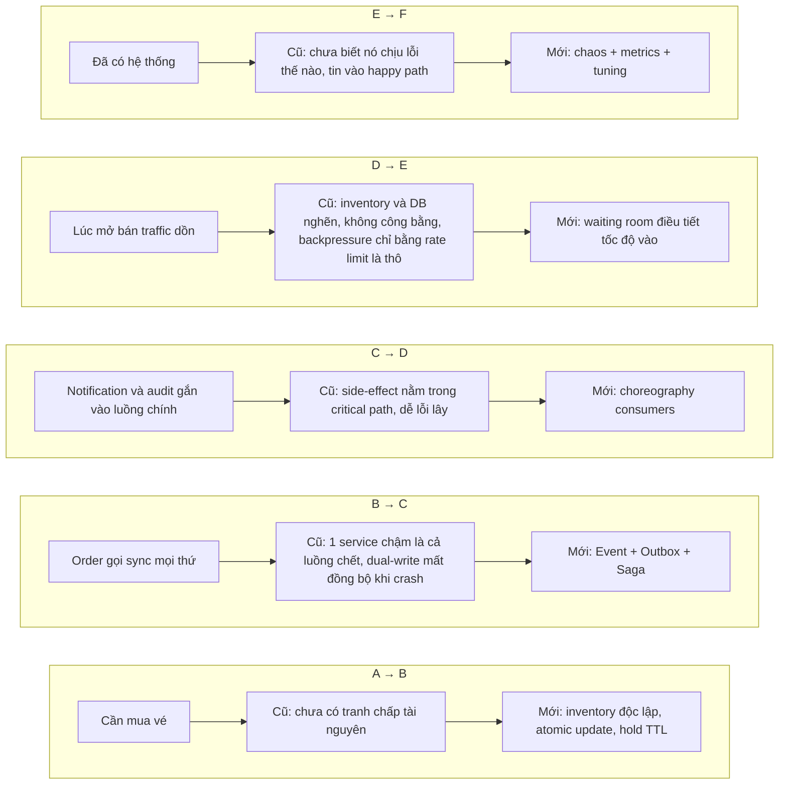
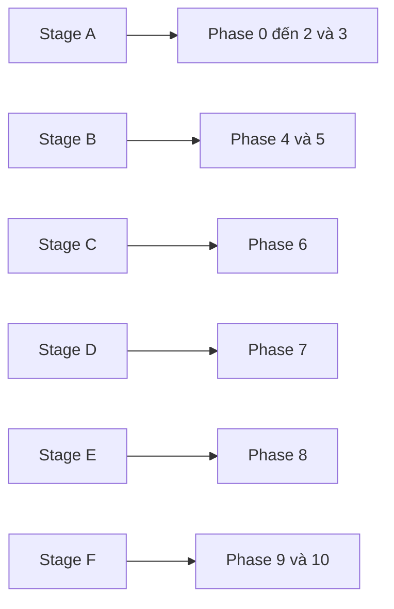

# S15 — Kiến trúc tiến hóa (microservices ngay từ đầu, nhưng không dựng tất cả cùng lúc)

> Nguồn: mục "15. KIẾN TRÚC TIẾN HÓA".

## A. Mục tiêu
- Giải thích vì sao kiến trúc thay đổi qua từng stage A→F: vấn đề nào kiến trúc cũ chưa giải quyết tốt và kiến trúc mới giải quyết gì.
- Liên hệ: S03 (kiến trúc đích), S16 (phase), S22 (không thêm service thứ 11).

## B. Overview diagram

### S15-D1 — Sáu stage (Walking Skeleton → Resilience)

## C. Detailed diagrams

### S15-D2 — Vì sao phải đổi ở mỗi bước

### S15-D3 — Stage ↔ Phase
> **ĐỀ XUẤT BỔ SUNG:** source không có bảng stage ↔ phase; ánh xạ suy ra từ nội dung từng phase.

## D. Giải thích sơ đồ
- Mỗi stage thêm **một loại vấn đề phân tán mới**: tranh chấp (B), dual-write và bất đồng bộ (C), eventual consistency (D), tải đột biến (E), khả năng chịu lỗi (F).
- Nguyên tắc: không dựng 10 service rồi mới chạy; thêm dần và chỉ thêm khi có vấn đề cụ thể.

## E. Những điều phải nhớ
- Mỗi lần đổi kiến trúc phải trả lời được: vì sao cần đổi, vấn đề của cũ, cái mới giải quyết gì (viết thành ADR, S20).
- Stage A→B đã tồn tại "microservices từ đầu" nhưng với số service nhỏ.
- **SOURCE CHƯA QUY ĐỊNH:** ánh xạ stage ↔ phase chính thức; thời điểm bật Kafka (Phase 4 nói có thể bật sớm hoặc chờ Phase 6).

## F. Liên kết
- Đầu vào: S03. Đầu ra: S16 (thứ tự phase), S17, S20 (ADR).

## G. Checklist
- [x] 6 stage A–F  - [x] bảng "vì sao đổi" (5 bước)  - [x] ánh xạ stage ↔ phase (đề xuất)
