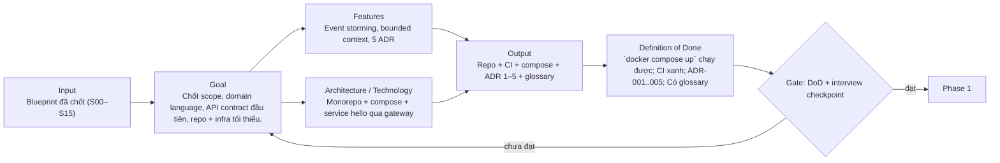

# PHASE 0 — Requirement & Skeleton design

> Nguồn: mục "16. ROADMAP" → PHASE 0. Thời lượng ước lượng: ≈1 tuần. Ô ghi `SOURCE CHƯA QUY ĐỊNH` nghĩa là source không có trường đó cho phase này.

## A. Mục tiêu
- **Goal:** Chốt scope, domain language, API contract đầu tiên, repo + infra tối thiểu.
- Vị trí trong roadmap: xem S16 (D1–D3). Kiến trúc stage tương ứng: xem S15-D3.

## B. Overview diagram

### P0-D1 — Input → Goal → Output → DoD → Gate
> **ĐỀ XUẤT BỔ SUNG:** phần *Input* được suy ra từ thứ tự phase và nội dung; riêng DoD, Goal, Features lấy từ source.

## C. Chi tiết phase (đúng các trường của source)
| Trường | Nội dung |
|---|---|
| Goal | Chốt scope, domain language, API contract đầu tiên, repo + infra tối thiểu. |
| Features | Event storming 1 buổi (sticky note trên giấy hoặc Excalidraw): liệt kê domain event của checkout; Vẽ bounded context; Viết 5 ADR đầu |
| Architecture / Technology | Monorepo, docker-compose (Postgres, Redis, Kafka), 1 service "hello" chạy qua gateway. |
| Concepts learned | Bounded context, ubiquitous language, ADR, 12-factor. |
| Coding tasks | Dựng repo/CI build; Chuẩn hóa error response (problem+json), correlation id filter, logging JSON, Flyway baseline; Viết khung docs/ |
| Expected difficulty | ★★☆☆☆ |
| Optimization opportunity | Cache layer của Maven/Gradle trong CI. |

**Definition of Done**
- [ ] `docker compose up` chạy được
- [ ] CI xanh
- [ ] ADR-001..005
- [ ] Có glossary

**Common mistakes**
- Tạo shared lib nhét entity
- Cấu hình 1 DB dùng chung mọi service

**Interview (câu mẫu trong source)**
- Bounded context là gì?
- Vì sao mỗi service 1 DB?
- 12-factor app gồm những gì?

## D. Giải thích sơ đồ
- Sơ đồ đọc từ trái sang phải: đầu vào từ phase trước → mục tiêu → hai nhánh song song (tính năng, kiến trúc/công nghệ) → sản phẩm đầu ra → DoD → **cổng chuyển phase**.
- Cổng chuyển phase theo source: chưa qua **DoD + interview checkpoint** của phase này thì không sang phase sau. "Interview checkpoint" là bộ câu hỏi (10 lý thuyết, 10 project, 5 debugging, 5 system design, 5 production) mà source nói sẽ tạo sau mỗi phase; ở đây chỉ có câu mẫu.

## E. Những điều phải nhớ
- Mỗi lỗi trong "Common mistakes" là lỗi thật mà phase này dễ mắc; dùng làm checklist review.
- Tiêu chí DoD phải **kiểm chứng được** bằng test, số đo hoặc demo.
- **SOURCE CHƯA QUY ĐỊNH:** mọi ô `SOURCE CHƯA QUY ĐỊNH` ở bảng trên.

## F. Liên kết
- Đầu vào: Blueprint đã chốt (S00–S15). Đầu ra: Repo + CI + compose + ADR 1–5 + glossary. Phase kế tiếp: Phase 1.

## G. Checklist
- [x] Goal  - [x] Features  - [x] Architecture/Technology  - [x] Concepts  - [x] Coding tasks  - [x] Difficulty  - [x] DoD  - [x] Mistakes  - [x] Optimization  - [x] Interview (ô thiếu đã ghi rõ)
