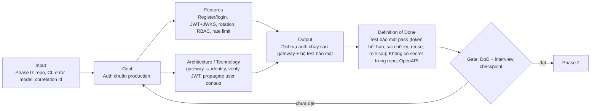

# PHASE 1 — Identity + Gateway

> Nguồn: mục "16. ROADMAP" → PHASE 1. Thời lượng ước lượng: ≈2 tuần. Ô ghi `SOURCE CHƯA QUY ĐỊNH` nghĩa là source không có trường đó cho phase này.

## A. Mục tiêu
- **Goal:** Auth chuẩn production.
- Vị trí trong roadmap: xem S16 (D1–D3). Kiến trúc stage tương ứng: xem S15-D3.

## B. Overview diagram

### P1-D1 — Input → Goal → Output → DoD → Gate
> **ĐỀ XUẤT BỔ SUNG:** phần *Input* được suy ra từ thứ tự phase và nội dung; riêng DoD, Goal, Features lấy từ source.

## C. Chi tiết phase (đúng các trường của source)
| Trường | Nội dung |
|---|---|
| Goal | Auth chuẩn production. |
| Features | Register/login; JWT RS256 + JWKS; Refresh rotation + reuse detection; Logout; RBAC; Organizer profile; Rate limit login |
| Architecture / Technology | gateway → identity; gateway verify JWT; propagate user context. |
| Concepts learned | Spring Security filter chain, stateless auth, password hashing, CSRF/CORS, token family. |
| Coding tasks | Thiết kế bảng + flow refresh tự suy luận; Viết filter ở gateway xóa header giả mạo; Test: dùng lại refresh token cũ → cả family bị revoke; Method security cho endpoint admin |
| Expected difficulty | ★★★☆☆ |
| Optimization opportunity | Cache JWKS có TTL; đo chi phí verify ở gateway. |

**Definition of Done**
- [ ] Test bảo mật pass (token hết hạn, sai chữ ký, reuse, role sai)
- [ ] Không có secret trong repo
- [ ] OpenAPI

**Common mistakes**
- Lưu JWT trong localStorage
- Refresh token lưu plaintext
- Tin role từ request body
- JWT sống quá lâu

**Interview (câu mẫu trong source)**
- Access vs refresh token?
- Vì sao rotation?
- Logout JWT stateless thực sự làm gì?
- Privilege escalation là gì?
- BCrypt vs Argon2?

## D. Giải thích sơ đồ
- Sơ đồ đọc từ trái sang phải: đầu vào từ phase trước → mục tiêu → hai nhánh song song (tính năng, kiến trúc/công nghệ) → sản phẩm đầu ra → DoD → **cổng chuyển phase**.
- Cổng chuyển phase theo source: chưa qua **DoD + interview checkpoint** của phase này thì không sang phase sau. "Interview checkpoint" là bộ câu hỏi (10 lý thuyết, 10 project, 5 debugging, 5 system design, 5 production) mà source nói sẽ tạo sau mỗi phase; ở đây chỉ có câu mẫu.

## E. Những điều phải nhớ
- Mỗi lỗi trong "Common mistakes" là lỗi thật mà phase này dễ mắc; dùng làm checklist review.
- Tiêu chí DoD phải **kiểm chứng được** bằng test, số đo hoặc demo.
- **SOURCE CHƯA QUY ĐỊNH:** mọi ô `SOURCE CHƯA QUY ĐỊNH` ở bảng trên.

## F. Liên kết
- Đầu vào: Phase 0: repo, CI, error model, correlation id. Đầu ra: Dịch vụ auth chạy sau gateway + bộ test bảo mật. Phase kế tiếp: Phase 2.

## G. Checklist
- [x] Goal  - [x] Features  - [x] Architecture/Technology  - [x] Concepts  - [x] Coding tasks  - [x] Difficulty  - [x] DoD  - [x] Mistakes  - [x] Optimization  - [x] Interview (ô thiếu đã ghi rõ)
