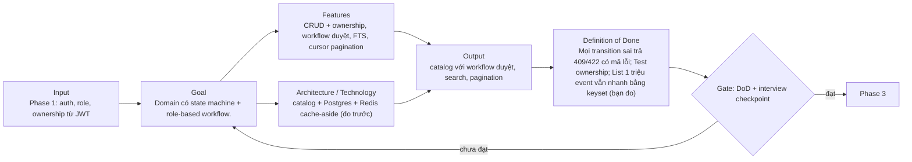

# PHASE 2 — Catalog + Workflow duyệt sự kiện

> Nguồn: mục "16. ROADMAP" → PHASE 2. Thời lượng ước lượng: ≈2–3 tuần. Ô ghi `SOURCE CHƯA QUY ĐỊNH` nghĩa là source không có trường đó cho phase này.

## A. Mục tiêu
- **Goal:** Domain có state machine + role-based workflow.
- Vị trí trong roadmap: xem S16 (D1–D3). Kiến trúc stage tương ứng: xem S15-D3.

## B. Overview diagram

### P2-D1 — Input → Goal → Output → DoD → Gate
> **ĐỀ XUẤT BỔ SUNG:** phần *Input* được suy ra từ thứ tự phase và nội dung; riêng DoD, Goal, Features lấy từ source.

## C. Chi tiết phase (đúng các trường của source)
| Trường | Nội dung |
|---|---|
| Goal | Domain có state machine + role-based workflow. |
| Features | CRUD event/tier (ownership); submit → review → publish; status history; search FTS, filter; cursor pagination; staff assignment |
| Architecture / Technology | catalog service + Postgres; Redis cache-aside cho trang chi tiết (tạm thời, đo trước). |
| Concepts learned | State pattern, JPA relationships, @Version, indexing, FTS, keyset pagination, ownership-based authorization. |
| Coding tasks | State machine không dùng if rải rác; Chặn moderator duyệt event của chính mình; Viết migration index và chứng minh bằng EXPLAIN |
| Expected difficulty | ★★★☆☆ |
| Optimization opportunity | Bài tập cố định: tạo N+1 → phát hiện → sửa → đo lại. |

**Definition of Done**
- [ ] Mọi transition sai trả 409/422 có mã lỗi
- [ ] Test ownership
- [ ] List 1 triệu event vẫn nhanh bằng keyset (bạn đo)

**Common mistakes**
- OFFSET sâu
- N+1 khi load tier
- Entity lộ ra API
- Validate chỉ ở UI

**Interview (câu mẫu trong source)**
- OFFSET vs keyset?
- @Version hoạt động thế nào?
- Lazy loading gây N+1 ra sao?
- Index composite: thứ tự cột quan trọng thế nào?

## D. Giải thích sơ đồ
- Sơ đồ đọc từ trái sang phải: đầu vào từ phase trước → mục tiêu → hai nhánh song song (tính năng, kiến trúc/công nghệ) → sản phẩm đầu ra → DoD → **cổng chuyển phase**.
- Cổng chuyển phase theo source: chưa qua **DoD + interview checkpoint** của phase này thì không sang phase sau. "Interview checkpoint" là bộ câu hỏi (10 lý thuyết, 10 project, 5 debugging, 5 system design, 5 production) mà source nói sẽ tạo sau mỗi phase; ở đây chỉ có câu mẫu.

## E. Những điều phải nhớ
- Mỗi lỗi trong "Common mistakes" là lỗi thật mà phase này dễ mắc; dùng làm checklist review.
- Tiêu chí DoD phải **kiểm chứng được** bằng test, số đo hoặc demo.
- **SOURCE CHƯA QUY ĐỊNH:** mọi ô `SOURCE CHƯA QUY ĐỊNH` ở bảng trên.

## F. Liên kết
- Đầu vào: Phase 1: auth, role, ownership từ JWT. Đầu ra: catalog với workflow duyệt, search, pagination. Phase kế tiếp: Phase 3.

## G. Checklist
- [x] Goal  - [x] Features  - [x] Architecture/Technology  - [x] Concepts  - [x] Coding tasks  - [x] Difficulty  - [x] DoD  - [x] Mistakes  - [x] Optimization  - [x] Interview (ô thiếu đã ghi rõ)
