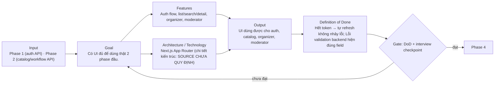

# PHASE 3 — Frontend nền (song song)

> Nguồn: mục "16. ROADMAP" → PHASE 3. Thời lượng ước lượng: ≈1–2 tuần rải rác. Ô ghi `SOURCE CHƯA QUY ĐỊNH` nghĩa là source không có trường đó cho phase này.

## A. Mục tiêu
- **Goal:** Có UI đủ để dùng thật 2 phase đầu.
- Vị trí trong roadmap: xem S16 (D1–D3). Kiến trúc stage tương ứng: xem S15-D3.

## B. Overview diagram

### P3-D1 — Input → Goal → Output → DoD → Gate
> **ĐỀ XUẤT BỔ SUNG:** phần *Input* được suy ra từ thứ tự phase và nội dung; riêng DoD, Goal, Features lấy từ source.

## C. Chi tiết phase (đúng các trường của source)
| Trường | Nội dung |
|---|---|
| Goal | Có UI đủ để dùng thật 2 phase đầu. |
| Features | Auth flow (silent refresh single-flight); List/search/detail; Organizer tạo và submit; Moderator duyệt |
| Architecture / Technology | SOURCE CHƯA QUY ĐỊNH |
| Concepts learned | App Router, middleware route guard, TanStack Query, zod, error mapping. |
| Coding tasks | SOURCE CHƯA QUY ĐỊNH |
| Expected difficulty | SOURCE CHƯA QUY ĐỊNH |
| Optimization opportunity | SOURCE CHƯA QUY ĐỊNH |

**Definition of Done**
- [ ] Hết token → tự refresh không nhảy lỗi
- [ ] Lỗi validation backend hiện đúng field

**Common mistakes**
- Làm UI đẹp quá sớm
- Check quyền chỉ ở frontend

**Interview (câu mẫu trong source)**
- SSR vs CSR vs ISR?
- Vì sao không lưu token ở localStorage?
- Race khi nhiều request cùng gặp 401?

## D. Giải thích sơ đồ
- Sơ đồ đọc từ trái sang phải: đầu vào từ phase trước → mục tiêu → hai nhánh song song (tính năng, kiến trúc/công nghệ) → sản phẩm đầu ra → DoD → **cổng chuyển phase**.
- Cổng chuyển phase theo source: chưa qua **DoD + interview checkpoint** của phase này thì không sang phase sau. "Interview checkpoint" là bộ câu hỏi (10 lý thuyết, 10 project, 5 debugging, 5 system design, 5 production) mà source nói sẽ tạo sau mỗi phase; ở đây chỉ có câu mẫu.

## E. Những điều phải nhớ
- Mỗi lỗi trong "Common mistakes" là lỗi thật mà phase này dễ mắc; dùng làm checklist review.
- Tiêu chí DoD phải **kiểm chứng được** bằng test, số đo hoặc demo.
- **SOURCE CHƯA QUY ĐỊNH:** mọi ô `SOURCE CHƯA QUY ĐỊNH` ở bảng trên.

## F. Liên kết
- Đầu vào: Phase 1 (auth API) · Phase 2 (catalog/workflow API). Đầu ra: UI dùng được cho auth, catalog, organizer, moderator. Phase kế tiếp: Phase 4.

## G. Checklist
- [x] Goal  - [x] Features  - [x] Architecture/Technology  - [x] Concepts  - [x] Coding tasks  - [x] Difficulty  - [x] DoD  - [x] Mistakes  - [x] Optimization  - [x] Interview (ô thiếu đã ghi rõ)
