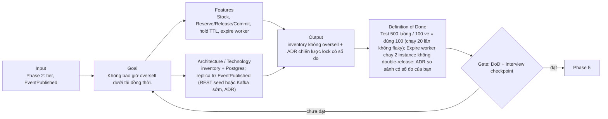

# PHASE 4 — Inventory

> Nguồn: mục "16. ROADMAP" → PHASE 4. Thời lượng ước lượng: ≈3 tuần. Ô ghi `SOURCE CHƯA QUY ĐỊNH` nghĩa là source không có trường đó cho phase này.

## A. Mục tiêu
- **Goal:** Không bao giờ oversell dưới tải đồng thời.
- Vị trí trong roadmap: xem S16 (D1–D3). Kiến trúc stage tương ứng: xem S15-D3.

## B. Overview diagram

### P4-D1 — Input → Goal → Output → DoD → Gate
> **ĐỀ XUẤT BỔ SUNG:** phần *Input* được suy ra từ thứ tự phase và nội dung; riêng DoD, Goal, Features lấy từ source.

## C. Chi tiết phase (đúng các trường của source)
| Trường | Nội dung |
|---|---|
| Goal | Không bao giờ oversell dưới tải đồng thời. |
| Features | Stock theo tier; Reserve/Release/Commit (REST trước); hold TTL; worker expire; max_per_user; local replica từ EventPublished |
| Architecture / Technology | inventory + Postgres; consumer catalog events (chưa cần Kafka đầy đủ: có thể seed bằng REST rồi chuyển Kafka ở Phase 6, hoặc bật Kafka sớm — bạn quyết và ghi ADR). |
| Concepts learned | Isolation level, lock strategies, atomic UPDATE, SKIP LOCKED, constraint như lớp phòng thủ, idempotent reserve. |
| Coding tasks | Tự cài ít nhất 2 chiến lược (atomic update vs optimistic retry vs FOR UPDATE); Viết concurrency test chung; Đo throughput + lỗi từng cái; Chọn 1 và ghi ADR |
| Expected difficulty | ★★★★☆ |
| Optimization opportunity | Hot row → thử sharded counter (chỉ khi đo thấy nghẽn). |

**Definition of Done**
- [ ] Test 500 luồng / 100 vé = đúng 100 (chạy 20 lần không flaky)
- [ ] Expire worker chạy 2 instance không double-release
- [ ] ADR so sánh có số đo của bạn

**Common mistakes**
- Đọc rồi ghi (SELECT rồi UPDATE ở app)
- Dùng synchronized
- Dùng thời gian app thay thời gian DB
- Quên release khi order fail

**Interview (câu mẫu trong source)**
- Read Committed vs Repeatable Read khác gì ở bài này?
- Optimistic vs pessimistic khi contention cao?
- Vì sao synchronized không đủ?
- Deadlock xảy ra khi nào, tránh thế nào?

## D. Giải thích sơ đồ
- Sơ đồ đọc từ trái sang phải: đầu vào từ phase trước → mục tiêu → hai nhánh song song (tính năng, kiến trúc/công nghệ) → sản phẩm đầu ra → DoD → **cổng chuyển phase**.
- Cổng chuyển phase theo source: chưa qua **DoD + interview checkpoint** của phase này thì không sang phase sau. "Interview checkpoint" là bộ câu hỏi (10 lý thuyết, 10 project, 5 debugging, 5 system design, 5 production) mà source nói sẽ tạo sau mỗi phase; ở đây chỉ có câu mẫu.

## E. Những điều phải nhớ
- Mỗi lỗi trong "Common mistakes" là lỗi thật mà phase này dễ mắc; dùng làm checklist review.
- Tiêu chí DoD phải **kiểm chứng được** bằng test, số đo hoặc demo.
- **SOURCE CHƯA QUY ĐỊNH:** mọi ô `SOURCE CHƯA QUY ĐỊNH` ở bảng trên.

## F. Liên kết
- Đầu vào: Phase 2: tier, EventPublished. Đầu ra: inventory không oversell + ADR chiến lược lock có số đo. Phase kế tiếp: Phase 5.

## G. Checklist
- [x] Goal  - [x] Features  - [x] Architecture/Technology  - [x] Concepts  - [x] Coding tasks  - [x] Difficulty  - [x] DoD  - [x] Mistakes  - [x] Optimization  - [x] Interview (ô thiếu đã ghi rõ)
