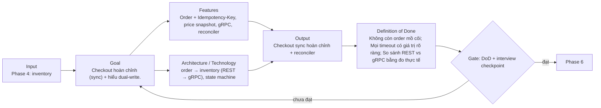

# PHASE 5 — Order + Saga đồng bộ rồi gRPC

> Nguồn: mục "16. ROADMAP" → PHASE 5. Thời lượng ước lượng: ≈2–3 tuần. Ô ghi `SOURCE CHƯA QUY ĐỊNH` nghĩa là source không có trường đó cho phase này.

## A. Mục tiêu
- **Goal:** Checkout hoàn chỉnh (sync) + hiểu dual-write.
- Vị trí trong roadmap: xem S16 (D1–D3). Kiến trúc stage tương ứng: xem S15-D3.

## B. Overview diagram

### P5-D1 — Input → Goal → Output → DoD → Gate
> **ĐỀ XUẤT BỔ SUNG:** phần *Input* được suy ra từ thứ tự phase và nội dung; riêng DoD, Goal, Features lấy từ source.

## C. Chi tiết phase (đúng các trường của source)
| Trường | Nội dung |
|---|---|
| Goal | Checkout hoàn chỉnh (sync) + hiểu dual-write. |
| Features | Tạo order (Idempotency-Key); price snapshot; Gọi inventory (REST → đo → chuyển gRPC); order state machine; cancel; order expire; reconciler |
| Architecture / Technology | order-service gọi inventory đồng bộ (REST rồi gRPC). |
| Concepts learned | Idempotency design, @Transactional không bọc call mạng, timeout/retry/CB, protobuf, deadline. |
| Coding tasks | Mô phỏng crash giữa bước 2–3 (kill container) → viết reconciler; Viết test double-submit 10 request song song cùng key → 1 order |
| Expected difficulty | ★★★★☆ |
| Optimization opportunity | Connection pooling HTTP/gRPC channel; deadline propagation. |

**Definition of Done**
- [ ] Không còn order mồ côi
- [ ] Mọi timeout có giá trị rõ ràng
- [ ] So sánh REST vs gRPC bằng đo thực tế

**Common mistakes**
- Giữ transaction DB mở khi gọi gRPC
- Retry không idempotent
- Lưu giá theo tier hiện tại (không snapshot)

**Interview (câu mẫu trong source)**
- Idempotency-Key lưu ở đâu, hết hạn sao?
- Dual-write là gì?
- Vì sao không để @Transactional bọc cả call gRPC?
- Circuit breaker 3 trạng thái?

## D. Giải thích sơ đồ
- Sơ đồ đọc từ trái sang phải: đầu vào từ phase trước → mục tiêu → hai nhánh song song (tính năng, kiến trúc/công nghệ) → sản phẩm đầu ra → DoD → **cổng chuyển phase**.
- Cổng chuyển phase theo source: chưa qua **DoD + interview checkpoint** của phase này thì không sang phase sau. "Interview checkpoint" là bộ câu hỏi (10 lý thuyết, 10 project, 5 debugging, 5 system design, 5 production) mà source nói sẽ tạo sau mỗi phase; ở đây chỉ có câu mẫu.

## E. Những điều phải nhớ
- Mỗi lỗi trong "Common mistakes" là lỗi thật mà phase này dễ mắc; dùng làm checklist review.
- Tiêu chí DoD phải **kiểm chứng được** bằng test, số đo hoặc demo.
- **SOURCE CHƯA QUY ĐỊNH:** mọi ô `SOURCE CHƯA QUY ĐỊNH` ở bảng trên.

## F. Liên kết
- Đầu vào: Phase 4: inventory. Đầu ra: Checkout sync hoàn chỉnh + reconciler. Phase kế tiếp: Phase 6.

## G. Checklist
- [x] Goal  - [x] Features  - [x] Architecture/Technology  - [x] Concepts  - [x] Coding tasks  - [x] Difficulty  - [x] DoD  - [x] Mistakes  - [x] Optimization  - [x] Interview (ô thiếu đã ghi rõ)
