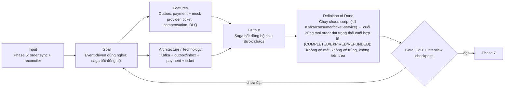

# PHASE 6 — Kafka + Outbox + Payment + Ticket

> Nguồn: mục "16. ROADMAP" → PHASE 6. Thời lượng ước lượng: ≈4 tuần — phase khó nhất. Ô ghi `SOURCE CHƯA QUY ĐỊNH` nghĩa là source không có trường đó cho phase này.

## A. Mục tiêu
- **Goal:** Event-driven đúng nghĩa; saga bất đồng bộ.
- Vị trí trong roadmap: xem S16 (D1–D3). Kiến trúc stage tương ứng: xem S15-D3.

## B. Overview diagram

### P6-D1 — Input → Goal → Output → DoD → Gate
> **ĐỀ XUẤT BỔ SUNG:** phần *Input* được suy ra từ thứ tự phase và nội dung; riêng DoD, Goal, Features lấy từ source.

## C. Chi tiết phase (đúng các trường của source)
| Trường | Nội dung |
|---|---|
| Goal | Event-driven đúng nghĩa; saga bất đồng bộ. |
| Features | Outbox relay mọi producer; payment-service + mock provider (delay/fail/duplicate webhook); webhook verify + dedupe; ticket issuance idempotent; order consume payment/ticket event; compensation (refund khi trễ); retry topic + DLQ + replay tool |
| Architecture / Technology | Kafka + outbox/inbox ở mọi service; payment và ticket là service mới; order là orchestrator. |
| Concepts learned | At-least-once, partition key và ordering, consumer group/rebalance, offset commit, Inbox, schema versioning, saga compensation. |
| Coding tasks | Tự thiết kế envelope + topic; Viết outbox poller SKIP LOCKED; Test kill consumer giữa chừng; Test duplicate event ×10; Test thanh toán đến muộn |
| Expected difficulty | ★★★★★ |
| Optimization opportunity | Batch consumer; tăng partition; đo outbox latency. |

**Definition of Done**
- [ ] Chạy chaos script (kill Kafka/consumer/ticket-service) → cuối cùng mọi order đạt trạng thái cuối hợp lệ (COMPLETED/EXPIRED/REFUNDED)
- [ ] Không vé mất, không vé trùng, không tiền treo

**Common mistakes**
- Gửi Kafka trong @Transactional rồi tưởng đã atomic
- Consumer không idempotent
- Commit offset trước khi xử lý xong
- Dùng 1 partition rồi nói có thứ tự

**Interview (câu mẫu trong source)**
- Exactly-once có thật?
- Vì sao cần Outbox?
- Order trong Kafka đảm bảo ở mức nào?
- Poison message xử lý ra sao?
- Saga vs 2PC?
- Event 2 lần thì sao?

## D. Giải thích sơ đồ
- Sơ đồ đọc từ trái sang phải: đầu vào từ phase trước → mục tiêu → hai nhánh song song (tính năng, kiến trúc/công nghệ) → sản phẩm đầu ra → DoD → **cổng chuyển phase**.
- Cổng chuyển phase theo source: chưa qua **DoD + interview checkpoint** của phase này thì không sang phase sau. "Interview checkpoint" là bộ câu hỏi (10 lý thuyết, 10 project, 5 debugging, 5 system design, 5 production) mà source nói sẽ tạo sau mỗi phase; ở đây chỉ có câu mẫu.

## E. Những điều phải nhớ
- Mỗi lỗi trong "Common mistakes" là lỗi thật mà phase này dễ mắc; dùng làm checklist review.
- Tiêu chí DoD phải **kiểm chứng được** bằng test, số đo hoặc demo.
- **SOURCE CHƯA QUY ĐỊNH:** mọi ô `SOURCE CHƯA QUY ĐỊNH` ở bảng trên.

## F. Liên kết
- Đầu vào: Phase 5: order sync + reconciler. Đầu ra: Saga bất đồng bộ chịu được chaos. Phase kế tiếp: Phase 7.

## G. Checklist
- [x] Goal  - [x] Features  - [x] Architecture/Technology  - [x] Concepts  - [x] Coding tasks  - [x] Difficulty  - [x] DoD  - [x] Mistakes  - [x] Optimization  - [x] Interview (ô thiếu đã ghi rõ)
