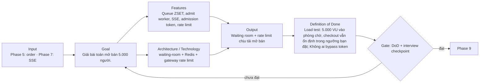

# PHASE 8 — Waiting Room + Rate Limiting

> Nguồn: mục "16. ROADMAP" → PHASE 8. Thời lượng ước lượng: ≈3 tuần. Ô ghi `SOURCE CHƯA QUY ĐỊNH` nghĩa là source không có trường đó cho phase này.

## A. Mục tiêu
- **Goal:** Giải bài toán mở bán 5.000 người.
- Vị trí trong roadmap: xem S16 (D1–D3). Kiến trúc stage tương ứng: xem S15-D3.

## B. Overview diagram

### P8-D1 — Input → Goal → Output → DoD → Gate
> **ĐỀ XUẤT BỔ SUNG:** phần *Input* được suy ra từ thứ tự phase và nội dung; riêng DoD, Goal, Features lấy từ source.

## C. Chi tiết phase (đúng các trường của source)
| Trường | Nội dung |
|---|---|
| Goal | Giải bài toán mở bán 5.000 người. |
| Features | Join queue (Redis ZSET); admit worker (N người/chu kỳ, cấu hình theo event); SSE vị trí/ETA; admission token (ký, TTL, gắn user + event); inventory/order từ chối nếu thiếu token; heartbeat loại người rời; rate limit gateway (token bucket/sliding window) |
| Architecture / Technology | waiting-room-service + Redis; gateway rate limit. |
| Concepts learned | Redis ZSET/Lua/TTL, fairness, backpressure, token bucket, fail-open vs fail-closed. |
| Coding tasks | Quyết định và ghi ADR: Redis chết thì sao?; Vào queue 2 tab thì sao?; Làm sao chống một người chiếm nhiều chỗ? |
| Expected difficulty | SOURCE CHƯA QUY ĐỊNH |
| Optimization opportunity | SOURCE CHƯA QUY ĐỊNH |

**Definition of Done**
- [ ] Load test: 5.000 VU vào phòng chờ, checkout vẫn ổn định trong ngưỡng bạn đặt
- [ ] Không ai bypass token

**Common mistakes**
- Admit theo ai gọi API nhanh nhất
- Không TTL → queue ma
- Lua script không idempotent

**Interview (câu mẫu trong source)**
- Thiết kế rate limiter phân tán?
- Token bucket vs sliding window?
- Redis chết thì làm gì?
- Fairness đo thế nào?

## D. Giải thích sơ đồ
- Sơ đồ đọc từ trái sang phải: đầu vào từ phase trước → mục tiêu → hai nhánh song song (tính năng, kiến trúc/công nghệ) → sản phẩm đầu ra → DoD → **cổng chuyển phase**.
- Cổng chuyển phase theo source: chưa qua **DoD + interview checkpoint** của phase này thì không sang phase sau. "Interview checkpoint" là bộ câu hỏi (10 lý thuyết, 10 project, 5 debugging, 5 system design, 5 production) mà source nói sẽ tạo sau mỗi phase; ở đây chỉ có câu mẫu.

## E. Những điều phải nhớ
- Mỗi lỗi trong "Common mistakes" là lỗi thật mà phase này dễ mắc; dùng làm checklist review.
- Tiêu chí DoD phải **kiểm chứng được** bằng test, số đo hoặc demo.
- **SOURCE CHƯA QUY ĐỊNH:** mọi ô `SOURCE CHƯA QUY ĐỊNH` ở bảng trên.

## F. Liên kết
- Đầu vào: Phase 5: order · Phase 7: SSE. Đầu ra: Waiting room + rate limit chịu tải mở bán. Phase kế tiếp: Phase 9.

## G. Checklist
- [x] Goal  - [x] Features  - [x] Architecture/Technology  - [x] Concepts  - [x] Coding tasks  - [x] Difficulty  - [x] DoD  - [x] Mistakes  - [x] Optimization  - [x] Interview (ô thiếu đã ghi rõ)
