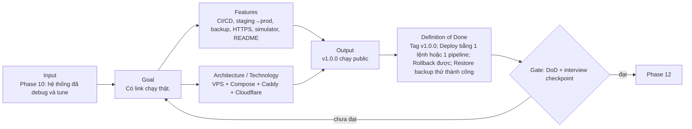

# PHASE 11 — Deployment & Public Release

> Nguồn: mục "16. ROADMAP" → PHASE 11. Thời lượng ước lượng: ≈2 tuần. Ô ghi `SOURCE CHƯA QUY ĐỊNH` nghĩa là source không có trường đó cho phase này.

## A. Mục tiêu
- **Goal:** Có link chạy thật.
- Vị trí trong roadmap: xem S16 (D1–D3). Kiến trúc stage tương ứng: xem S15-D3.

## B. Overview diagram

### P11-D1 — Input → Goal → Output → DoD → Gate
> **ĐỀ XUẤT BỔ SUNG:** phần *Input* được suy ra từ thứ tự phase và nội dung; riêng DoD, Goal, Features lấy từ source.

## C. Chi tiết phase (đúng các trường của source)
| Trường | Nội dung |
|---|---|
| Goal | Có link chạy thật. |
| Features | CI/CD (build → test → image → deploy); staging → prod; backup Postgres; Caddy HTTPS; Cloudflare; seed demo; landing + Flash Sale Simulator (nút tạo 2.000 người ảo vào queue); README + diagram + video demo |
| Architecture / Technology | VPS + Docker Compose + Caddy + Cloudflare (S21). |
| Concepts learned | SOURCE CHƯA QUY ĐỊNH |
| Coding tasks | SOURCE CHƯA QUY ĐỊNH |
| Expected difficulty | SOURCE CHƯA QUY ĐỊNH |
| Optimization opportunity | SOURCE CHƯA QUY ĐỊNH |

**Definition of Done**
- [ ] Tag v1.0.0
- [ ] Deploy bằng 1 lệnh hoặc 1 pipeline
- [ ] Rollback được
- [ ] Restore backup thử thành công

**Common mistakes**
- Mở port Postgres/Kafka ra Internet
- Không backup
- Secret trong image

**Interview (câu mẫu trong source)**
- SOURCE CHƯA QUY ĐỊNH

## D. Giải thích sơ đồ
- Sơ đồ đọc từ trái sang phải: đầu vào từ phase trước → mục tiêu → hai nhánh song song (tính năng, kiến trúc/công nghệ) → sản phẩm đầu ra → DoD → **cổng chuyển phase**.
- Cổng chuyển phase theo source: chưa qua **DoD + interview checkpoint** của phase này thì không sang phase sau. "Interview checkpoint" là bộ câu hỏi (10 lý thuyết, 10 project, 5 debugging, 5 system design, 5 production) mà source nói sẽ tạo sau mỗi phase; ở đây chỉ có câu mẫu.

## E. Những điều phải nhớ
- Mỗi lỗi trong "Common mistakes" là lỗi thật mà phase này dễ mắc; dùng làm checklist review.
- Tiêu chí DoD phải **kiểm chứng được** bằng test, số đo hoặc demo.
- **SOURCE CHƯA QUY ĐỊNH:** mọi ô `SOURCE CHƯA QUY ĐỊNH` ở bảng trên.

## F. Liên kết
- Đầu vào: Phase 10: hệ thống đã debug và tune. Đầu ra: v1.0.0 chạy public. Phase kế tiếp: Phase 12.

## G. Checklist
- [x] Goal  - [x] Features  - [x] Architecture/Technology  - [x] Concepts  - [x] Coding tasks  - [x] Difficulty  - [x] DoD  - [x] Mistakes  - [x] Optimization  - [x] Interview (ô thiếu đã ghi rõ)
