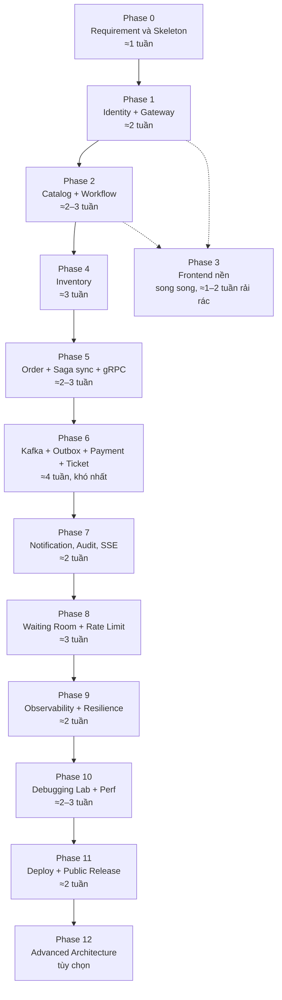
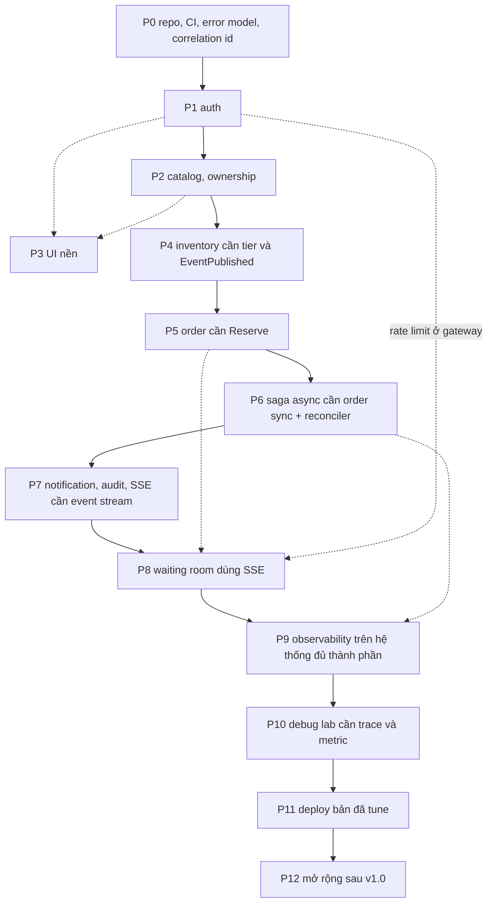
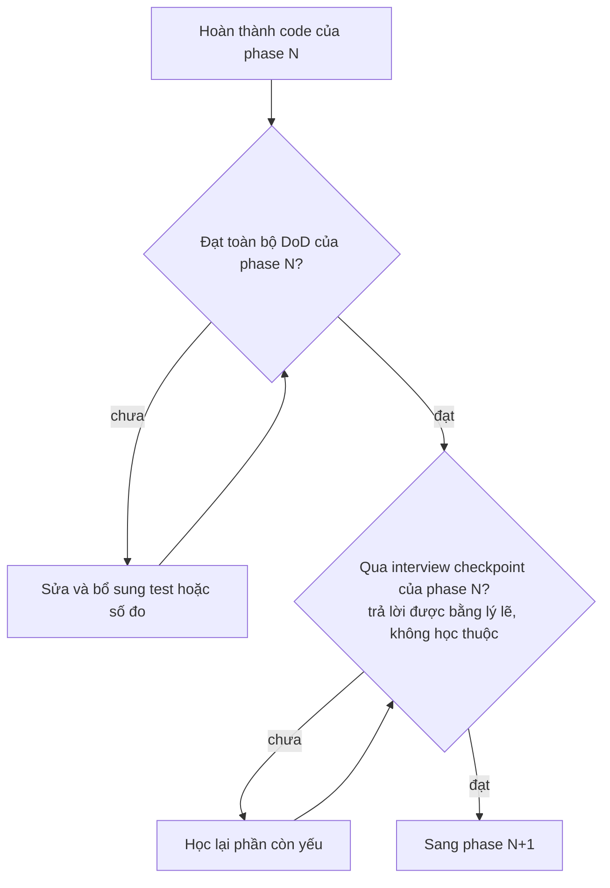
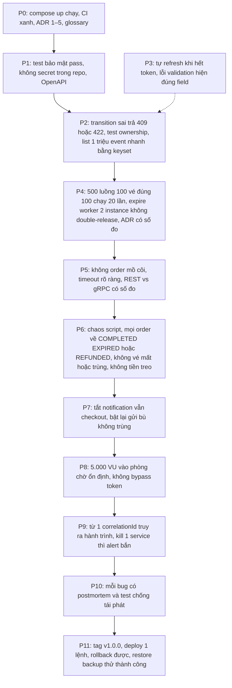

# S16 — Roadmap (tổng quan, dependency, gate)

> Nguồn: mục "16. ROADMAP (phase-by-phase)" và mục "17. Recommended Development Order". Chi tiết từng phase nằm ở `P00` … `P12` cùng thư mục.

## A. Mục tiêu
- Giữ nguyên thứ tự 13 phase (Phase 0–12), thời lượng ước lượng, quan hệ phụ thuộc và **điều kiện chuyển phase**.
- Mỗi phase có file riêng với đủ trường: Goal, Features, Architecture/Technology, Concepts, Coding tasks, Difficulty, DoD, Mistakes, Optimization, Interview.
- Liên hệ: S15 (kiến trúc tiến hóa), S17 (thứ tự build), S18–S19 (debug/interview), checklist.

## B. Overview diagram

### S16-D1 — Roadmap tổng thể (13 phase)

Source ước lượng tổng ≈ 20–28 tuần (part-time khoảng 12–15 giờ/tuần).

## C. Detailed diagrams

### S16-D2 — Dependency giữa các phase
> **ĐỀ XUẤT BỔ SUNG:** source chỉ cho thứ tự tuyến tính (và Phase 3 song song). Các cạnh dưới đây suy từ nội dung phase để cho thấy *vì sao* thứ tự đó hợp lý; nét liền = phụ thuộc chính, nét đứt = phụ thuộc phụ.

### S16-D3 — Cổng chuyển phase (quy tắc khóa phase)

### S16-D4 — Điều kiện cần đạt trước khi sang phase tiếp theo (DoD từng phase)

## D. Giải thích sơ đồ
- **D1** là bản đồ thời gian; Phase 3 chạy song song với Phase 1–2 vì UI chỉ cần API đã có.
- **D2** cho thấy tại sao Phase 4 (inventory) đứng trước Phase 6 (Kafka): bạn phải hiểu tranh chấp và dual-write ở dạng đơn giản (sync) trước khi giải bằng event.
- **D3** là quy tắc khóa phase của source: **cả DoD lẫn interview checkpoint** đều phải đạt.
- **D4** gom toàn bộ DoD để bạn có một "bảng cổng" duy nhất.

## E. Những điều phải nhớ
- Phase 6 là phase khó nhất (★★★★★); đừng lướt qua DoD chaos.
- Health + metrics cơ bản bật từ Phase 1; logging JSON + correlation id từ Phase 0 (xem S17).
- **SOURCE CHƯA QUY ĐỊNH:** ánh xạ cạnh dependency (D2 là đề xuất); thời lượng Phase 12.
- **Không khớp nhỏ trong source:** các phase ghi thời lượng cộng lại khoảng 25–28 tuần (bỏ Phase 3 vì song song), trong khi tổng ghi ≈ 20–28 tuần; cận dưới 20 tuần chưa khớp với cách cộng. Nên coi 20–28 chỉ là định hướng.
- Phase 12 trong source nhắc "v1.1 → v4" nhưng bảng mục 23 còn có v5.0.

## F. Liên kết
- Đầu vào: S15. Đầu ra: P00–P12, S17, S18, S19.

## G. Checklist
- [x] 13 phase giữ nguyên thứ tự  - [x] dependency  - [x] gate  - [x] DoD tổng hợp  - [x] thời lượng
