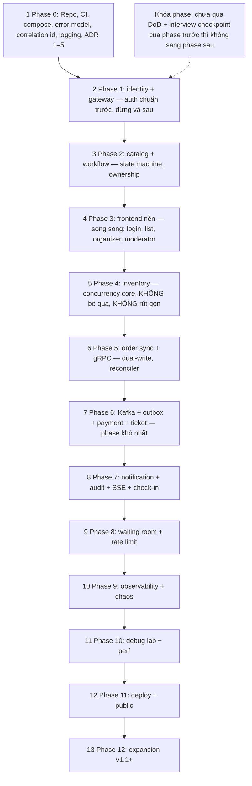
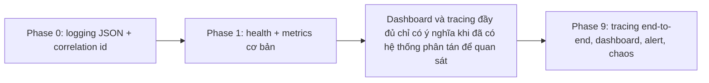

# S17 — Recommended Development Order

> Nguồn: mục "17. RECOMMENDED DEVELOPMENT ORDER".

## A. Mục tiêu
- Chốt thứ tự build chính xác (13 bước), quy tắc khóa phase và lý do Observability đầy đủ ở cuối.
- Liên hệ: S16 (roadmap), S15 (tiến hóa), S22.

## B. Overview diagram

### S17-D1 — 13 bước theo thứ tự và quy tắc khóa phase

## C. Detailed diagrams

### S17-D2 — Vì sao Observability đầy đủ ở cuối

## D. Giải thích sơ đồ
- Thứ tự đi từ nền tảng bảo mật (auth) → domain có workflow → lõi tranh chấp (inventory) → checkout sync → bất đồng bộ → side-effect → tải đột biến → quan sát → debug → deploy → mở rộng.
- Phase 4 bị nhấn mạnh "KHÔNG bỏ qua / KHÔNG rút gọn" vì là nơi học concurrency thật.
- Observability được chia đôi: **nền tảng sớm** (log JSON, correlation id, health, metrics cơ bản) và **đầy đủ muộn** (Phase 9).

## E. Những điều phải nhớ
- Bước 4 (Phase 3) chạy song song, không phải tuần tự cứng.
- **SOURCE CHƯA QUY ĐỊNH:** nếu thứ tự thay đổi (ví dụ bật Kafka sớm ở Phase 4) thì cần ADR; source chưa nói ảnh hưởng đến thứ tự.

## F. Liên kết
- Đầu vào: S16. Đầu ra: kế hoạch thực thi từng phase (P00–P12).

## G. Checklist
- [x] 13 bước  - [x] quy tắc khóa phase  - [x] vì sao Observability ở cuối
