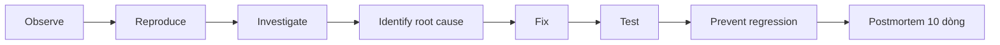
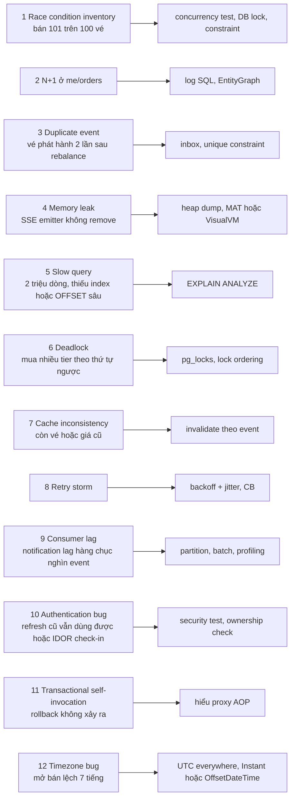

# S18 — Debugging Mode

> Nguồn: mục "18. DEBUGGING MODE — bug cố tình đưa vào".

## A. Mục tiêu
- Luyện quy trình debug có hệ thống bằng 12 bug cố tình đưa vào (nhánh `bug/xx`).
- Liên hệ: S10 (failure scenarios), S09 (công cụ quan sát), S12 (đo), Phase 10.

## B. Overview diagram

### S18-D1 — Quy trình debug

## C. Detailed diagrams

### S18-D2 — 12 bug và kỹ năng luyện

## D. Giải thích sơ đồ
- D1: mỗi bug phải đi hết 8 bước, đặc biệt **Prevent regression** (test chống tái phát) và postmortem ngắn.
- D2: mỗi bug nhắm đúng một kỹ năng gốc: bug #1 và #6 là cạnh tranh DB, #3 và #9 là Kafka, #4 là JVM, #10 là bảo mật, #11 và #12 là lỗi tinh vi của framework/thời gian.

## E. Những điều phải nhớ
- DoD Phase 10: mỗi bug có postmortem ngắn + test chống tái phát.
- **SOURCE CHƯA QUY ĐỊNH:** cách "cài" bug vào mã (nhánh `bug/xx` chỉ là tên), thứ tự làm bug, bug nào thuộc phase nào.

## F. Liên kết
- Đầu vào: S09, S10, S11. Đầu ra: Phase 10, `docs/learning/bug-lab/`, `postmortems/`.

## G. Checklist
- [x] 8 bước quy trình  - [x] 12 bug với triệu chứng và kỹ năng
