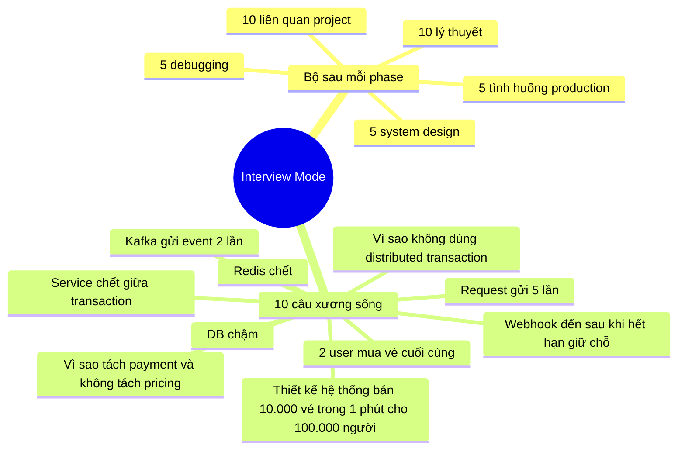
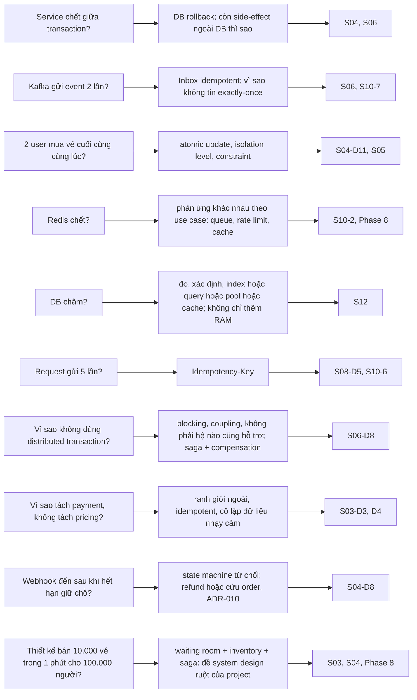

# S19 — Interview Mode

> Nguồn: mục "19. INTERVIEW MODE (khung)".

## A. Mục tiêu
- Sau mỗi major phase có bộ câu hỏi: 10 lý thuyết · 10 project · 5 debugging · 5 system design · 5 production.
- Trả lời được 10 câu "xương sống" bằng lý lẽ chứ không học thuộc.
- Liên hệ: S16 (interview của từng phase), S10 (tình huống), checklist cuối.

## B. Overview diagram

### S19-D1 — Cấu trúc bộ phỏng vấn

## C. Detailed diagrams

### S19-D2 — Câu hỏi → khái niệm cần hiểu → mục liên quan

## D. Giải thích sơ đồ
- D1: khung chung; câu "xương sống" là điểm tựa để kiểm tra hiểu thật.
- D2: mỗi câu trỏ về khái niệm gốc và các sơ đồ đã vẽ, để bạn tự trả lời rồi đối chiếu.

## E. Những điều phải nhớ
- Mình (mentor) sẽ tạo bộ câu hỏi đầy đủ **sau mỗi phase** khi bạn báo xong.
- **SOURCE CHƯA QUY ĐỊNH:** đáp án chuẩn từng câu (source chỉ gợi ý hướng), điểm đạt của "interview checkpoint".

## F. Liên kết
- Đầu vào: S04–S12. Đầu ra: cổng chuyển phase (S16-D3), checklist.

## G. Checklist
- [x] khung 5 loại câu hỏi  - [x] 10 câu xương sống
