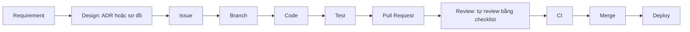
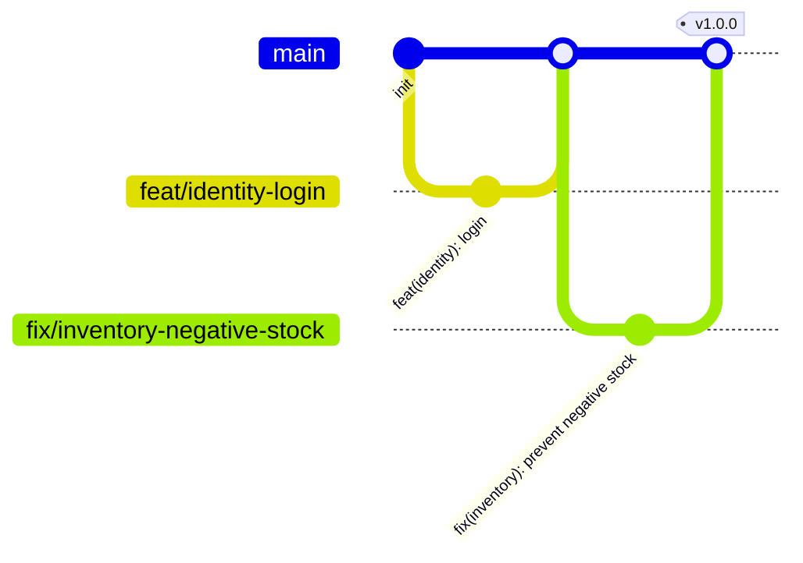
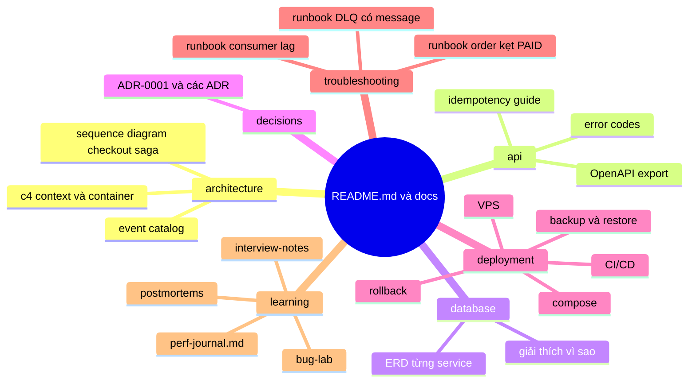
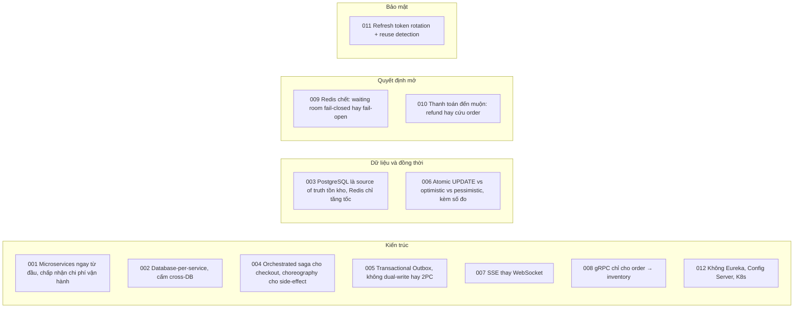
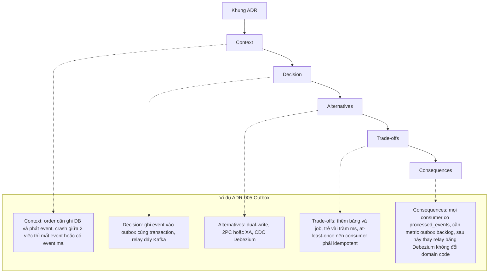

# S20 — Workflow, Docs, ADR (20.1–20.3)

> Nguồn: mục "20. WORKFLOW, DOCS, ADR" (20.1 Git workflow, 20.2 Cấu trúc docs, 20.3 ADR).

## A. Mục tiêu
- Làm việc như team thật: quy trình từ yêu cầu đến deploy, checklist PR/review, cấu trúc tài liệu và 12 ADR cần viết.
- Liên hệ: S15 (mỗi lần đổi kiến trúc cần ADR), S21 (CI/CD), S25 (portfolio).

## B. Overview diagram

### S20-D1 — Quy trình phát triển

## C. Detailed diagrams

### S20-D2 — Trunk-based nhẹ, branch ngắn, tag vX.Y.Z

Hình chỉ minh họa quy ước: `main` luôn deploy được; branch ngắn `feat/…`, `fix/…`, `chore/…`, `docs/…`; tag `vX.Y.Z`.

### S20-D3 — Cấu trúc docs

### S20-D4 — 12 ADR cần viết

### S20-D5 — Khung ADR và ví dụ ADR-005

## D. Giải thích sơ đồ
- **D1–D2:** quy trình giống team thật nhưng gọn: trunk-based, branch ngắn, review bằng checklist tự làm, tag cho phiên bản.
- **D3:** mỗi thư mục docs trả lời một loại câu hỏi (kiến trúc, API, dữ liệu, quyết định, vận hành, sự cố, học tập).
- **D4–D5:** ADR giúp bạn *hiểu* kiến trúc thay vì *thuộc* kiến trúc: mỗi quyết định có bối cảnh, lựa chọn thay thế và cái giá.

## E. Những điều phải nhớ
- **Commit convention:** Conventional Commits, ví dụ `feat(order): add idempotency key`, `fix(inventory): prevent negative stock`.
- **Issue template:** Context · Acceptance Criteria · Out of scope · Technical notes · Test plan.
- **PR checklist:** có test (unit + integration nếu đụng DB/Kafka) · migration an toàn (backward compatible) · idempotent? · transaction boundary đúng? · có log/metric? · không lộ PII/secret · doc/ADR cập nhật · đã chạy lại concurrency test nếu đụng inventory/order.
- **Code review checklist (tự review):** ownership check? N+1? gọi mạng trong transaction? retry có idempotent? timeout đã đặt? lỗi có mã/ý nghĩa rõ? có abstraction thừa?
- **Definition of Done mỗi task:** chạy local bằng compose · test pass trong CI · không tăng warning · doc/ADR cập nhật · có metric/log phù hợp · demo được bằng 1 kịch bản.
- **SOURCE CHƯA QUY ĐỊNH:** công cụ issue/PR (GitHub là mặc định hợp lý nhưng source không nêu), quy tắc bảo vệ nhánh `main`, đánh số ADR chính xác (ADR-0001 hay ADR-001: source dùng cả hai), thời điểm viết từng ADR ngoài ADR 1–5 ở Phase 0 và ADR-006 ở Phase 4.
- Gitgraph ở D2 là hình minh họa quy ước, không phải lịch sử thật.

## F. Liên kết
- Đầu vào: S15, S16. Đầu ra: mọi phase (DoD), S21 (CI), S25 (README).

## G. Checklist
- [x] 20.1 workflow, branch, commit, issue, PR, review, DoD  - [x] 20.2 cây docs  - [x] 20.3 12 ADR + khung + ví dụ ADR-005
