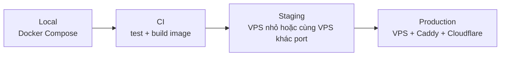
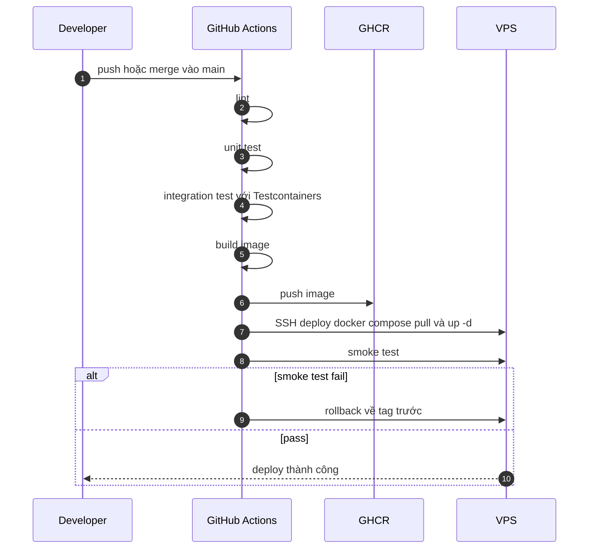
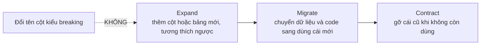
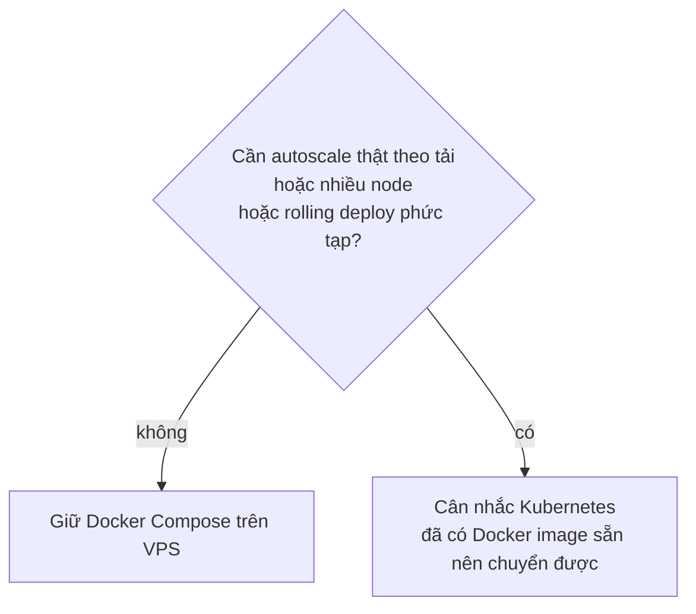

# S21 — Deployment Strategy

> Nguồn: mục "21. DEPLOYMENT STRATEGY".

## A. Mục tiêu
- Lộ trình triển khai chi phí thấp: Local → CI → Staging → Production trên một VPS, không cần Kubernetes.
- Liên hệ: S14 (stack), S20 (CI), S05 (migration), Phase 11.

## B. Overview diagram

### S21-D1 — Lộ trình môi trường

## C. Detailed diagrams

### S21-D2 — Pipeline CI/CD

### S21-D3 — Migration an toàn

### S21-D4 — Khi nào mới cần Kubernetes

## D. Giải thích sơ đồ
- **D1–D2:** mọi thay đổi đi qua test trước khi tạo image; deploy bằng SSH + Compose và có smoke test; fail thì rollback tag trước.
- **D3:** expand → migrate → contract để migration không phá bản đang chạy (tránh downtime).
- **D4:** chỉ xét K8s khi có nhu cầu thật; hiện tại là overengineering.

## E. Những điều phải nhớ
- Cấu hình gợi ý: 1 VPS 4 vCPU / 8GB (Hetzner, Contabo, DigitalOcean…) chạy toàn bộ stack bằng Compose.
- Nếu thiếu RAM: gộp Postgres thành 1 instance nhiều DB, dùng Redpanda thay Kafka, tắt Loki.
- Next.js: Vercel/Cloudflare hoặc container cùng VPS; HTTPS/WAF/DNS: Caddy + Cloudflare.
- Backup: `pg_dump` định kỳ ra object storage và **thử restore**.
- Không mở port Postgres/Kafka ra Internet; không để secret trong image (Phase 11).
- **SOURCE CHƯA QUY ĐỊNH:** tần suất backup, chiến lược staging cụ thể (cùng VPS khác port là gợi ý), cách rollback dữ liệu khi migration đã chạy, nhà cung cấp object storage.

## F. Liên kết
- Đầu vào: S14, S20. Đầu ra: Phase 11, S25.

## G. Checklist
- [x] 4 môi trường  - [x] pipeline  - [x] migration  - [x] backup  - [x] lý do không K8s
