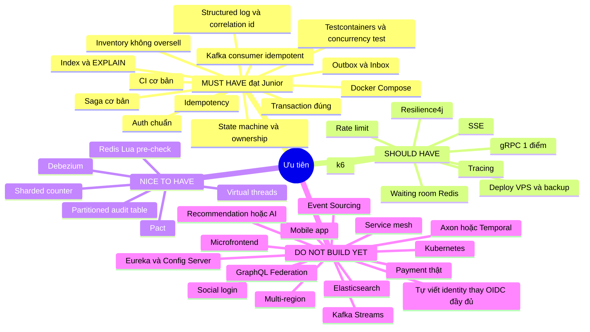
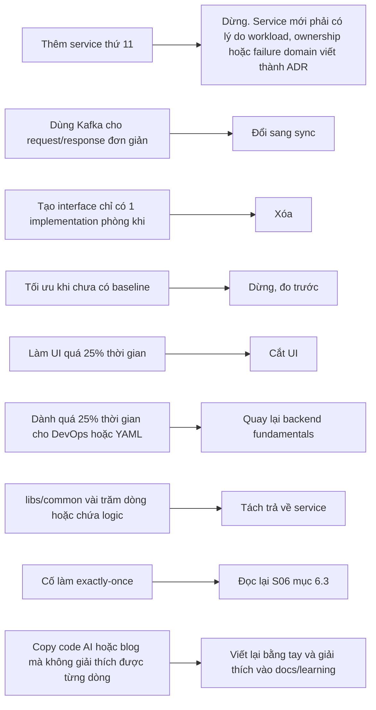
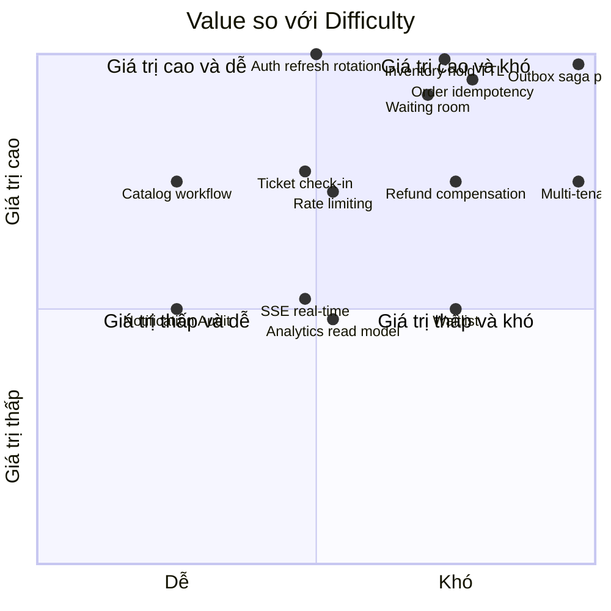

# S22 — Things Not To Build & Cảnh báo Overengineering

> Nguồn: mục "22. THINGS NOT TO BUILD & CẢNH BÁO OVERENGINEERING" (MUST/SHOULD/NICE/DO NOT BUILD, bảng tín hiệu lệch, Feature prioritization).

## A. Mục tiêu
- Phân loại kiến thức/tính năng theo mức ưu tiên và chỉ ra tín hiệu bạn đang đi lệch sang overengineering.
- Liên hệ: S13 (nhãn), S03 (thành phần không dùng), S02 (feature).

## B. Overview diagram

### S22-D1 — Bốn nhóm

## C. Detailed diagrams

### S22-D2 — Tín hiệu lệch → hành động

### S22-D3 — Feature prioritization: giá trị và độ khó
> **ĐỀ XUẤT BỔ SUNG:** biểu đồ chỉ để nhìn trực quan; tọa độ quy đổi từ thang 1–5 của bảng source (`(điểm−1)/4`) và có **jitter nhỏ** để các điểm trùng không chồng nhãn. Bảng gốc nằm ngay dưới.

| Feature | Value | Difficulty | Learning | Priority | Lý do (source) |
|---|---:|---:|---:|---:|---|
| Auth + refresh rotation | 5 | 3 | 5 | P0 | Mọi thứ phụ thuộc; kiến thức phỏng vấn dày |
| Catalog + workflow duyệt | 4 | 2 | 4 | P0 | State machine + ownership, đủ nhẹ để ra sản phẩm sớm |
| Inventory + hold TTL | 5 | 4 | 5 | P0 | Giá trị lõi + concurrency thật |
| Order + idempotency | 5 | 4 | 5 | P0 | Dual-write, idempotency |
| Outbox + saga + payment mock | 5 | 5 | 5 | P0 | Phân tán thật; khó nhất |
| Ticket + check-in | 4 | 3 | 4 | P1 | Hoàn thiện sản phẩm, bài toán duplicate scan |
| Notification/Audit | 3 | 2 | 4 | P1 | Choreography, tách side-effect |
| Waiting room | 5 | 4 | 5 | P1 | Điểm khác biệt, đẹp để demo |
| Rate limiting | 4 | 3 | 4 | P1 | Security + performance |
| SSE real-time | 3 | 3 | 4 | P1 | Frontend↔Backend thật |
| Refund/compensation | 4 | 4 | 5 | P1 | Hoàn thiện saga |
| Analytics read model | 3 | 3 | 4 | P2 | CQRS-lite |
| Waitlist khi sold-out | 3 | 4 | 4 | P2 | Event-driven + fairness |
| Multi-tenant | 4 | 5 | 4 | P3 | v4 |

## D. Giải thích sơ đồ
- **D1:** MUST là điều kiện đạt Junior; DO NOT BUILD là danh sách "đừng làm bây giờ", không phải "không bao giờ".
- **D2:** mỗi tín hiệu có hành động sửa cụ thể; chạy kiểm tra này hàng tuần.
- **D3 + bảng:** priority = `Value × Learning` cao và phụ thuộc kỹ thuật đứng trước (theo source); các mục P0 là xương sống, P3 là mở rộng.

## E. Những điều phải nhớ
- Thang điểm 1–5; "Learning" là mức kiến thức Junior học được.
- **SOURCE CHƯA QUY ĐỊNH:** công thức tính Priority chính xác (source mô tả định tính), ngưỡng chuyển P0→P1.
- Source nói "không được chỉ đánh giá cảm tính", nhưng bảng vẫn là điểm chủ quan; hãy tự hiệu chỉnh theo trải nghiệm của bạn.

## F. Liên kết
- Đầu vào: S02, S03, S13. Đầu ra: thứ tự build (S17), review hàng tuần.

## G. Checklist
- [x] 4 nhóm MUST/SHOULD/NICE/DO NOT BUILD  - [x] 9 tín hiệu lệch  - [x] bảng 14 feature  - [x] cảnh báo
