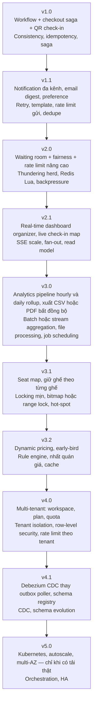

# S23 — Expansion Roadmap

> Nguồn: mục "23. EXPANSION ROADMAP (mỗi version = bài toán kỹ thuật mới)".

## A. Mục tiêu
- Mỗi version sau v1.0 phải tạo ra **bài toán kỹ thuật mới**, không chỉ thêm CRUD.
- Liên hệ: S16 (Phase 12), S02 (Advanced features), S22 (DO NOT BUILD YET).

## B. Overview diagram

### S23-D1 — Chuỗi version và bài toán mới

## C. Detailed diagrams
Không có sơ đồ chi tiết riêng: S23-D1 đã chứa mọi version và bài toán kỹ thuật mới; kiến trúc đích của từng version chưa được source mô tả.

## D. Giải thích sơ đồ
- Mỗi nút gồm **tên version**, **thay đổi** và **bài toán kỹ thuật mới**.
- Một số version quay lại chủ đề đã học ở mức sâu hơn (v2.0 về waiting room nâng cao so với Phase 8; v4.1 nhắc lại ý "thay relay bằng Debezium" của ADR-005).

## E. Những điều phải nhớ
- Không thêm tính năng chỉ vì "có thể": mỗi version phải trả lời "bài toán kỹ thuật mới là gì".
- Mục **DO NOT BUILD YET** của S22 vẫn đúng với tới khi tới version tương ứng.
- **SOURCE CHƯA QUY ĐỊNH:** thời lượng và điều kiện kích hoạt từng version; Phase 12 chỉ nhắc "v1.1 → v4" nhưng bảng còn có v5.0.

## F. Liên kết
- Đầu vào: Phase 11 (v1.0.0). Đầu ra: Phase 12.

## G. Checklist
- [x] 10 version v1.0 → v5.0  - [x] bài toán kỹ thuật mới của từng version
