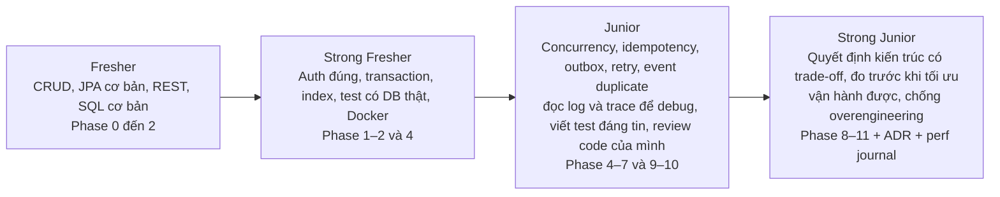
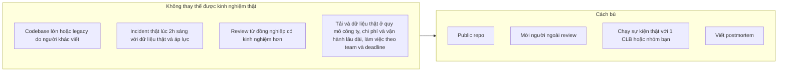

# S24 — Skill Progression: Fresher → Junior

> Nguồn: mục "24. SKILL PROGRESSION".

## A. Mục tiêu
- Map project với 4 cấp năng lực và nói rõ những gì project **không** thay thế được.
- Liên hệ: S16 (phase), S19 (interview), checklist.

## B. Overview diagram

### S24-D1 — Bốn level và phase luyện

## C. Detailed diagrams

### S24-D2 — Những gì project không thay thế được và cách bù

## D. Giải thích sơ đồ
- D1: cấp càng cao càng dịch từ "làm được" sang "giải thích, đo, quyết định và vận hành".
- D2: nhận thức giới hạn của project cá nhân và có biện pháp bù cụ thể.

## E. Những điều phải nhớ
- Các phase ở D1 chồng lấn (ví dụ Phase 4 xuất hiện ở hai level) vì cùng một phase luyện nhiều năng lực.
- **SOURCE CHƯA QUY ĐỊNH:** tiêu chí đo để xác nhận đã lên level (source dùng checklist ở cuối làm công cụ tự đánh giá).

## F. Liên kết
- Đầu vào: S16. Đầu ra: Skill Checklist.

## G. Checklist
- [x] 4 level  - [x] project giúp luyện gì  - [x] giới hạn và cách bù
