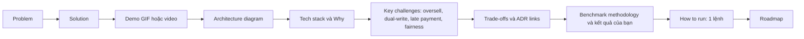
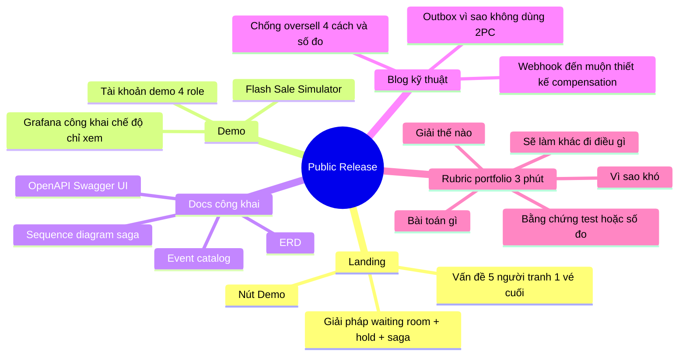

# S25 — Public Release & Portfolio

> Nguồn: mục "25. PUBLIC RELEASE & PORTFOLIO".

## A. Mục tiêu
- Biến project thành portfolio public: landing, demo, README, docs, blog; người xem hiểu trong 3 phút.
- Liên hệ: S20 (docs), S21 (deploy), Phase 11.

## B. Overview diagram

### S25-D1 — Cấu trúc README

## C. Detailed diagrams

### S25-D2 — Gói public release

## D. Giải thích sơ đồ
- D1 là câu chuyện kỹ thuật: vấn đề → giải pháp → bằng chứng → cách chạy.
- D2 gom mọi tài sản public; Flash Sale Simulator là phần demo trực quan nhất (tạo N user ảo vào phòng chờ, xem hàng đợi chảy và số vé về 0 mà không oversell).

## E. Những điều phải nhớ
- Benchmark trong README là **số của bạn** kèm cấu hình môi trường, không bịa.
- **SOURCE CHƯA QUY ĐỊNH:** tên miền, nền tảng host landing, quy định pháp lý khi mở cho người dùng thật ngoài việc dùng mock payment.

## F. Liên kết
- Đầu vào: S12 (benchmark), S20, S21. Đầu ra: Phase 11 (v1.0.0 public).

## G. Checklist
- [x] landing  - [x] demo  - [x] README  - [x] docs công khai  - [x] 3 bài blog  - [x] rubric 3 phút
