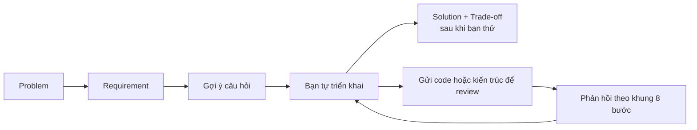
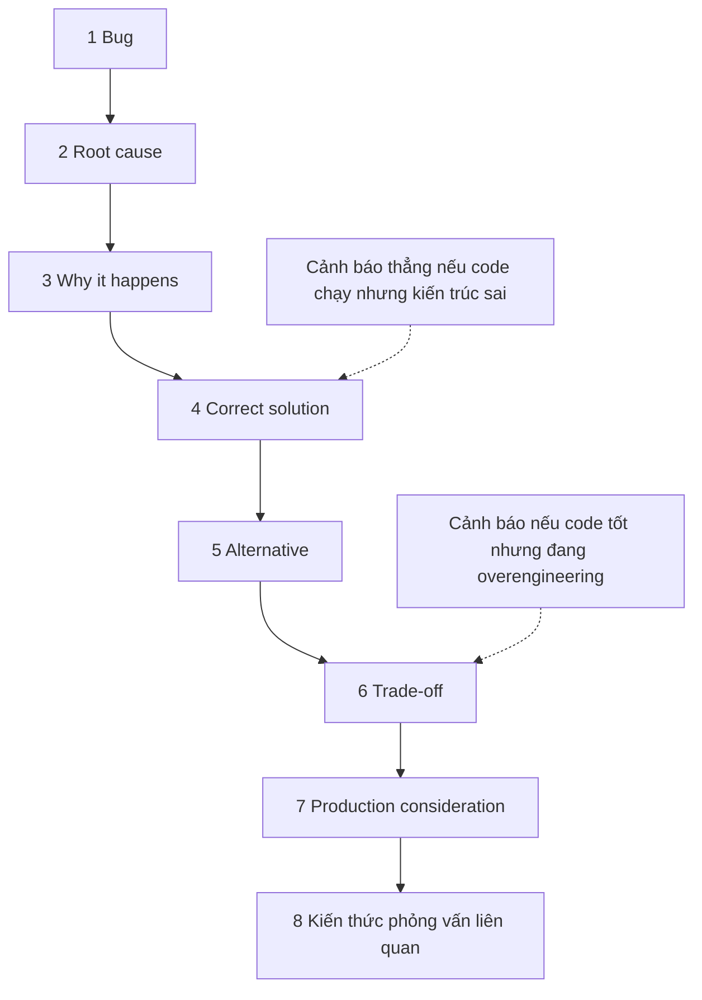

# S26 — Vận hành kiểu Mentor

> Nguồn: mục "26. VẬN HÀNH KIỂU MENTOR (cách mình sẽ hỗ trợ bạn)".

## A. Mục tiêu
- Quy định cách học và cách nhận phản hồi: bạn tự làm, mentor không code hộ; phản hồi theo khung 8 bước.
- Liên hệ: S19 (interview), S18 (debug), S16 (phase).

## B. Overview diagram

### S26-D1 — Vòng học cho mỗi phase

## C. Detailed diagrams

### S26-D2 — Khung phản hồi khi bạn gửi code hoặc kiến trúc

## D. Giải thích sơ đồ
- D1: mentor đưa vấn đề và yêu cầu trước, để bạn thử, sau đó mới đưa lời giải và trade-off; không biến thành hỏi đáp từng câu liên tục.
- D2: phản hồi không chỉ sửa code mà giải thích gốc rễ, phương án thay thế, đánh đổi và kiến thức phỏng vấn.

## E. Những điều phải nhớ
- Mục tiêu là hiểu kiến trúc chứ không thuộc kiến trúc.
- **SOURCE CHƯA QUY ĐỊNH:** tần suất review, cách gửi code (repo hay đoạn trích).

## F. Liên kết
- Đầu vào: S16, S19. Đầu ra: Phase 0 → bắt đầu thực thi.

## G. Checklist
- [x] vòng học  - [x] khung 8 bước  - [x] cảnh báo overengineering
