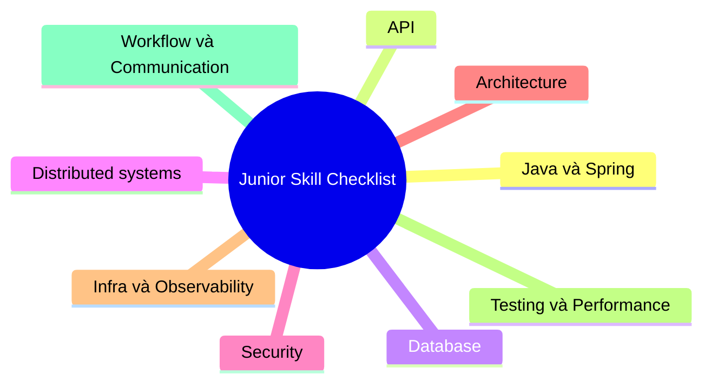

# CL — Junior Backend Skill Checklist

> Nguồn: mục "JUNIOR BACKEND SKILL CHECKLIST". Đánh dấu `[x]` chỉ khi bạn **tự giải thích được bằng lời** và **có test hoặc bằng chứng** trong repo.

## A. Mục tiêu
- Theo dõi tiến độ năng lực trong suốt project, chia thành 9 nhóm.
- Liên hệ: S13 (knowledge map), S16 (phase), S19 (interview), S24.

## B. Overview diagram

### CL-D1 — Chín nhóm checklist

## C. Checklist chi tiết

### Java và Spring
- [ ] Giải thích DI, bean scope/lifecycle, vì sao self-invocation làm `@Transactional` không chạy
- [ ] Thiết kế exception hierarchy + `@RestControllerAdvice` trả problem+json
- [ ] Dùng `ExecutorService`/`CompletableFuture` đúng (timeout, xử lý lỗi, không nuốt exception)
- [ ] Đọc thread dump/heap dump cơ bản, tìm 1 leak thật (bug #4)
- [ ] Profiles, externalized config, không hardcode secret

### API
- [ ] Idempotency-Key cho POST nhạy cảm, có test song song
- [ ] Cursor pagination + filter/sort an toàn (chống injection, whitelist field)
- [ ] Error model thống nhất, versioning, OpenAPI chính xác
- [ ] Rate limit + trả `429 Retry-After`

### Database
- [ ] Giải thích và demo Read Committed vs Repeatable Read bằng 2 session
- [ ] Optimistic vs pessimistic lock — cài cả hai, đo cả hai
- [ ] Đọc `EXPLAIN (ANALYZE, BUFFERS)`, thêm index đúng, chứng minh bằng số
- [ ] Phát hiện và sửa N+1 có test đếm query
- [ ] Flyway migration backward-compatible
- [ ] Dùng `SKIP LOCKED` cho worker nhiều instance
- [ ] Hiểu connection pool, cấu hình có lý do

### Distributed systems
- [ ] Không còn dual-write (dùng Outbox) — có test crash giữa chừng
- [ ] Consumer idempotent — có test duplicate ×10
- [ ] Giải thích at-least-once, ordering theo partition key, rebalance
- [ ] Retry với backoff + jitter, DLQ + công cụ replay
- [ ] Circuit breaker/timeout/bulkhead — có test mô phỏng downstream chậm
- [ ] Saga có compensation (thanh toán muộn, phát hành vé fail)
- [ ] Giải thích vì sao không dùng 2PC; CAP và eventual consistency trong chính project này
- [ ] Local read model (replica từ event) và hiểu hệ quả

### Security
- [ ] Access/refresh token đúng, rotation + reuse detection
- [ ] Ownership/ABAC check ở service, không chỉ ở gateway
- [ ] Không tin dữ liệu danh tính từ client; chặn IDOR (có test)
- [ ] Webhook signature + dedupe; CORS/CSRF đúng; secret ngoài repo
- [ ] Password hashing đúng chuẩn

### Architecture
- [ ] Giải thích boundary và ownership từng service, vì sao không tách thêm
- [ ] Phân biệt orchestration/choreography và chọn có lý do
- [ ] ≥ 10 ADR có trade-off thật
- [ ] Phát hiện và gỡ ≥ 1 chỗ overengineering của chính mình

### Infra và Observability
- [ ] `docker compose up` chạy cả hệ thống; healthcheck/readiness đúng
- [ ] Trace 1 request qua HTTP → gRPC → Kafka bằng correlationId
- [ ] Dashboard: latency p95/p99, error rate, consumer lag, outbox backlog
- [ ] Alert cho DLQ, order kẹt, lag
- [ ] CI chạy unit + integration (Testcontainers); deploy tự động; backup + restore đã thử

### Testing và Performance
- [ ] Concurrency test chống oversell ổn định (chạy ≥ 20 lần không flaky)
- [ ] Integration test dùng Postgres/Kafka/Redis thật
- [ ] E2E happy path + ≥ 3 failure path
- [ ] Perf journal ≥ 4 bài: baseline → bottleneck → fix → đo lại
- [ ] k6 load test waiting room + checkout, kèm cấu hình môi trường

### Workflow và Communication
- [ ] Mọi thay đổi qua PR có checklist; commit theo convention
- [ ] Runbook troubleshooting ≥ 5 tình huống
- [ ] ≥ 5 postmortem từ bug lab
- [ ] README đạt rubric 3 phút; có ít nhất 1 người ngoài review repo
- [ ] Trả lời trôi chảy 10 câu "xương sống" ở S19 mà không cần nhìn tài liệu

## D. Giải thích
- Mỗi mục gắn với một phase: ví dụ "Concurrency test" ↔ Phase 4, "Outbox + duplicate ×10" ↔ Phase 6, "Trace qua Kafka" ↔ Phase 9, "Postmortem" ↔ Phase 10.

## E. Những điều phải nhớ
- Đánh dấu khi có **bằng chứng** (test, số đo, ADR), không đánh dấu theo cảm giác.
- **SOURCE CHƯA QUY ĐỊNH:** mục nào thuộc phase nào (mình ghi ở phần D là gợi ý), điểm đạt tổng.

## F. Liên kết
- Đầu vào: S13, S16, S19, S24. Đầu ra: theo dõi tiến độ liên tục.

## G. Checklist đối chiếu
- [x] 9 nhóm  - [x] toàn bộ mục của source
