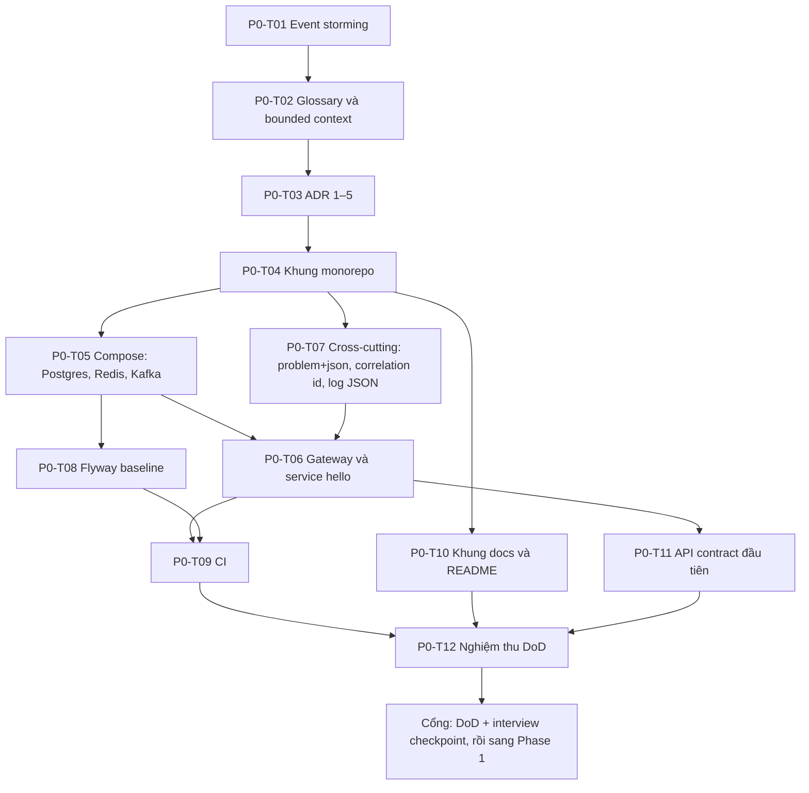
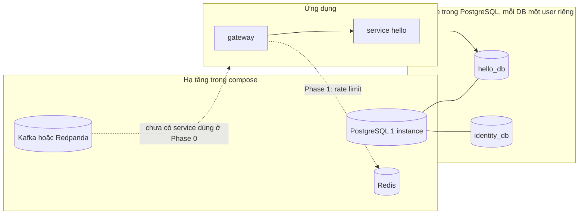
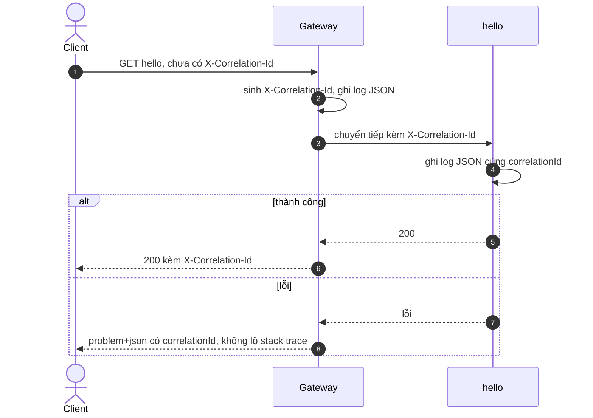
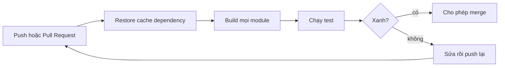
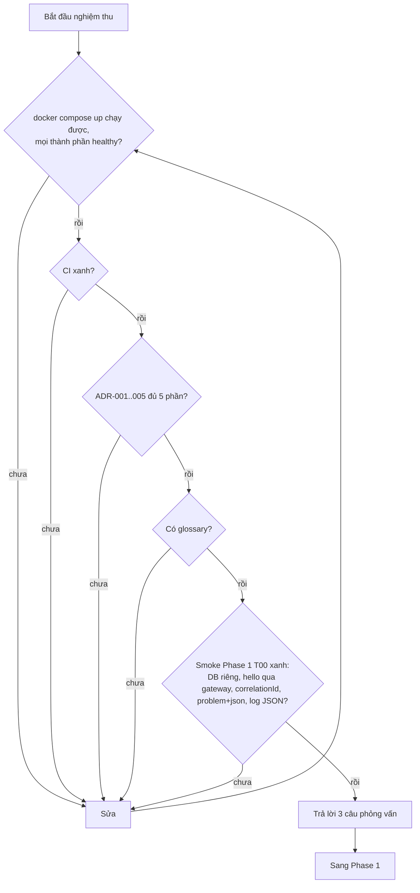

# PHASE 0 — Requirement & Skeleton design: Tài liệu khởi động

> Nguồn: Phase 0 (S16), S17 bước 1, S03 (monorepo, hexagonal-nhẹ), S05 (database-per-service), S06/S09 (error model, correlation id), S20 (ADR, docs). Nhãn: **ĐỀ XUẤT BỔ SUNG** = mình bổ sung; **SOURCE CHƯA QUY ĐỊNH** = source không nêu, bạn tự chốt.
> Nguyên tắc mentor: mình đưa **Problem → Requirement → câu hỏi gợi mở**; bạn tự làm, tự viết lý do; đáp án/trade-off chỉ xem sau khi đã thử.

## 1. Mục tiêu, phạm vi, tiêu chí
- **Goal (source):** chốt scope, domain language, API contract đầu tiên, repo + infra tối thiểu. Độ khó ★★☆☆☆, ≈ 1 tuần.
- **Features (source):** event storming 1 buổi (giấy hoặc Excalidraw) liệt kê domain event của checkout · vẽ bounded context · viết 5 ADR đầu.
- **Architecture (source):** monorepo, docker-compose (Postgres, Redis, Kafka), 1 service "hello" chạy qua gateway.
- **Coding tasks (source):** dựng repo/CI build · error response problem+json · correlation id filter · logging JSON · Flyway baseline · khung `docs/`.
- **DoD (source):** `docker compose up` chạy được · CI xanh · ADR-001..005 · có glossary.
- **Ngoài phạm vi:** bất kỳ logic nghiệp vụ nào (auth, catalog, inventory…). Phase 0 chỉ dựng nền và ra quyết định.

### PH0-D1 — Đồ thị task và cổng ra

## 2. Quyết định cần chốt sớm (ghi vào ADR hoặc README)
| # | Quyết định | Source | Lựa chọn | Gợi ý |
|---|---|---|---|---|
| 1 | Build tool | chỉ nhắc cache Maven/Gradle | Maven hoặc Gradle | Chọn 1, dùng cho toàn bộ service |
| 2 | Kafka hay Redpanda | "Kafka KRaft; Redpanda nhẹ hơn nếu máy yếu" | tùy RAM máy | Đo RAM trước; nếu tight thì Redpanda |
| 3 | Tạo DB cho service nào ở Phase 0 | "Postgres nhiều database, tách logic" | tạo tất cả · chỉ tạo khi cần | Chỉ tạo `hello_db` và `identity_db` (Phase 1 cần); mỗi DB một user riêng |
| 4 | Chuẩn log JSON | "Logback JSON" | tên field cụ thể | Dùng bộ field ở S09-D2 |
| 5 | Đặt tên package/module | S03: api, application, domain, infrastructure, config | — | Giữ đúng 5 thư mục này |
| 6 | Kafka có chạy trong compose ở Phase 0 không | source: compose gồm Kafka | có · chưa | Có, nhưng chưa có service nào dùng; chỉ cần healthy |

## 3. Task chi tiết
(Đường dẫn file/module là **đề xuất**. Mỗi task có test hoặc bằng chứng cụ thể trước khi sang task kế.)

### P0-T01 — Event storming checkout
- **Problem:** chưa ai thống nhất "chuyện gì xảy ra" trong checkout nên dễ chia service sai.
- **Requirement:** trên giấy/Excalidraw, liệt kê domain event (động từ quá khứ), command, actor, aggregate, và các điểm "đau" (chỗ có thể fail).
- **Câu hỏi gợi mở (tự trả lời trước):** Event nào xảy ra *trước* khi user trả tiền? Chuyện gì xảy ra nếu hết hạn giữ chỗ? Ai là actor, hệ thống nào là actor ngoài (payment provider)? Dữ liệu nào "thuộc" về ai?
- **Output:** ảnh/file board + danh sách event + danh sách điểm đau.
- **Pass:** bạn tự kể được luồng checkout từ đầu đến cuối bằng event, kể cả 2 nhánh lỗi. *Đối chiếu sau khi làm xong:* S04 (luồng checkout) và S06 mục 6.1.

### P0-T02 — Glossary và bounded context
- **Requirement:** viết `docs/glossary.md` (thuật ngữ tiếng Việt/Anh nhất quán: Event, Tier, Hold, Order, Payment, Ticket, Admission token…); gom event thành các nhóm thuộc về cùng một ngữ cảnh.
- **Câu hỏi gợi mở:** Từ "Order" có nghĩa giống nhau ở catalog, inventory, payment không? Nếu hai nhóm dùng cùng từ nhưng khác nghĩa thì đó có phải ranh giới không?
- **Pass:** mỗi thuật ngữ có đúng một định nghĩa; mỗi bounded context có chủ sở hữu dữ liệu rõ ràng. *Đối chiếu:* S03-D3, D4, S05-D1.

### P0-T03 — ADR-001..005
- **Requirement:** mỗi ADR có Context · Decision · Alternatives · Trade-offs · Consequences (S20-D5). Viết **trước khi** xem ví dụ ở S20.
- **Danh sách và câu hỏi gợi mở:**
| ADR | Chủ đề | Câu hỏi gợi mở |
|---|---|---|
| 001 | Microservices ngay từ đầu, chấp nhận chi phí vận hành | Bạn mất gì so với modular monolith? Vì sao vẫn chọn? |
| 002 | Database-per-service, cấm cross-DB | Nếu A cần dữ liệu của B thì làm sao mà không đọc DB của B? |
| 003 | PostgreSQL là source of truth tồn kho, Redis chỉ tăng tốc | Nếu Redis mất dữ liệu thì chuyện gì xảy ra với số vé? |
| 004 | Orchestrated saga cho checkout, choreography cho side-effect | Khi nào ai điều khiển ai, và khi nào chỉ "nghe"? |
| 005 | Transactional Outbox thay vì dual-write/2PC | Điều gì xảy ra nếu service chết giữa "ghi DB" và "gửi Kafka"? |
- **Pass:** 5 ADR đủ 5 phần, mỗi ADR nêu ≥ 2 phương án thay thế và 1 cái giá phải trả.

### P0-T04 — Khung monorepo
- **Requirement:** thư mục `services/`, `libs/`, `web/`, `tools/`, `infra/`, `docs/` (S03-D9); mỗi service có 5 thư mục api/application/domain/infrastructure/config; `.gitignore`, `.env.example`.
- **Pass:** cấu trúc đúng; không có file bí mật; `libs/` chỉ chứa `event-contracts` (rỗng) và `common-web`.
- **Lỗi hay gặp:** nhét entity vào lib dùng chung (source cảnh báo).

### P0-T05 — Compose hạ tầng
- **Requirement:** Postgres (1 instance, nhiều database, **user riêng cho từng DB**), Redis, Kafka (KRaft hoặc Redpanda); healthcheck cho cả ba; cấu hình bằng biến môi trường.
- **Câu hỏi gợi mở:** Vì sao dùng một user cho mọi DB là sai ngay từ đầu (liên hệ ADR-002)?
- **Test:** `docker compose up -d` rồi mọi container healthy; kết nối vào `hello_db` bằng user của nó thành công, vào DB khác bằng user đó bị từ chối.
- **Pass:** ba thành phần healthy; quyền DB tách thật.

### PH0-D2 — Hạ tầng compose

### P0-T06 — Gateway và service hello
- **Requirement:** gateway (Spring Cloud Gateway) route `/hello` tới service hello; hello trả một JSON đơn giản và có `health`.
- **Test:** gọi qua gateway nhận 200; gọi thẳng hello (nếu port mở trong dev) vẫn chạy nhưng **production không expose** (S07-D7).
- **Pass:** đi được toàn tuyến client → gateway → hello.

### P0-T07 — Cross-cutting: problem+json, correlation id, log JSON
- **Requirement:** (1) mọi lỗi trả `application/problem+json` (type, title, status, detail, instance, `correlationId`, `errors[]` cho lỗi field); (2) filter sinh `X-Correlation-Id` nếu thiếu và truyền tiếp; (3) log JSON có timestamp, level, service, correlationId, traceId.
- **Câu hỏi gợi mở:** Vì sao correlationId phải sinh ở gateway chứ không phải ở service? Trường nào **không** được đưa vào log?
- **Test:** gửi request không có header ⇒ response có header; log của gateway và hello cùng một correlationId; gây lỗi ⇒ body là problem+json, không có stack trace.
- **Pass:** 3 test xanh. *Đối chiếu:* S09-D2.

### PH0-D3 — Hello đi qua gateway

### P0-T08 — Flyway baseline
- **Requirement:** mỗi service có DB riêng và migration `V1` (baseline); không để Hibernate tự sinh schema.
- **Test:** khởi động Hello với `hello_db` trống thì Flyway ghi V1 vào `flyway_schema_history`. Khởi động lại Hello để kiểm tra V1 giữ nguyên. Migration của Identity thực hiện ở Phase 1.
- **Pass:** migration chạy sạch và lặp lại được.

### P0-T09 — CI
- **Requirement:** pipeline build + test, có **cache dependency** Maven/Gradle (optimization của source); chạy trên mỗi PR.
- **Test:** push một thay đổi nhỏ ⇒ CI xanh; lần chạy thứ hai nhanh hơn rõ rệt nhờ cache (đo và ghi số của bạn, không bịa).
- **Pass:** CI xanh, có cache. *Mở rộng sau:* S21-D2.

### PH0-D4 — Pipeline CI tối thiểu của Phase 0

### P0-T10 — Khung docs và README
- **Requirement:** cây `docs/` đúng S20-D3 (architecture, api, database, decisions, deployment, troubleshooting, learning) và `README.md` nêu cách chạy bằng 1 lệnh.
- **Pass:** người lạ làm theo README chạy được `docker compose up`.

### P0-T11 — API contract đầu tiên
- **Requirement:** viết hợp đồng cho những gì Phase 0 thật sự có: endpoint hello/health, **error model problem+json**, header `X-Correlation-Id`. 
- **Ghi chú:** source chỉ nói "API contract đầu tiên" mà không nêu nội dung (**SOURCE CHƯA QUY ĐỊNH**); hợp đồng nghiệp vụ đầu tiên thật sự (auth) nằm ở Phase 1.
- **Pass:** có file spec (OpenAPI) lint sạch, mô tả cả response lỗi.

### P0-T12 — Nghiệm thu
### PH0-D5 — Cổng ra Phase 0

## 4. Lỗi thường gặp (source) và biện pháp
| Lỗi | Vì sao tệ | Cách tránh |
|---|---|---|
| Tạo shared lib nhét entity | Biến thành distributed monolith | `libs/` chỉ có event-contracts và common-web mỏng |
| Cấu hình 1 DB dùng chung mọi service | Phá database-per-service, không deploy độc lập được | DB riêng, user riêng |
| ĐỀ XUẤT: bật quá nhiều thứ ở Phase 0 | Over-engineering | Chỉ dựng đúng DoD; không thêm service thứ hai |
| ĐỀ XUẤT: bỏ qua ADR vì "ai cũng biết" | Không giải thích được kiến trúc khi phỏng vấn | Viết trước khi code |

## 5. Optimization (source)
Cache layer của Maven/Gradle trong CI: đo thời gian build có/không cache, ghi vào `docs/learning/perf-journal.md` bằng **số của bạn**.

## 6. Câu hỏi phỏng vấn mẫu (source) và tự kiểm tra thêm
Source: **Bounded context là gì? Vì sao mỗi service 1 DB? 12-factor app gồm những gì?**
Mình thêm (ĐỀ XUẤT): Vì sao correlationId sinh ở gateway? Vì sao ADR quan trọng hơn sơ đồ? Nếu bạn dựng mọi service trong Phase 0 thì mất gì?
Bộ phỏng vấn đầy đủ (10 lý thuyết, 10 project, 5 debugging, 5 system design, 5 production) mình tạo khi bạn báo xong Phase 0.

## 7. Checklist chạy và rà soát
- [ ] `docker compose up -d` ⇒ Postgres, Redis, Kafka/Redpanda healthy
- [ ] `hello_db` và `identity_db` có user riêng, quyền tách thật
- [ ] Gọi hello qua gateway; header `X-Correlation-Id` có mặt; log hai nơi cùng id
- [ ] Gây lỗi ⇒ problem+json, không stack trace
- [ ] Flyway baseline chạy sạch, lặp lại được
- [ ] CI xanh, có cache; ghi số đo
- [ ] ADR-001..005, glossary, `docs/` khung, README chạy được bằng 1 lệnh
- [ ] Không có secret trong repo; có `.env.example`

## E. Những điều phải nhớ
- Phase 0 là phase của **quyết định và nền móng**; làm vội ở đây sẽ trả giá ở mọi phase sau.
- Mọi lỗi từ đây trở đi dùng chung một error model và một correlationId; Phase 1 dựa vào chúng.
- **SOURCE CHƯA QUY ĐỊNH:** build tool, nội dung "API contract đầu tiên", bộ field log chi tiết, quyết định Kafka vs Redpanda, tên bảng/file cụ thể.
