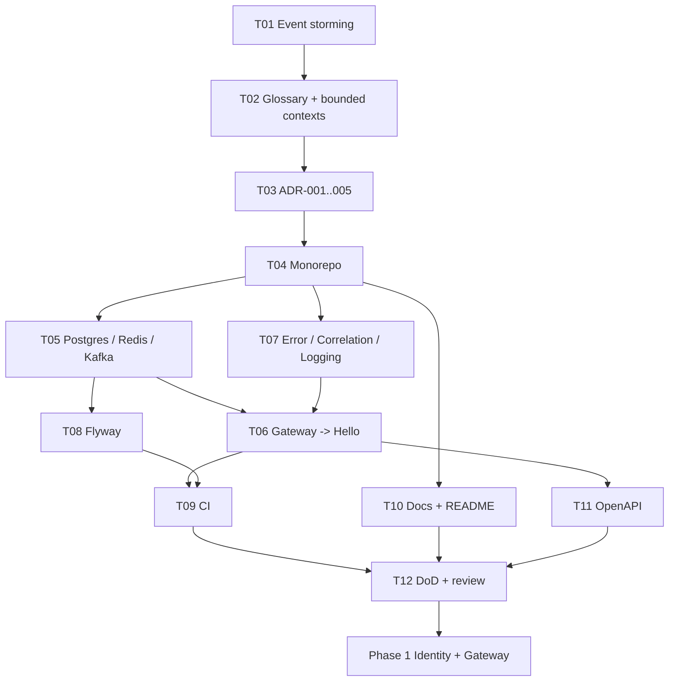
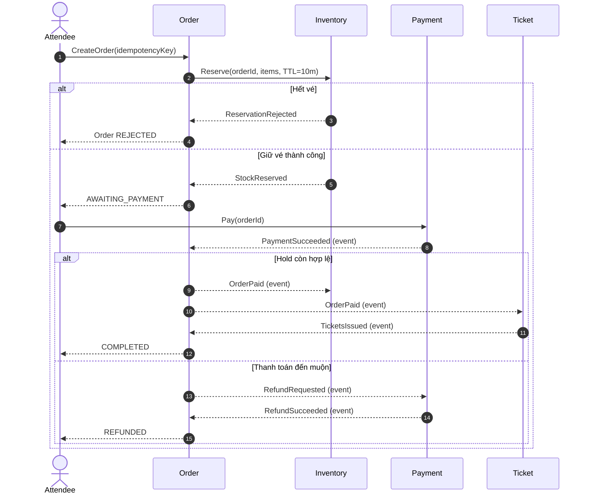
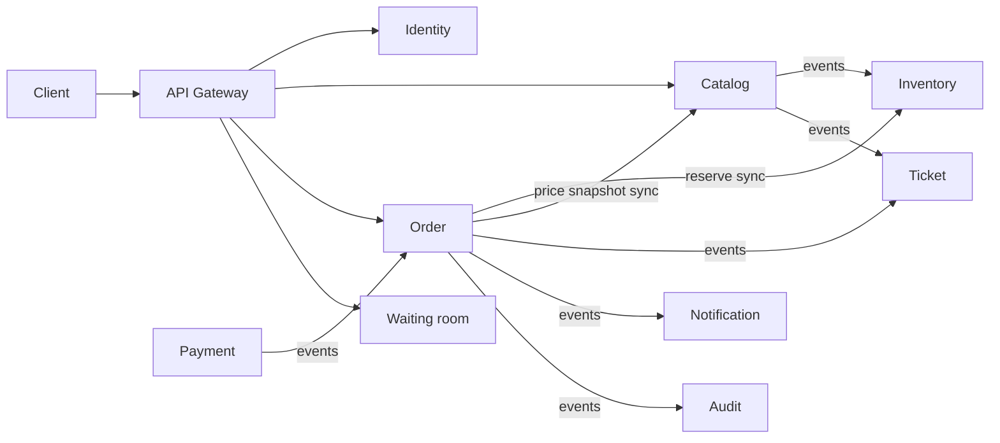
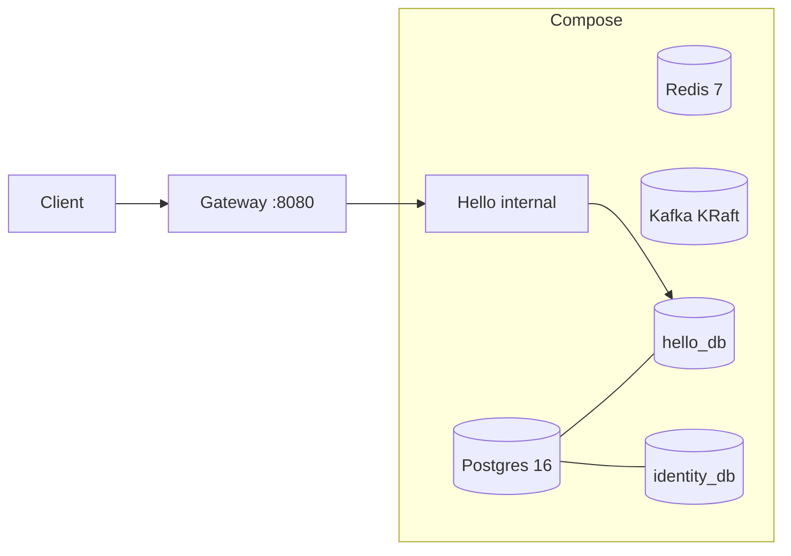
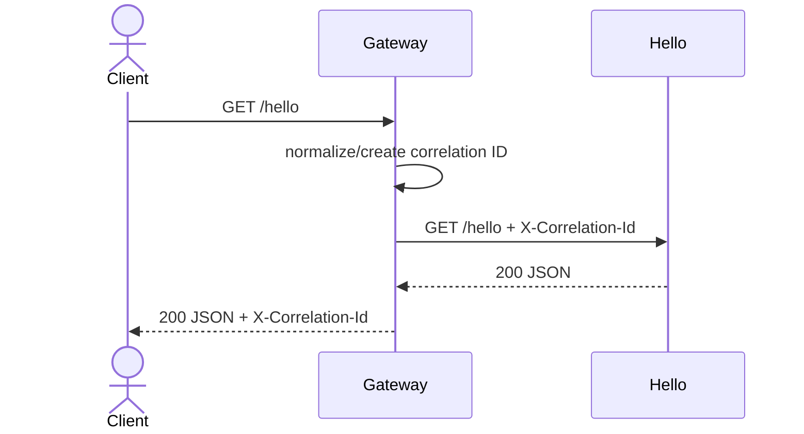
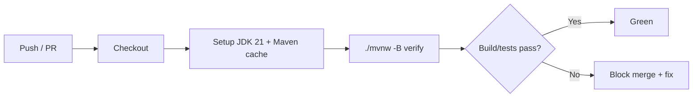

# QFLOW — PHASE 0: REQUIREMENT & SKELETON DESIGN

> **Tài liệu thiết kế đã giải quyết P0-T01 → P0-T12** · Phiên bản 1.0 · Dự án QFlow — nền tảng bán vé sự kiện cộng đồng có fair waiting room.
>
> **Nguồn:** `PHASE 0 — Requirement & Skeleton design: Tài liệu khởi động` và `QFLOW — PROJECT BLUEPRINT` do chủ dự án cung cấp. Giữ nguyên định hướng microservices từ đầu, walking skeleton, database-per-service, Java 21 / Spring Boot 3.x / PostgreSQL 16 / Redis 7 / Kafka KRaft / Docker Compose / GitHub Actions.
>
> **Trạng thái:** Thiết kế Phase 0 đã được ghi lại trong tài liệu này. Kết quả kiểm tra CI và quickstart được cập nhật ở P0-T09 và P0-T10. Ma trận P0-T12 vẫn dùng cho nghiệm thu toàn phase.

## Quy ước đọc

- **[SOURCE]**: yêu cầu hoặc quyết định có trong tài liệu nguồn.
- **[CHỐT THIẾT KẾ]**: lựa chọn cụ thể cho QFlow trong tài liệu này; cần xác nhận khi thực hiện, không giả định nguồn đã quyết định.
- **[ĐỀ XUẤT BỔ SUNG]**: chi tiết thiết kế, cấu trúc file, schema, test hoặc quy trình nhằm lấp khoảng trống triển khai.
- **[CHỜ CODE/VERIFY]**: chỉ hoàn thành khi có mã nguồn, chạy thử hoặc bằng chứng kiểm thử.

## 1. Mục tiêu, phạm vi, cổng ra Phase 0

**Mục tiêu [SOURCE]:** thống nhất domain language và ranh giới service, quyết định kiến trúc, dựng monorepo và hạ tầng tối thiểu; một `hello-service` đi qua Gateway; có CI, chuẩn lỗi, correlation ID, JSON logging, Flyway baseline, README và bộ docs.

**Không thuộc Phase 0 [SOURCE]:** đăng ký/đăng nhập, JWT, RBAC, catalog nghiệp vụ, giữ vé, thanh toán, phát vé, waiting room vận hành, consumer Kafka, saga runtime. Chỉ mô hình hóa những luồng này để xác định ranh giới và quyết định nền tảng.

**Đầu ra tài liệu đã chốt:** event storming checkout; glossary; bounded context và ownership; ADR-001…005; monorepo tree; cấu hình hạ tầng được mô tả; route hello/health; quy tắc problem+json, correlation ID và JSON log; chiến lược Flyway; thiết kế CI; khung docs; API contract; ma trận nghiệm thu.

**Cổng ra Phase 0 [SOURCE]:** `docker compose up` chạy được, CI xanh, 5 ADR và glossary; bản task chi tiết còn yêu cầu DB isolation, hello qua gateway, correlation ID, problem+json, log JSON, Flyway và OpenAPI. **Đây là tiêu chí tương lai, không phải kết quả đã đạt.**



---

# P0-T01 — EVENT STORMING CHECKOUT

## Problem → Requirement → Kết quả

**Problem:** không thể tách bounded context đúng nếu chưa hiểu ai làm gì, dữ liệu thuộc về ai, những điểm bất đồng bộ và tình huống thất bại của checkout.

**Requirement [SOURCE]:** liệt kê actor, command, domain event (động từ quá khứ), aggregate, điểm đau; giải thích luồng checkout chính và tối thiểu hai nhánh lỗi.

### Actors và external systems

| Actor | Hành động | Quyền/phạm vi |
|---|---|---|
| GUEST | Xem sự kiện công khai | Không mua vé |
| ATTENDEE | Vào hàng chờ, tạo order, thanh toán, xem vé | Chỉ dữ liệu của mình |
| ORGANIZER | Tạo sự kiện/tier, gửi duyệt, quản lý sự kiện sở hữu | Không tự duyệt |
| MODERATOR | Duyệt/từ chối sự kiện | Không xử lý tiền |
| EVENT_STAFF | Check-in vé của sự kiện được gán | Không đọc dữ liệu thanh toán |
| ADMIN | Quản trị và xử lý vận hành | Có audit |
| SYSTEM | Worker expire/reconcile/replay | Machine identity, không mượn token user |
| Mock Payment Provider | Gửi webhook kết quả thanh toán | Hệ thống ngoài, phải xác thực chữ ký |

### Timeline command → event → owner

| Bước | Command/trigger | Domain event (đã xảy ra) | Aggregate / owner |
|---|---|---|---|
| 1 | Organizer tạo event | `EventCreated` | Event / catalog |
| 2 | Organizer submit | `EventSubmittedForReview` | Event / catalog |
| 3 | Moderator approve | `EventPublished` | Event / catalog |
| 4 | Scheduler mở bán | `EventSaleStarted` | Event / catalog |
| 5 | Attendee join queue (phase sau) | `QueueJoined` | QueueEntry / waiting-room |
| 6 | Waiting room admit | `AttendeeAdmitted` | Admission / waiting-room |
| 7 | Attendee tạo order | `OrderCreated` | Order / order |
| 8 | Order yêu cầu reserve | `StockReserved` hoặc `ReservationRejected` | TierStock + Hold / inventory |
| 9 | Order nhận reserve OK | `OrderAwaitingPayment` | Order / order |
| 10 | Attendee yêu cầu thanh toán | `PaymentCreated` | Payment / payment |
| 11 | Provider webhook thành công | `PaymentSucceeded` | Payment / payment |
| 12 | Order tiếp nhận payment | `OrderPaid` | Order / order |
| 13 | Inventory commit hold | `StockCommitted` | Hold / inventory |
| 14 | Ticket phát hành | `TicketsIssued` | Ticket / ticket |
| 15 | Order hoàn tất | `OrderCompleted` | Order / order |
| 16 | Notification/Audit nghe event | `NotificationCreated`, `AuditEntryRecorded` (tên đề xuất) | Notification / audit |

**Lưu ý:** bảng là **event storming toàn sản phẩm**, không phải yêu cầu phải code những event này trong Phase 0. Tên `QueueJoined`, `AttendeeAdmitted`, `NotificationCreated`, `AuditEntryRecorded` là **[ĐỀ XUẤT BỔ SUNG]**; blueprint chỉ chốt một số topic và event chính.

### Nhánh lỗi quan trọng

1. **Hết vé:** inventory atomic reserve thất bại → `ReservationRejected` → order `REJECTED`; không tạo payment. Không được đọc số vé cache rồi coi đó là quyết định.
2. **Hold hết hạn:** hold `ACTIVE → EXPIRED`, tồn kho được nhả đúng một lần; order `EXPIRED`. Nếu `PaymentSucceeded` đến muộn, **[CHỐT THIẾT KẾ]** không hồi sinh order; phát yêu cầu hoàn tiền và chuyển `REFUND_PENDING → REFUNDED` khi refund thành công.
3. **Order crash sau reserve:** inventory đã có hold nhưng order chưa chuyển `AWAITING_PAYMENT`; reconciler hỏi lại trạng thái theo `orderId`, khôi phục hoặc để hold hết hạn/giải phóng theo trạng thái. Không reserve lần hai với ID khác.
4. **Webhook trùng:** dedupe bằng `provider_event_id`, xử lý idempotent; cùng payment không được phát `PaymentSucceeded` nhiều lần về mặt nghiệp vụ.
5. **Kafka down:** payment/order ghi DB + outbox trong cùng transaction; relay gửi bù sau, không dual-write trực tiếp.
6. **Ticket-service down:** order có thể ở `PAID` trong thời gian chờ; retry/DLQ/reconciliation, không tạo vé trùng; nếu không thể hoàn tất thì compensation theo chính sách.



**Pain points cần giữ cho các phase sau:** contention stock, duplicate click, webhook duplicate, crash giữa hai transaction, late payment, Kafka outage, stale read model, consumer retry. **Phase 0 chỉ ghi nhận thiết kế.**

**Bằng chứng khi triển khai:** `docs/architecture/event-storming-checkout.md` + board ảnh/Excalidraw (nếu muốn), có ít nhất 2 failure path. **[CHỜ CODE/VERIFY]** Không cần code cho T01.

---

# P0-T02 — GLOSSARY VÀ BOUNDED CONTEXT

## Glossary thống nhất

| Thuật ngữ | Định nghĩa dùng trong QFlow | Chủ sở hữu |
|---|---|---|
| Event | Sự kiện được tổ chức và bán vé; không đồng nghĩa Kafka message | catalog |
| Domain event | Sự kiện nghiệp vụ đã xảy ra, ví dụ `OrderPaid` | service phát sinh |
| Ticket tier | Loại vé của một Event, gồm giá, quota và giới hạn mua | catalog |
| TierStock | Trạng thái tồn kho có tính nhất quán của một tier | inventory |
| Available | `total - reserved - sold`, tính từ nguồn sự thật | inventory |
| Hold / Reservation | Phần vé được giữ tạm cho một order, có TTL | inventory |
| Order | Ý định mua và trạng thái checkout, lưu snapshot giá | order |
| Order item | Dòng vé trong order, gồm tier ID, tên và đơn giá snapshot | order |
| Payment | Giao dịch với provider; không đồng nghĩa order đã hoàn tất | payment |
| Refund | Nghiệp vụ trả lại tiền cho payment | payment |
| Ticket | Quyền tham dự được phát hành sau khi order paid | ticket |
| Check-in | Ghi nhận một ticket đã được sử dụng tại cổng | ticket |
| Waiting room | Hàng đợi điều tiết lượng người được vào checkout | waiting-room |
| Admission token | Bằng chứng được phép vào bước mua, có ký và TTL | waiting-room |
| Organizer profile | Hồ sơ ban tổ chức và trạng thái xác minh | identity |
| Correlation ID | Mã truy vết một request xuyên các thành phần | gateway tạo, mọi service truyền |
| Aggregate | Ranh giới dữ liệu/quy tắc cần nhất quán trong một transaction | từng domain |
| Bounded context | Ranh giới nơi thuật ngữ, quy tắc và ownership có nghĩa thống nhất | kiến trúc |
| Saga | Quy trình nhiều local transaction có điều phối và bù trừ | order |
| Outbox | Bảng lưu event cùng transaction với thay đổi nghiệp vụ | producer service |
| Inbox / processed_events | Dấu vết consumer đã xử lý event để chống lặp | consumer service |
| Idempotency key | Khóa đại diện cho một ý định request, retry không tạo kết quả mới | order/payment |
| Source of truth | Nguồn dữ liệu quyết định cuối cùng | PostgreSQL theo service |

**Phân biệt bắt buộc:** `Event` (sự kiện biểu diễn buổi biểu diễn/workshop) khác `domain event` (thông điệp nghiệp vụ). `Tier` mô tả sản phẩm bán ở catalog; `TierStock` quyết định còn vé ở inventory. `PaymentSucceeded` không có nghĩa ticket đã được phát hành.

## Context map và ownership

| Bounded context | Dữ liệu sở hữu | Không được làm |
|---|---|---|
| Identity | users, credentials, roles, organizer profiles, refresh tokens | Không giữ event/ticket |
| Catalog | events, tiers, review, staff assignment | Không tự trừ tồn kho |
| Waiting room | queue, admission | Không quyết định stock |
| Inventory | stock, hold, expiry, purchase counters | Không tính giá từ catalog DB |
| Order | orders, order items, saga state, price snapshot | Không tự sửa stock/payment DB |
| Payment | payment, webhook, refund | Không phát hành ticket |
| Ticket | ticket, QR, check-in | Không quyết định payment |
| Notification | notification/delivery | Không làm hỏng checkout nếu lỗi gửi |
| Audit | append-only audit records | Không sửa nguồn nghiệp vụ |
| API Gateway (technical edge) | route, request metadata, authN coarse, rate limit | Không sở hữu dữ liệu nghiệp vụ |

**[SOURCE]** Mỗi service có DB và DB user riêng; không cross-DB join/FK. Tham chiếu qua UUID, API hoặc local read model cập nhật từ event.



**Quy tắc tách context [SOURCE]:** không tách pricing/search/venue thành service riêng; không tạo shared JPA entities; không sync call vòng; gateway không được thành business orchestrator. Phase 0 chỉ code Gateway + Hello, những context khác là bản đồ định hướng.

**Bằng chứng thiết kế:** `docs/glossary.md`, `docs/architecture/context-map.md`. **[CHỜ CODE/VERIFY]** đưa file vào repo.

---

# P0-T03 — NĂM ARCHITECTURE DECISION RECORDS (ADR)

> Cấu trúc theo template nguồn: **Context → Decision → Alternatives → Trade-offs → Consequences**. Nội dung dưới đây là bản quyết định kiến trúc, không phải kết quả benchmark.

## ADR-001 — Microservices từ đầu, nhưng walking skeleton

- **Status:** Accepted for design.
- **Context:** QFlow có workload khác nhau: waiting room throughput cao, inventory consistency cao, payment phụ thuộc bên ngoài, catalog read-heavy. Dự án hướng tới học distributed systems, nhưng khởi tạo toàn bộ service ngay từ đầu sẽ làm tăng chi phí vận hành và trì hoãn giá trị.
- **Decision [SOURCE]:** monorepo microservices từ đầu, **chỉ dựng service theo phase**; Phase 0 Gateway + Hello, Phase 1 Identity; không tạo 10 service runtime ngay.
- **Alternatives:** (1) Modular monolith trước; (2) dựng đầy đủ mọi microservice trước; (3) microservices theo walking skeleton (chọn).
- **Trade-offs:** được ranh giới độc lập và bài học distributed thật, đổi lại nhiều build/deploy config, networking, tracing, contract và eventual consistency hơn monolith.
- **Consequences:** một repo, nhiều module/service; tách DB; API rõ ràng; kiểm thử tích hợp khó hơn. Không dùng Eureka/Config Server/Kubernetes trong giai đoạn này.

## ADR-002 — Database-per-service, cấm cross-DB access

- **Status:** Accepted for design.
- **Context:** Shared DB khiến service phụ thuộc schema và quyền ghi của nhau; deploy không độc lập.
- **Decision [SOURCE]:** PostgreSQL 16 một instance dev, **nhiều database logic** với **user riêng**, chỉ owner service được đọc/ghi DB của mình. Không cross-service FK, join hoặc dùng một DB user cho mọi service.
- **Alternatives:** (1) Một shared DB/schema; (2) một PostgreSQL instance cho mỗi service ngay từ đầu; (3) một instance, DB/user riêng (chọn cho dev).
- **Trade-offs:** cần API/read model và chấp nhận eventual consistency; một PostgreSQL instance vẫn là single point of failure ở dev, chưa phải isolation hạ tầng hoàn toàn.
- **Consequences:** Phase 0 tạo `hello_db` và `identity_db`, với `hello_app` và `identity_app`; các DB khác tạo khi service xuất hiện. `hello_app` không thể kết nối `identity_db` (cần kiểm chứng thực tế). Không dùng superuser cho application.

## ADR-003 — PostgreSQL là source of truth của inventory

- **Status:** Accepted for design.
- **Context:** Redis có thể mất cache/TTL; bán vượt quota là lỗi nghiêm trọng.
- **Decision [SOURCE]:** PostgreSQL lưu `total`, `reserved`, `sold`; reserve bằng atomic conditional update và CHECK constraint. Redis chỉ dùng cache hiển thị availability, không quyết định còn vé.
- **Alternatives:** (1) Redis counter làm nguồn sự thật; (2) PostgreSQL atomic update (chọn trước); (3) PostgreSQL optimistic locking / `SELECT FOR UPDATE`.
- **Trade-offs:** contention hot row ở Postgres khi flash sale; ưu tiên correctness hơn throughput, chỉ tối ưu sau khi đo.
- **Consequences:** cache mất thì rebuild; inventory DB down thì fail fast; Phase 4 cần concurrency test và so sánh chiến lược bằng số đo thật. **Không code inventory ở Phase 0.**

## ADR-004 — Orchestrated saga cho checkout, choreography cho side effects

- **Status:** Accepted for design.
- **Context:** Checkout qua inventory/payment/ticket có nhiều điểm lỗi; email/audit không được chặn checkout.
- **Decision [SOURCE]:** `order-service` điều phối saga và state machine; notification/audit/analytics chỉ consume event, không quyết định state checkout.
- **Alternatives:** (1) Distributed 2PC/XA; (2) choreography cho mọi bước; (3) orchestration cho critical path + choreography side effects (chọn).
- **Trade-offs:** order-service phức tạp hơn, là điểm điều phối logic; đổi lại state, retry, compensation và debug dễ truy vết hơn choreography thuần.
- **Consequences:** order có state `PENDING`, `AWAITING_PAYMENT`, `PAID`, `COMPLETED`, `EXPIRED`, `REFUND_PENDING`, `REFUNDED`…; late payment sau expiry chuyển sang refund **[CHỐT THIẾT KẾ]**; reconciliation là bắt buộc ở phase checkout. **Không code saga ở Phase 0.**

## ADR-005 — Transactional Outbox + idempotent Inbox, không dual-write

- **Status:** Accepted for design.
- **Context:** Commit DB rồi publish Kafka có cửa sổ crash làm mất event; publish trước commit có thể phát sự kiện cho thay đổi DB chưa thành công.
- **Decision [SOURCE]:** producer ghi business data + outbox trong cùng DB transaction; relay publish at-least-once; consumer ghi `processed_events` và thay đổi nghiệp vụ trong cùng transaction.
- **Alternatives:** (1) Ghi DB rồi publish trực tiếp; (2) XA/2PC; (3) Outbox poller + Inbox (chọn); Debezium CDC để sau.
- **Trade-offs:** cần outbox table, relay, retry, monitoring và cleanup; event có thể đến trễ hoặc trùng, không đảm bảo exactly-once end-to-end.
- **Consequences:** envelope có `eventId`, `type`, `version`, `occurredAt`, `aggregateId`, `correlationId`, `causationId`, `payload`; partition key theo aggregate; consumer idempotent; DLQ/replay ở phase async. **Kafka chạy healthy ở Phase 0 nhưng chưa có producer/consumer nghiệp vụ.**

### Các quyết định vận hành bổ sung (không thay ADR-001..005)

| Mã | Chủ đề | Quyết định | Nguồn/trạng thái |
|---|---|---|---|
| D-01 | Build | **Maven** multi-module, Maven Wrapper; đồng nhất Java 21 | [CHỐT THIẾT KẾ], source cho Maven/Gradle |
| D-02 | Broker | **Kafka KRaft** trong Compose; Redpanda là phương án thay thế nếu máy thiếu RAM | [CHỐT THIẾT KẾ], source ưu tiên Kafka KRaft |
| D-03 | DB Phase 0 | `hello_db` và `identity_db`, mỗi DB một login role riêng | [CHỐT THIẾT KẾ] theo gợi ý Phase 0 |
| D-04 | JSON logs | `timestamp`, `level`, `service`, `correlationId`, `traceId`, `message` và metadata an toàn | [CHỐT THIẾT KẾ] theo source logging |
| D-05 | Service packages | `api`, `application`, `domain`, `infrastructure`, `config` | [SOURCE] |
| D-06 | Runtime | Gateway + Hello; Postgres, Redis, Kafka healthy; chưa chạy nghiệp vụ Kafka | [SOURCE] |
| D-07 | API prefix | `/api/v1/hello`, `/api/v1/health` qua Gateway; giữ `/hello` alias theo yêu cầu task | [ĐỀ XUẤT BỔ SUNG] |
| D-08 | Secrets | `.env.example` chỉ placeholder; secret thật từ env/secrets, không commit | [SOURCE] |

**Bằng chứng:** 5 file `docs/decisions/ADR-001-*.md` … `ADR-005-*.md`, mỗi file giữ đúng 5 mục trên. **[CHỜ CODE/VERIFY]** tách thành file ADR trong repo và review.

---

# P0-T04 — KHUNG MONOREPO

**Problem:** nếu chưa có quy ước module và package, các service sẽ phát triển khác nhau, shared lib dễ thành nơi chứa entity nghiệp vụ.

**[CHỐT THIẾT KẾ]** Maven parent `pom.xml` quản lý Java 21, dependency/plugin version và modules đang tồn tại. Không đưa service chưa xây vào Maven reactor.

```text
qflow/
├── .github/workflows/ci.yml
├── .gitignore
├── .env.example
├── README.md
├── mvnw
├── mvnw.cmd
├── .mvn/wrapper/
├── pom.xml                       # Maven parent/aggregator
├── services/
│   ├── gateway/                 # Spring Cloud Gateway, WebFlux
│   │   ├── pom.xml
│   │   └── src/{main,test}/...
│   └── hello/                   # Spring Boot hello-service
│       ├── pom.xml
│       └── src/{main,test}/...
├── libs/
│   ├── common-web/              # problem+json, correlation helpers; KHÔNG entity
│   └── event-contracts/         # khung contract, chưa có producer/consumer
├── web/                         # placeholder Next.js; chưa build UI
├── tools/
│   ├── mock-payment/            # placeholder cho phase sau
│   └── load/                    # placeholder k6
├── infra/
│   └── compose/
│       ├── compose.yml
│       └── postgres/init/
└── docs/
    ├── architecture/
    ├── api/
    ├── database/
    ├── decisions/
    ├── deployment/
    ├── troubleshooting/
    └── learning/
```

**Package mỗi service [SOURCE]:** `api/` controller/DTO/handler; `application/` use case/transaction; `domain/` rule/model; `infrastructure/` repository/clients; `config/` wiring. Không bắt buộc tạo class rỗng chỉ để lấp package; có thể thêm `.gitkeep` ở thư mục placeholder.

**Dependency rule [ĐỀ XUẤT BỔ SUNG]:** `domain` không phụ thuộc Spring Web/JPA; `api` gọi `application`; `application` không import controller; `infrastructure` triển khai port; `common-web` không chứa `User`, `Order`, `Ticket`, JPA entity hay repository nghiệp vụ. Gateway WebFlux không kéo servlet stack từ `common-web`.

**`.gitignore` cần loại:** `.env`, `*.pem`, `*.key`, `target/`, `.idea/`, `.vscode/`, `node_modules/`, log/dump, file credential. `.env.example` có tên biến và placeholder nhưng không có secret thật.

**Bằng chứng [CHỜ CODE/VERIFY]:** repo tree đúng, `./mvnw -B verify` chạy, secret scan sạch.

---

# P0-T05 — DOCKER COMPOSE INFRA

**Problem:** cần môi trường local tái lập được, có isolation quyền DB và healthcheck trước khi thêm nghiệp vụ.

## Cấu phần và quyết định

| Thành phần | Lựa chọn | Mục đích Phase 0 | Healthcheck/điều kiện đạt |
|---|---|---|---|
| PostgreSQL | 16, một instance | `hello_db`, `identity_db`, user riêng | `pg_isready` + query DB thực tế |
| Redis | 7 | Sẵn sàng cho rate limit/waiting room phase sau | `PING` trả `PONG` |
| Kafka | KRaft, không ZooKeeper | Broker nền, chưa có event nghiệp vụ | Broker API reachable/cluster ready |
| Gateway | Spring Cloud Gateway | Entry point duy nhất | readiness/health UP |
| Hello | Spring Boot | Walking skeleton | health UP, route trả JSON |

**[CHỐT THIẾT KẾ]** Database bootstrap thực hiện bằng init SQL chạy với quyền admin *chỉ lúc khởi tạo volume mới*. App credentials không dùng superuser. Tạo `hello_app` chỉ có CONNECT/USAGE và quyền DDL/DML cần thiết trên `hello_db`; tương tự `identity_app` trên `identity_db`. Phân quyền database phải kiểm tra cả `CONNECT` và `PUBLIC` mặc định; **REVOKE CONNECT FROM PUBLIC** nếu cần để test cross-DB bị từ chối. Không chỉ dựa vào tên user khác nhau.

**[ĐỀ XUẤT BỔ SUNG]** Có thể dùng app owner cho Flyway ở local, nhưng production nên tách migration user và runtime user; không cần làm phức tạp Phase 0. Dùng named volume cho Postgres/Kafka; `docker compose down -v` xóa dữ liệu, ghi rõ cảnh báo.

**Networking:** gateway public port (ví dụ `8080`); hello/Redis/Kafka/Postgres không public trong profile production. Ở local, nếu mở DB port để debug thì bind `127.0.0.1` và không dùng config đó cho production. Không mặc định tin container network là ranh giới bảo mật tuyệt đối.



**Kiểm thử cần làm [CHỜ CODE/VERIFY]:** `docker compose up -d`; `docker compose ps` healthy; hello user vào hello DB thành công, vào identity DB bị từ chối; identity user không vào hello DB; Redis ping; Kafka broker reachable; restart không làm mất dữ liệu không chủ đích.

---

# P0-T06 — GATEWAY + HELLO SERVICE

**Problem:** phải chứng minh một request đi được qua điểm vào chung tới service nội bộ, không chỉ chạy độc lập.

**[SOURCE]** Spring Cloud Gateway route `/hello` → Hello Service; Hello trả JSON đơn giản và có health endpoint.

**[CHỐT THIẾT KẾ]**

- Gateway lắng nghe port local `8080`; Hello port nội bộ `8081` (đều là giá trị đề xuất).
- `GET /hello` qua Gateway trả `200` JSON `{"service":"hello","message":"QFlow skeleton is running"}`.
- `GET /api/v1/hello` là alias đề xuất, không thay thế route `/hello` của source.
- Health: `GET /actuator/health` ở service; Gateway có `/actuator/health` riêng; **[ĐỀ XUẤT BỔ SUNG]** `GET /api/v1/health` có thể proxy Hello health nhưng không được đánh đồng health gateway với health downstream.
- Gateway forward `X-Correlation-Id`; không tạo business session; timeout rõ ràng (ví dụ connect 2s, response 5s — **[ĐỀ XUẤT BỔ SUNG]**, điều chỉnh sau đo).
- Production chỉ expose Gateway; Hello không có host port public.



**Negative cases:** route không tồn tại → 404 problem+json; Hello unavailable → 503 hoặc 502 theo mapping được thống nhất, không lộ stack trace; malformed correlation ID → gateway thay bằng ID hợp lệ, không tin nguyên giá trị client.

**Bằng chứng [CHỜ CODE/VERIFY]:** HTTP 200 qua Gateway, test header, health, lỗi downstream và network isolation.

---

# P0-T07 — CROSS-CUTTING: ERROR, CORRELATION, JSON LOGGING

## 7.1 Chuẩn error `application/problem+json`

**[SOURCE]** mọi lỗi dùng Problem Details: `type`, `title`, `status`, `detail`, `instance`, `correlationId`, `errors[]` nếu lỗi field. Không trả stack trace/SQL/secret.

**[CHỐT THIẾT KẾ]** `type` là URI định danh lỗi ổn định (ví dụ `https://qflow.local/problems/validation-error` dùng làm ví dụ, chưa phải URL website thật). `title` mô tả ngắn, `detail` an toàn; `instance` là request path; `errors[]` chứa `field`, `message`, `code` (**[ĐỀ XUẤT BỔ SUNG]**). Response có `X-Correlation-Id`.

```json
{
  "type": "https://qflow.local/problems/validation-error",
  "title": "Validation failed",
  "status": 400,
  "detail": "Request contains invalid fields",
  "instance": "/api/v1/hello",
  "correlationId": "5b21cb92-349e-4db8-8db1-7f6dbbe389ae",
  "errors": [
    {"field": "name", "code": "NotBlank", "message": "must not be blank"}
  ]
}
```

**Status mapping [ĐỀ XUẤT BỔ SUNG]:** 400 invalid input; 401 unauthenticated (Phase 1); 403 forbidden (Phase 1); 404 unknown route/resource; 409 state/conflict; 422 business rule rejected; 429 rate limited (Phase 1); 502 bad upstream response; 503 unavailable upstream; 500 unexpected error. Không trả `200` kèm body lỗi.

## 7.2 Correlation ID

1. Client có thể gửi `X-Correlation-Id`; Gateway chỉ chấp nhận nếu đúng format/độ dài cho phép (**[CHỐT THIẾT KẾ]** UUID canonical, tối đa 36 ký tự). Nếu thiếu/sai, Gateway sinh UUID mới.
2. Gateway gắn ID vào request downstream, response header và log context.
3. Hello đọc ID, ghi log với cùng giá trị, trả lại qua header khi thích hợp.
4. Với HTTP outbound phase sau, truyền tiếp; với Kafka, đưa vào event envelope/header; không dùng correlation ID làm authentication hoặc idempotency key.
5. MDC/reactive context: Gateway là WebFlux, **không dựa vào ThreadLocal MDC thuần** khi qua asynchronous boundary; dùng Reactor Context/observability integration tương thích.

## 7.3 JSON logging

**[CHỐT THIẾT KẾ]** JSON mỗi dòng, tối thiểu:

```json
{
  "timestamp": "2026-01-01T00:00:00Z",
  "level": "INFO",
  "service": "gateway",
  "correlationId": "5b21cb92-349e-4db8-8db1-7f6dbbe389ae",
  "traceId": null,
  "message": "request completed",
  "method": "GET",
  "path": "/hello",
  "status": 200
}
```

**Không log:** password, JWT, refresh token, `Authorization`, cookie, API key, payment card data, full sensitive body, raw secrets. Không ghi email/IP nguyên dạng nếu không có nhu cầu và chính sách bảo vệ dữ liệu rõ ràng. `traceId` có thể `null` trước khi tracing được bật; không bịa trace ID.

**Kiểm chứng [CHỜ CODE/VERIFY]:** (a) thiếu correlation header vẫn có ID; (b) Gateway/Hello log cùng ID; (c) lỗi trả problem+json không stack trace; (d) log parse được bằng `jq`; (e) kiểm tra không lộ secret.

---

# P0-T08 — FLYWAY BASELINE

**[SOURCE]** mỗi service có DB riêng và migration `V1`; Hibernate không tự tạo/sửa schema.

**[CHỐT THIẾT KẾ]**

| DB | Owner | Migration đầu | Nội dung tối thiểu |
|---|---|---|---|
| `hello_db` | hello-service | `V1__baseline.sql` | marker table `hello_metadata` hoặc schema tối thiểu có ý nghĩa; Flyway history |
| `identity_db` | identity-service ở Phase 1 | `V1__baseline.sql` | baseline trống/marker, chưa tạo bảng auth ở Phase 0 |

**Lưu ý quan trọng:** `identity_db` được bootstrap sớm nhưng `identity-service` chưa tồn tại. Để đáp ứng test `flyway_schema_history` của cả hai DB, **[ĐỀ XUẤT BỔ SUNG]** dùng một bước migration init riêng cho `identity_db` trong Phase 0 (Flyway CLI/job hoặc module migration tối thiểu), thay vì giả vờ identity-service đã chạy. Khi Phase 1 bắt đầu, dùng tiếp lịch sử đó và thêm `V2__create_identity_tables.sql`.

**Quy tắc:** không sửa migration đã apply; dùng migration mới; `spring.jpa.hibernate.ddl-auto=validate` nếu có JPA, không dùng `update/create`; migration chạy lại idempotent ở cấp công cụ Flyway (không apply lại V1); fail startup nếu migration sai.

**Kiểm chứng [CHỜ CODE/VERIFY]:** DB mới → V1 applied; restart → không apply lại; checksum/history đúng; hai DB có bảng `flyway_schema_history`; identity app không thể sửa hello DB.

---

# P0-T09 — CONTINUOUS INTEGRATION

**[SOURCE]** build + test tự động trên PR, cache Maven/Gradle dependency, CI xanh.

**[CHỐT THIẾT KẾ]** GitHub Actions, trigger `pull_request` và `push` trên main; Java 21; Maven Wrapper; cache Maven qua `actions/setup-java` hoặc tương đương. **[ĐỀ XUẤT BỔ SUNG]** pin major version action và cấp quyền workflow tối thiểu `contents: read`.



**Pipeline minimum:** checkout → setup JDK 21 → restore/cache dependencies → `./mvnw -B verify` → publish test reports khi lỗi (bổ sung). Không cần CD, GHCR publish, full E2E hoặc deploy ở Phase 0.

**Cache measurement:** ghi `run_id`, commit, thời lượng build đầu/có cache, cache hit/miss, runner và lệnh trong `docs/learning/perf-journal.md`. **Không có số đo giả.** Cache không đảm bảo lần thứ hai luôn nhanh hơn (runner/network/compile khác nhau); phải đo.

**Kiểm chứng [CHỜ CODE/VERIFY]:** PR thực tế chạy CI, tất cả jobs xanh; một test fail làm pipeline đỏ; cache hit quan sát được; thời gian đo được ghi lại.

**Kết quả 27/11/2026:** [PR #1](https://github.com/tulevan-dev/qflow/pull/1) đã merge vào `develop`, ba lượt chạy CI đều xanh và GitHub ghi nhận lượt cuối truy cập cache Maven. Bước build/test giảm từ 35 xuống 25 giây. Tiêu chí chính để chuyển P0-T10 đã đạt. Đã xác nhận test fail làm Maven trả exit code 1 trên bản clone tạm. Bằng chứng lượt CI đỏ tương ứng trên GitHub Actions vẫn đang chờ. [Số đo CI](../../learning/perf-journal.md)

---

# P0-T10 — DOCS + README

**[SOURCE]** `docs/` gồm architecture, api, database, decisions, deployment, troubleshooting, learning; README cho người mới chạy được bằng một lệnh.

**[CHỐT THIẾT KẾ]**

```text
docs/
├── architecture/
│   ├── overview.md
│   ├── event-storming-checkout.md
│   └── context-map.md
├── api/
│   ├── openapi-phase0.yaml
│   └── error-model.md
├── database/
│   ├── ownership.md
│   └── migrations.md
├── decisions/
│   ├── ADR-001-microservices-walking-skeleton.md
│   ├── ADR-002-database-per-service.md
│   ├── ADR-003-postgres-inventory-source-of-truth.md
│   ├── ADR-004-checkout-saga.md
│   └── ADR-005-transactional-outbox.md
├── deployment/
│   └── local-compose.md
├── troubleshooting/
│   └── common-issues.md
├── learning/
│   └── perf-journal.md
└── glossary.md
```

**README outline [ĐỀ XUẤT BỔ SUNG]:** mục tiêu QFlow → prerequisites (JDK 21, Docker Compose, Maven Wrapper) → `cp .env.example .env` và điền secret local → **một lệnh khởi động chính** `docker compose -f infra/compose/compose.yml up -d --build` → kiểm tra `docker compose ... ps` và `curl -i http://localhost:8080/hello` → chạy test `./mvnw -B verify` → sơ đồ repo → link docs → cleanup `docker compose ... down` (cảnh báo `-v`).

**[CHỐT THIẾT KẾ]** Nếu Compose không bao gồm Gateway/Hello mà chỉ infra, README không được tuyên bố một lệnh chạy toàn hệ thống. Chọn Compose gồm cả Gateway/Hello để đáp ứng mục tiêu source; test readiness trước khi gọi curl.

**Kiểm chứng [CHỜ CODE/VERIFY]:** một người khác clone, copy env, chạy đúng README và gọi hello thành công.

**Kết quả 27/11/2026:** Đã viết [README](../../../README.md) và cây tài liệu theo bảy nhóm. Smoke test từ bản clone sạch của `develop` tại `d6118c6` chạy Compose với volume mới, cả năm container healthy, `GET /hello` trả HTTP 200 qua Gateway và `GET /actuator/health` báo `UP`. Bản OpenAPI YAML được thực hiện ở P0-T11. Bước xác nhận bởi một người mới vẫn đang chờ.

---

# P0-T11 — API CONTRACT ĐẦU TIÊN

**[SOURCE]** Phase 0 contract chỉ mô tả hello/health, Problem Details và `X-Correlation-Id`; không tự thêm endpoint auth (thuộc Phase 1).

## Contract summary

| Method | Route qua Gateway | Auth | Thành công | Lỗi |
|---|---|---|---|---|
| GET | `/hello` | Public | 200 `HelloResponse` | Problem Details cho 400, 404, 500, 502 hoặc 503 |
| GET | `/actuator/health` | Local | 200 health status | 503 khi unhealthy |

**Headers:** request `X-Correlation-Id` optional; response `X-Correlation-Id` required cho API business/error qua Gateway. `Content-Type: application/json` thành công; `application/problem+json` lỗi.

**OpenAPI skeleton [ĐỀ XUẤT BỔ SUNG]:** đưa vào `docs/api/openapi-phase0.yaml` khi code; nội dung chuẩn tối thiểu:

```yaml
openapi: 3.0.3
info:
  title: QFlow Phase 0 API
  version: 0.1.0
paths:
  /hello:
    get:
      operationId: getHello
      parameters:
        - $ref: '#/components/parameters/CorrelationId'
      responses:
        '200':
          description: Hello response
          headers:
            X-Correlation-Id:
              schema: { type: string, format: uuid }
          content:
            application/json:
              schema: { $ref: '#/components/schemas/HelloResponse' }
        '503':
          $ref: '#/components/responses/ServiceUnavailable'
  /api/v1/hello:
    get:
      operationId: getVersionedHello
      parameters:
        - $ref: '#/components/parameters/CorrelationId'
      responses:
        '200':
          description: Hello response
          content:
            application/json:
              schema: { $ref: '#/components/schemas/HelloResponse' }
        '503':
          $ref: '#/components/responses/ServiceUnavailable'
  /api/v1/health:
    get:
      operationId: getHelloHealth
      responses:
        '200':
          description: Service health
          content:
            application/json:
              schema: { $ref: '#/components/schemas/HealthResponse' }
        '503':
          $ref: '#/components/responses/ServiceUnavailable'
components:
  parameters:
    CorrelationId:
      name: X-Correlation-Id
      in: header
      required: false
      schema: { type: string, format: uuid }
  schemas:
    HelloResponse:
      type: object
      required: [service, message]
      properties:
        service: { type: string, example: hello }
        message: { type: string, example: QFlow skeleton is running }
    HealthResponse:
      type: object
      required: [status]
      properties:
        status: { type: string, example: UP }
    Problem:
      type: object
      required: [type, title, status, detail, instance, correlationId]
      properties:
        type: { type: string, format: uri }
        title: { type: string }
        status: { type: integer }
        detail: { type: string }
        instance: { type: string }
        correlationId: { type: string, format: uuid }
        errors:
          type: array
          items:
            type: object
            properties:
              field: { type: string }
              code: { type: string }
              message: { type: string }
  responses:
    ServiceUnavailable:
      description: Downstream unavailable
      headers:
        X-Correlation-Id:
          schema: { type: string, format: uuid }
      content:
        application/problem+json:
          schema: { $ref: '#/components/schemas/Problem' }
```

**Contract review:** `/actuator/health` là endpoint vận hành Spring Actuator. OpenAPI mô tả thông tin health được Gateway trả về trong môi trường local.

**Kết quả 27/11/2026:** [OpenAPI Phase 0](../../api/openapi-phase0.yaml) mô tả `GET /hello` và `GET /actuator/health` đang chạy qua Gateway. Redocly CLI 2.84.0 lint sạch. Smoke test Compose xác nhận Hello trả 200, Gateway giữ UUID hợp lệ và tự cấp UUID khi thiếu hoặc sai. Route lạ trả 404 Problem Details với ID khớp header. Health trả 200 với `UP` và 503 với `DOWN` khi cấu hình ngưỡng dung lượng đĩa cao trên stack thử nghiệm. Cả hai response health hỗ trợ JSON thường và media type Actuator v2/v3.

Maven verify pass 20 test. Các test Gateway kiểm tra Problem Details cho 400, 404, 500, 502 và 503, gồm case upstream trả 500.

---

# P0-T12 — NGHIỆM THU / DEFINITION OF DONE

## Ma trận acceptance

| ID | Điều kiện pass | Bằng chứng phải có | Trạng thái hiện tại |
|---|---|---|---|
| A01 | Event storming có happy path + ≥2 failure path | Board/Markdown + review | **Thiết kế trong file này** |
| A02 | Glossary và context ownership rõ | `docs/glossary.md`, context map | **Thiết kế trong file này** |
| A03 | ADR-001..005 đủ Context/Decision/Alternatives/Trade-offs/Consequences | 5 ADR được commit | **Nội dung trong file này; chờ tách/commit** |
| A04 | Monorepo đúng, không commit secrets | Repo tree + secret scan | **CHỜ CODE/VERIFY** |
| A05 | Postgres, Redis, Kafka healthy | `docker compose ps` + health logs | **CHỜ CODE/VERIFY** |
| A06 | DB isolation thật, mỗi DB user riêng | Test connect positive/negative | **CHỜ CODE/VERIFY** |
| A07 | `GET /hello` qua Gateway trả 200 | curl output / integration test | **CHỜ CODE/VERIFY** |
| A08 | Correlation ID cùng nhau ở Gateway/Hello | response header + JSON logs | **CHỜ CODE/VERIFY** |
| A09 | Error `application/problem+json`, không lộ stack | curl error + test | **CHỜ CODE/VERIFY** |
| A10 | Flyway V1 trên cả hai DB; restart không chạy lại | `flyway_schema_history` + log | **CHỜ CODE/VERIFY** |
| A11 | CI build/test xanh, cache enabled | URL run/PR, cache log | **CHỜ CODE/VERIFY** |
| A12 | README một lệnh + docs + OpenAPI lint | Fresh-clone test + lint | **CHỜ CODE/VERIFY** |

## Smoke test checklist để tự chạy sau khi code

```bash
# Lệnh minh họa, đường dẫn phải khớp repo bạn triển khai
cp .env.example .env
docker compose -f infra/compose/compose.yml up -d --build
docker compose -f infra/compose/compose.yml ps
curl -i http://localhost:8080/hello
curl -i -H 'X-Correlation-Id: 5b21cb92-349e-4db8-8db1-7f6dbbe389ae' http://localhost:8080/hello
curl -i http://localhost:8080/route-does-not-exist
./mvnw -B verify
```

**Bắt buộc bổ sung bằng chứng:** query DB roles/connect privilege; kiểm tra Flyway history; log JSON parseable; CI run; cache measurement; OpenAPI lint. Các lệnh ở trên **chưa được thực thi** trong tài liệu này.

## Interview checkpoint

**Q1. Bounded context là gì?** Ranh giới mà thuật ngữ và mô hình nghiệp vụ có ý nghĩa thống nhất; nó quyết định service nào sở hữu quy tắc và dữ liệu. Ví dụ catalog sở hữu `Tier` mô tả vé, inventory sở hữu `TierStock` quyết định số vé còn.

**Q2. Vì sao mỗi service một DB?** Để tránh coupling vào schema, tránh service khác sửa dữ liệu trực tiếp và giữ quyền triển khai/tiến hóa độc lập. Chi phí là API, event/read model và eventual consistency.

**Q3. 12-factor app gồm gì?** Codebase, Dependencies, Config, Backing services, Build/release/run, Processes, Port binding, Concurrency, Disposability, Dev/prod parity, Logs, Admin processes. Áp dụng sớm: config qua env, dependency explicit, stateless process, logs ra stdout, backing services qua URL, môi trường local tái lập bằng Compose.

**Q4. Vì sao correlation ID sinh ở Gateway?** Gateway là điểm vào chung, đảm bảo request có ID trước khi đi downstream, cho phép truy vết toàn tuyến; nhưng cần validate ID client đưa vào.

**Q5. Vì sao không đưa JPA entity vào common-web?** Nó buộc các service phụ thuộc mô hình dữ liệu của nhau, tạo distributed monolith.

**Q6. Vì sao ADR quan trọng?** ADR giữ lại lý do, phương án đã loại và trade-off, để khi điều kiện thay đổi có thể xem lại quyết định thay vì chỉ nhìn sơ đồ hiện tại.

## Các lỗi triển khai cần tránh

| Anti-pattern | Cách xử lý |
|---|---|
| Dựng mọi service ngay Phase 0 | Chỉ Gateway + Hello, các service khác ở phase sau |
| Shared DB/shared DB user | DB riêng, role riêng, kiểm tra negative permission |
| `libs/common` chứa entity nghiệp vụ | Chỉ contract và cross-cutting mỏng |
| Dùng `ddl-auto=update` thay Flyway | Migration versioned, validate schema |
| Gateway chỉ chạy local, không test full route | Smoke client → gateway → hello |
| Correlation ID có ở response nhưng mất trong log | Propagate qua Reactor Context và downstream |
| Log token/secret hoặc stack trace ra response | Redact, error mapping an toàn |
| Tuyên bố CI xanh khi chưa chạy | Lưu link run và commit SHA thực tế |
| Tự bịa thời gian benchmark/cache | Ghi số đo thật, môi trường và phương pháp |

## Cổng chuyển sang Phase 1

**Được bắt đầu Phase 1 khi:** A01–A12 có bằng chứng phù hợp; trả lời được Q1–Q3; cấu hình secrets không bị commit; README chạy được từ clone sạch. Nếu mới chỉ hoàn thành file thiết kế này thì **đã giải quyết bài toán thiết kế Phase 0 nhưng CHƯA hoàn thành Phase 0 kỹ thuật**.

**Đầu vào Phase 1 đã chuẩn bị:** Gateway route, correlation/error/logging standard, `identity_db` + Flyway baseline, repo/CI, 5 ADR. Phase 1 bổ sung identity-service, register/login, JWT RS256/JWKS, refresh rotation/reuse detection, logout, RBAC, organizer profile và login rate limiting.

---

# PHỤ LỤC A — TRUY VẾT 12 TASK

| Task | Vấn đề đã giải quyết trong tài liệu | Đầu ra phải tạo khi code |
|---|---|---|
| P0-T01 | Event timeline, actors, commands, failures | Event storming board/doc |
| P0-T02 | Glossary, context ownership, context map | `docs/glossary.md`, context-map |
| P0-T03 | 5 ADR đủ phần và trade-offs | 5 file ADR |
| P0-T04 | Repo tree, dependency rules | Monorepo Maven |
| P0-T05 | Compose services, DB users, health, network | `compose.yml`, init SQL |
| P0-T06 | Routes, health, request flow, failure mapping | Gateway + Hello code |
| P0-T07 | Problem Details, correlation, JSON logging | filters/handlers/config/tests |
| P0-T08 | Flyway baseline cho 2 DB | V1 migrations + history |
| P0-T09 | CI stages/cache/evidence | `.github/workflows/ci.yml` |
| P0-T10 | Docs tree và README contract | Markdown files/README |
| P0-T11 | Endpoint, schema, error contract | OpenAPI YAML + lint |
| P0-T12 | Acceptance matrix, smoke, interview | Evidence + sign-off |

# PHỤ LỤC B — CÁC ĐIỂM CẦN TỰ XÁC NHẬN KHI TRIỂN KHAI

1. Maven thay vì Gradle: lựa chọn đã chốt ở mức thiết kế, có thể thay đổi bằng ADR nếu môi trường yêu cầu.
2. Kafka KRaft thay vì Redpanda: giữ Kafka theo blueprint; nếu máy không đủ RAM thì ghi quyết định thay thế, không lặng lẽ đổi.
3. `identity_db` migration Phase 0: dùng Flyway job độc lập trước khi có identity-service; bảo đảm version chain nhất quán khi sang Phase 1.
4. `GET /api/v1/hello` và `/api/v1/health`: route bổ sung, `/hello` vẫn là route bắt buộc.
5. Cách bảo vệ Actuator health: public tối thiểu hoặc internal; không lộ env/config/metrics nhạy cảm.
6. Mức quyền app user: tách owner/migrator/runtime ở production khi cần, nhưng phải chứng minh isolation ngay ở local.
7. Chọn bộ thư viện log JSON phù hợp Gateway WebFlux và Spring Boot version thực tế; không ép servlet filter vào WebFlux.
8. Kiểm tra phiên bản Spring Cloud tương thích chính xác với Spring Boot đang chọn trước khi khóa dependencies.
9. URI `qflow.local` trong ví dụ error là định danh minh họa; chọn namespace URI ổn định của dự án khi phát hành API.
10. Không đánh dấu PASS cho bất kỳ test, CI hay số đo nào nếu chưa thực thi.

---

**Kết luận:** P0-T01…P0-T12 đã có lời giải ở mức requirement/architecture/contract/acceptance. Tài liệu này là **design baseline** để chủ dự án tự code. Trạng thái kỹ thuật của Phase 0 vẫn **NOT VERIFIED** cho đến khi toàn bộ acceptance evidence được tạo.
