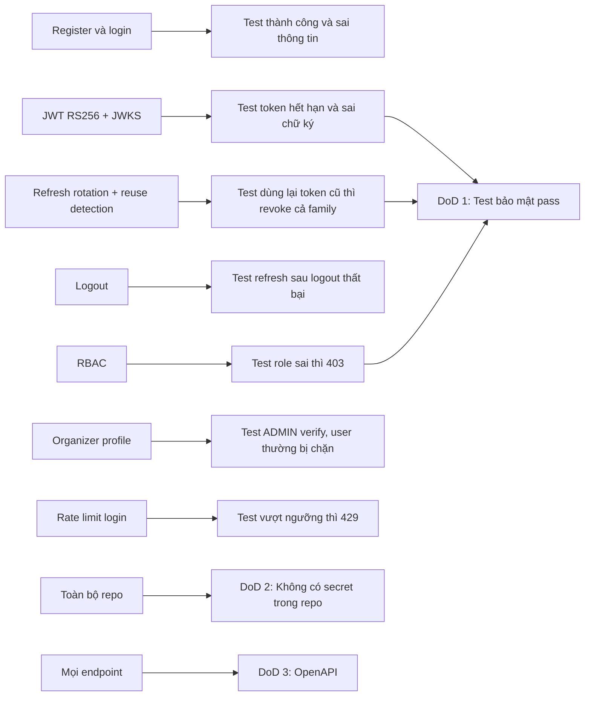
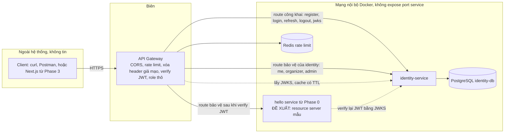
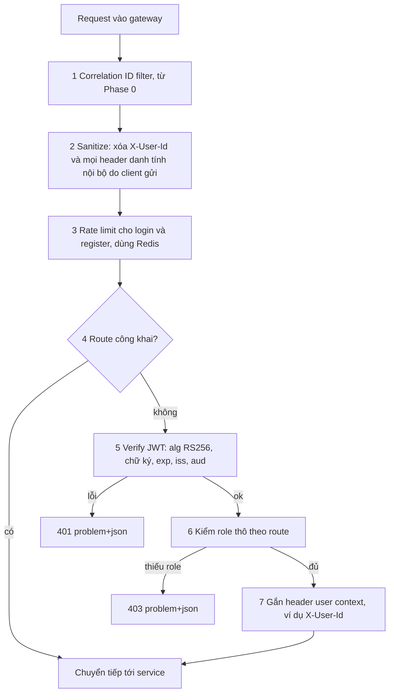
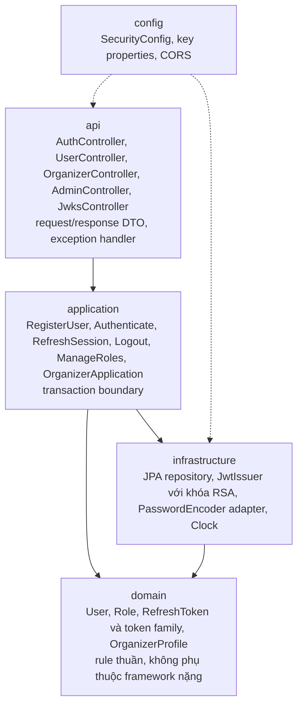

# PHASE 1 — Identity + Gateway: Scope và Kiến trúc

> Tài liệu triển khai riêng cho Phase 1. Nguồn: Phase 1 (S16), S07 Security, S05 §5.1, S01 roles. Nhãn: **ĐỀ XUẤT BỔ SUNG** = mình suy ra để lấp khoảng trống; **SOURCE CHƯA QUY ĐỊNH** = source không nêu, bạn phải tự chốt.

Cách đọc bộ tài liệu này: **thiết kế và luồng xử lý trước** (file 01–03), rồi **task nhỏ có dependency** (04), rồi **test** (05), rồi **checklist và câu hỏi tự kiểm tra** (06). Chưa có code hoàn chỉnh; chỉ có skeleton ở file 04.

## Mục 1. Mục tiêu, phạm vi, tiêu chí hoàn thành

### 1.1 Mục tiêu (source)
- **Goal:** Auth chuẩn production. Độ khó ★★★☆☆, thời lượng ≈ 2 tuần.
- **Features:** Register/login · JWT RS256 + JWKS · Refresh rotation + reuse detection · Logout · RBAC · Organizer profile · Rate limit login.
- **Architecture:** gateway → identity; gateway verify JWT; propagate user context.
- **Concepts:** Spring Security filter chain, stateless auth, password hashing, CSRF/CORS, token family.

### 1.2 Phạm vi
| Trong phạm vi | Ghi chú |
|---|---|
| identity-service + identity-db | users, user_roles, organizer_profiles, refresh_tokens |
| API gateway cho auth | verify JWT, rate limit login, correlation id, CORS, xóa header giả mạo |
| RBAC | role lưu DB, đưa vào JWT, kiểm thô ở gateway, kiểm tinh bằng method security |
| Organizer profile | nộp hồ sơ và ADMIN verify |
| Kiểm thử bảo mật + OpenAPI + không secret trong repo | chính là DoD của source |

### 1.3 Tiêu chí hoàn thành (DoD của source + cách kiểm chứng)
| DoD của source | Cách kiểm chứng (ĐỀ XUẤT BỔ SUNG) |
|---|---|
| Test bảo mật pass: token hết hạn, sai chữ ký, reuse, role sai | Bộ test SEC-01…SEC-20 (file 05) xanh trong CI; có test riêng cho 4 trường hợp này |
| Không có secret trong repo | Quét secret trong CI (ví dụ gitleaks) xanh; chỉ có `.env.example`; khóa RSA nạp từ secret/file ngoài repo |
| OpenAPI | Spec sinh từ code hoặc viết tay, **lint không lỗi**, liệt kê đủ endpoint và lỗi 4xx của file 03 |

### PH1-D1 — Feature → bằng chứng → DoD

## Mục 2. Kiến trúc gateway và identity-service

### 2.1 Thành phần và trách nhiệm
| Thành phần | Trách nhiệm | Nguồn |
|---|---|---|
| **API Gateway** (Spring Cloud Gateway) | Điểm vào duy nhất; verify JWT (chữ ký, exp); kiểm role **thô** theo route; rate limit; correlation id; CORS; xóa header danh tính giả mạo | S03, S07 |
| **identity-service** | Đăng ký, đăng nhập, cấp/xoay/thu hồi token, JWKS, role, organizer profile | S03, S05 |
| **PostgreSQL identity-db** | users, user_roles, organizer_profiles, refresh_tokens | S05 |
| **Redis** | Chỉ cho rate limit ở gateway trong Phase 1 | S03, S05 §5.8 |
| **Service mẫu "hello"** (Phase 0) | *ĐỀ XUẤT:* dùng làm resource được bảo vệ để chứng minh "service tự verify lại JWT" | ĐỀ XUẤT |

### PH1-D2 — Kiến trúc và trust boundary của Phase 1

### PH1-D3 — Thứ tự filter ở gateway
> **ĐỀ XUẤT BỔ SUNG:** source nêu các việc gateway phải làm nhưng không quy định thứ tự; thứ tự dưới đây có lý do: *làm sạch trước khi đọc, chặn tải trước khi tốn CPU verify chữ ký*.

### PH1-D4 — Cấu trúc bên trong identity-service (hexagonal nhẹ, theo S03)

### 2.2 Quy tắc kiến trúc áp dụng cho Phase 1
1. identity-service **sở hữu** identity-db; không service nào khác đọc DB này.
2. Gateway kiểm tra **thô**; service kiểm tra **tinh** (ownership) và **tự verify lại JWT** (S07).
3. Gateway **không** tin header danh tính từ ngoài; chỉ header do chính gateway gắn sau khi verify mới đáng tin.
4. S05 không liệt kê bảng outbox cho identity-db ⇒ Phase 1 **không phát event** ra Kafka (Phase 6 mới có Kafka đầy đủ). *Hệ quả:* thay đổi role, tạo user chưa thông báo cho service khác; audit tạm bằng structured log (audit-service tới Phase 7).
5. Không đặt logic nghiệp vụ vào `libs/common-web` (chỉ error model, correlation filter).

## Mục 2b. Quyết định bạn phải tự chốt (trong task T01, mỗi cái một ADR ngắn)
Nguyên tắc mentor: mình đưa lựa chọn và gợi ý, **bạn quyết và ghi lý do**.

| # | Quyết định | Source nói gì | Lựa chọn | Gợi ý của mình |
|---|---|---|---|---|
| 1 | Thuật toán hash mật khẩu | "Argon2id (hoặc BCrypt cost ≥ 12)" — chưa chốt | Argon2id (thêm dependency, OWASP ưu tiên) · BCrypt cost 12 (đơn giản; **cắt ở 72 byte**) | Cả hai đều chấp nhận được; bắt buộc ghi ADR và giới hạn độ dài mật khẩu tối đa để tránh DoS/cắt cụt |
| 2 | TTL access token | ~10–15 phút | 10 hoặc 15 phút | 15 phút, cấu hình được; ghi trade-off role cũ còn hiệu lực tối đa bằng TTL |
| 3 | TTL refresh token | 7–14 ngày | cố định theo token (sliding) · thêm trần tuyệt đối theo family | Bắt đầu 7 ngày; trần tuyệt đối theo family là OPTIONAL |
| 4 | Path của cookie refresh | `path=/auth/refresh` | Cookie Path **phải khớp đường dẫn thật** (nếu API là `/api/v1/auth/refresh` thì Path phải là chính nó) | Chốt một đường dẫn duy nhất cho refresh/logout và đặt Path khớp; kiểm bằng test |
| 5 | Cấp role ORGANIZER | chưa nêu khi nào | (a) cấp lúc **ADMIN verify** · (b) cấp lúc nộp hồ sơ | (a): chỉ tài khoản đã VERIFIED mới có role; khớp điều kiện submit ở S04 |
| 6 | Lưu bộ đếm lock | S07: "lock tạm sau N lần sai"; S05 chưa có cột | (a) cột `failed_login_count`, `locked_until` trong `users` · (b) Redis cho identity | (a): giữ đúng "identity chỉ PostgreSQL" (S03) |
| 7 | Race khi refresh song song bằng cùng token | chưa nêu | coi là reuse (nghiêm) · cho **grace window** ngắn | Nghiêm ngặt trước, client đã có single-flight (S08); chỉ thêm grace nếu thấy false positive |
| 8 | Đường dẫn JWKS và xoay khóa | chưa nêu | JWKS ở `/.well-known/jwks.json`; xoay khóa bằng cách publish 2 khóa theo `kid` | Làm đường dẫn cố định + hỗ trợ ≥ 2 khóa; xoay khóa thật là OPTIONAL |
| 9 | Phản hồi đăng ký khi email đã tồn tại | chưa nêu | 409 rõ ràng (dễ dùng, lộ tồn tại) · phản hồi trung tính | 409 cho Phase 1, ghi rõ trade-off lộ thông tin |
| 10 | Tạo ADMIN đầu tiên | chưa nêu | seed qua migration chỉ ở dev · lệnh bootstrap một lần | Không để mật khẩu admin trong repo; dùng biến môi trường lúc bootstrap |
| 11 | Xác minh email / quên mật khẩu | chưa nêu | làm · không làm | **Không làm ở Phase 1** (ngoài phạm vi) |

## E. Những điều phải nhớ
- Gateway bị bypass thì service vẫn phải tự bảo vệ.
- Header như `X-User-Id` chỉ đáng tin khi gateway tự gắn sau khi xóa bản từ ngoài.
- Thay đổi role chỉ có hiệu lực ở access token mới (tối đa sau TTL access); đây là trade-off có chủ đích của JWT stateless.
- **SOURCE CHƯA QUY ĐỊNH:** mọi mục ở bảng quyết định trên.
