# PHASE 1 — Luồng xử lý (Mục 3–10)

> Mỗi mục: sơ đồ → giải thích → nhánh lỗi → bất biến. Endpoint trong sơ đồ là **ĐỀ XUẤT BỔ SUNG** (source chưa định nghĩa endpoint; xem file 03).

## Mục 3. Register / Login

### PH1-D5 — Register
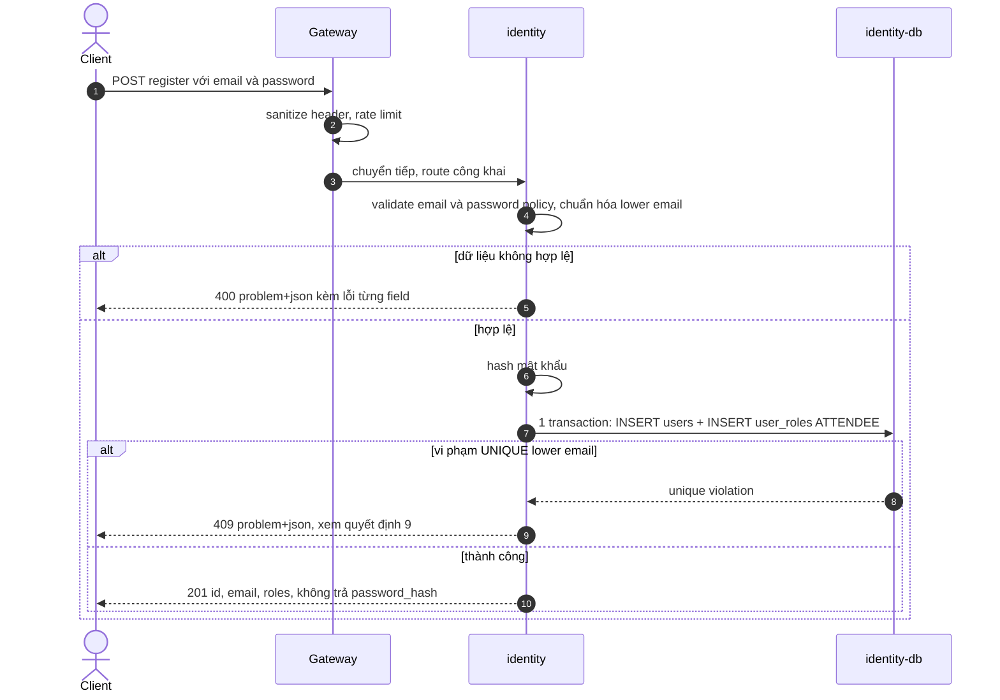
- Role mặc định `ATTENDEE` là **ĐỀ XUẤT** (source không nêu); client **không** được gửi `roles` (mass assignment).
- Không tự động đăng nhập sau đăng ký (đề xuất, giữ luồng đơn giản).
- **Bất biến:** email duy nhất không phân biệt hoa/thường (chặn bằng DB, không chỉ bằng code); không bao giờ log hoặc trả mật khẩu/hash.

### PH1-D6 — Login
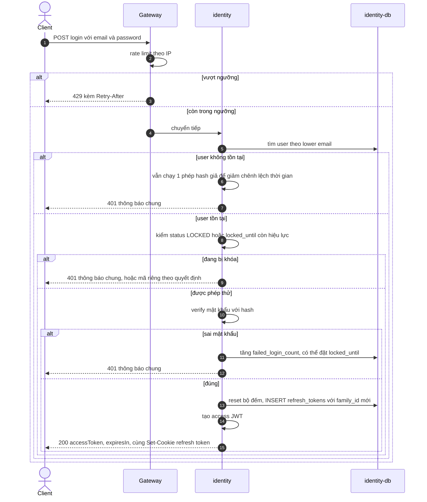
- **Thông báo chung** cho "không có user" và "sai mật khẩu" để tránh dò email (user enumeration).
- Thông tin lock (`failed_login_count`, `locked_until`) là **đề xuất schema** (quyết định 6).
- Access token trả trong body để client giữ **trong memory**; refresh token chỉ đi qua cookie `httpOnly` (S07).

## Mục 4. JWT RS256 và JWKS verification

### PH1-D7 — Phát hành và verify
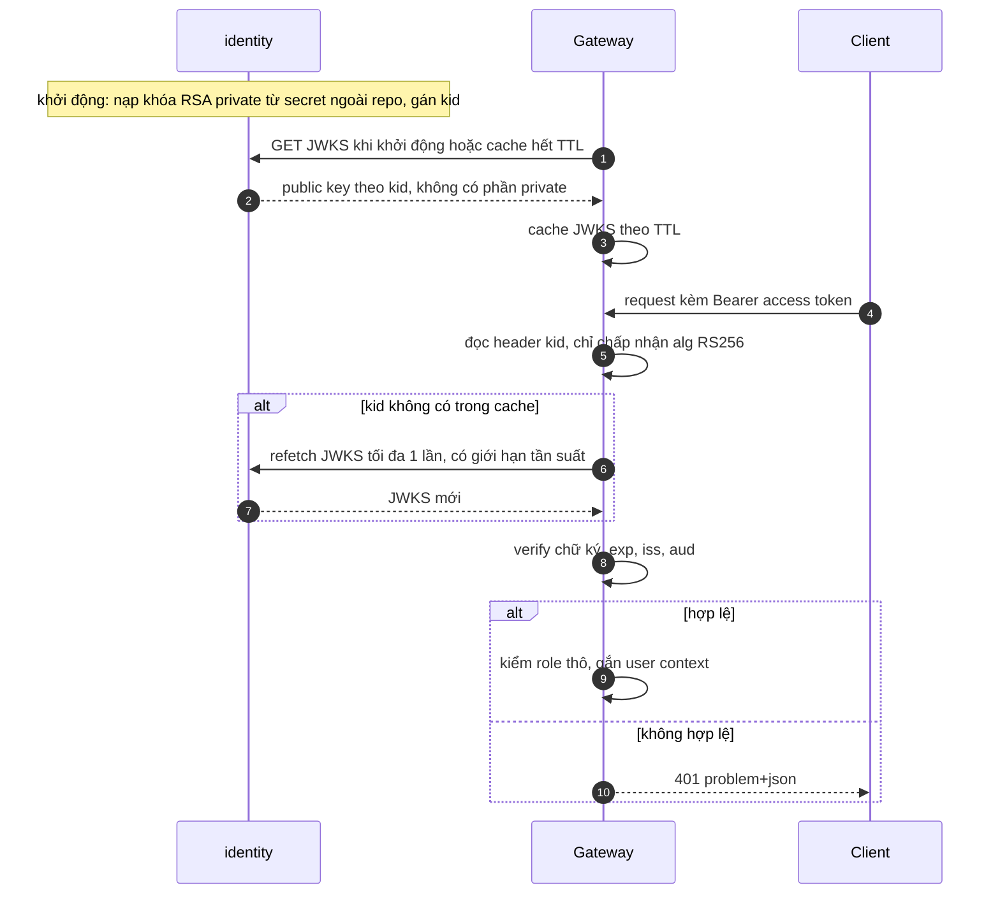

**Claims của access token**
| Claim | Nguồn | Ghi chú |
|---|---|---|
| `sub` | source | userId |
| `roles` | source | danh sách role |
| `jti` | source | id token; dùng nếu bật denylist (OPTIONAL) |
| `exp`, `iat` | đề xuất | `exp` = `iat` + TTL access |
| `iss`, `aud` | đề xuất | để từ chối token do bên khác phát hoặc dành cho hệ khác |
| header `kid`, `alg=RS256` | đề xuất | `kid` cần để hỗ trợ xoay khóa |

- Vì sao **RS256 + JWKS**: chỉ identity giữ khóa **private** (ký); gateway và mọi service chỉ cần khóa **public** để verify, nên lộ một service không cho phép giả token. HS256 dùng chung bí mật nên không có tính chất này.
- **Phải ép `alg`**: không cho token tự chọn thuật toán (chặn `alg=none` và nhầm lẫn HS256/RS256).
- **Optimization (source):** cache JWKS có TTL; đo chi phí verify ở gateway.
- **SOURCE CHƯA QUY ĐỊNH:** đường dẫn JWKS, TTL cache, quy trình xoay khóa, độ lệch đồng hồ cho phép (clock skew).

## Mục 5. Vòng đời access token và refresh token

### PH1-D8 — Dòng thời gian một phiên
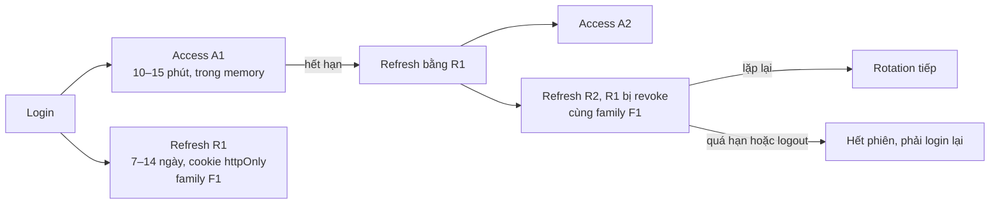

### PH1-D9 — Trạng thái của một refresh token
> **ĐỀ XUẤT BỔ SUNG:** tên state là cách mô hình hóa từ các cột `revoked_at`, `replaced_by`, `expires_at` (S05); source không có state machine này.
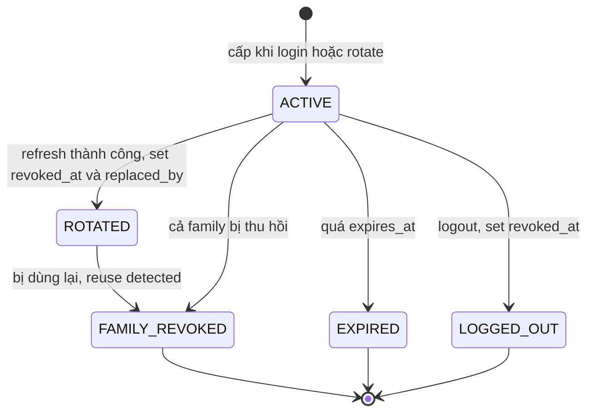
- Access token **không** lưu ở DB; hiệu lực chỉ do `exp` và chữ ký.
- Refresh token là chuỗi ngẫu nhiên 256-bit (opaque); DB chỉ lưu **hash** (`token_hash` UNIQUE). Vì token đã có entropy cao, một hàm hash nhanh như SHA-256 là đủ (đề xuất), không cần hash chậm như với mật khẩu.
- **Phải revoke chứ không xóa dòng**: nếu xóa thì mất khả năng phát hiện reuse.

## Mục 6. Refresh rotation và reuse detection

### PH1-D10 — Refresh
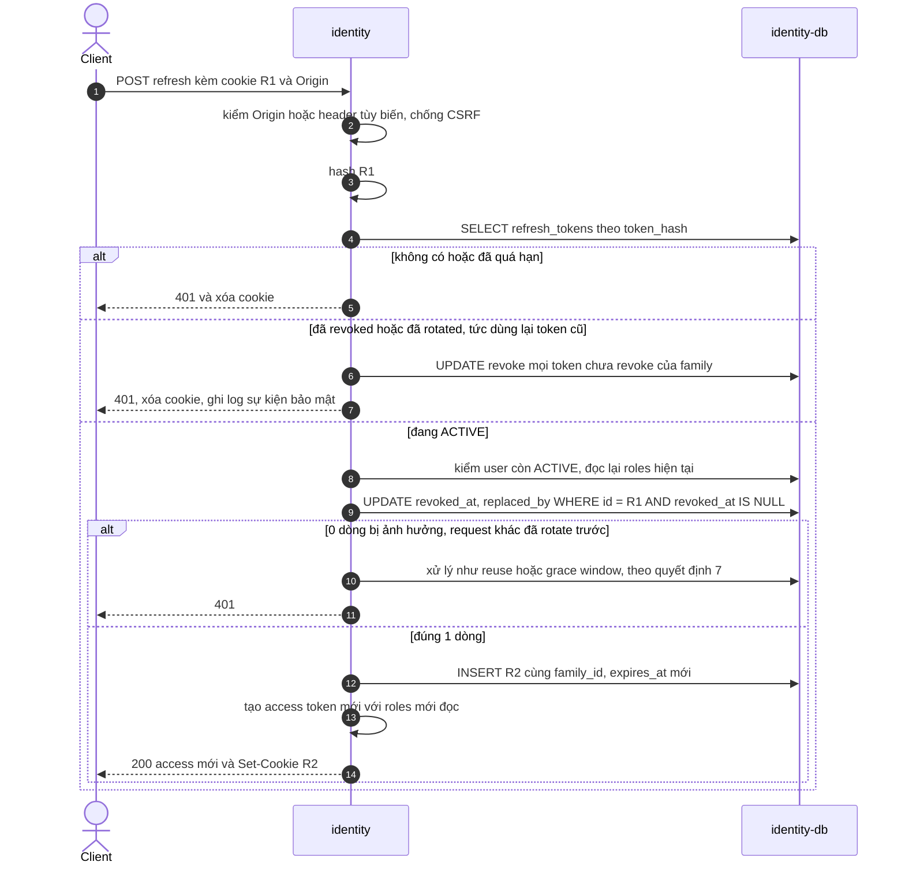
- **Atomic:** việc "revoke R1" phải là **một câu UPDATE có điều kiện** và kiểm số dòng bị ảnh hưởng, không phải SELECT rồi UPDATE ở tầng ứng dụng (cùng bài học chống race ở Phase 4). Hai request đồng thời dùng cùng R1 thì chỉ một cái thắng.
- Mỗi lần refresh đọc lại roles/status từ DB ⇒ đây là chỗ role mới và lock tài khoản có hiệu lực.
- Request refresh song song từ 2 tab có thể bị coi là reuse; giải pháp phía client là **single-flight** (S08-D3).

### PH1-D11 — Family và reuse detection
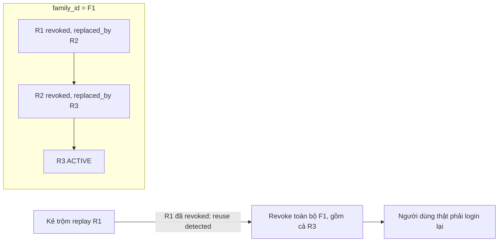
- Lý do: nếu token cũ xuất hiện lại thì có hai bên cùng nắm một chuỗi token; không biết bên nào là thật nên thu hồi cả chuỗi.
- **Trade-off:** người dùng thật bị đăng xuất khi có kẻ trộm replay (và khi có race khi refresh song song).

### PH1-D12 — Cookie, CORS và CSRF
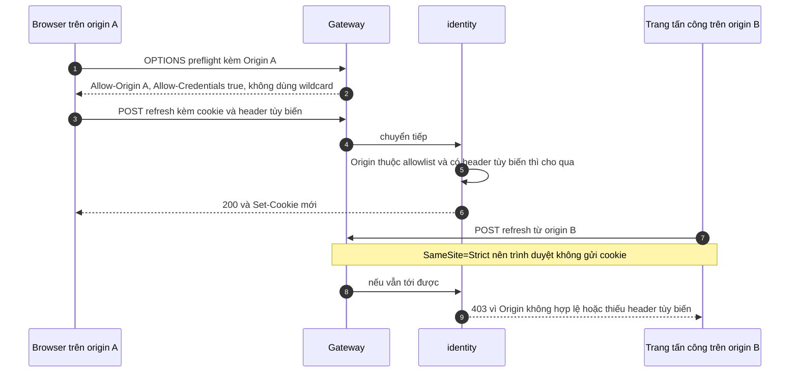
- Cookie refresh: `HttpOnly; Secure; SameSite=Strict; Path` **khớp đường dẫn refresh**; chỉ dùng cho refresh/logout.
- `SameSite=Strict` chỉ giúp khi web và API cùng *site* (cùng tên miền đăng ký, ví dụ khác subdomain). Nếu khác site hoàn toàn thì cookie không gửi được: cần thiết kế deploy hợp lý (S21).
- Không dùng `Allow-Origin: *` cùng `Allow-Credentials: true`.

## Mục 7. Logout và revocation

### PH1-D13 — Logout
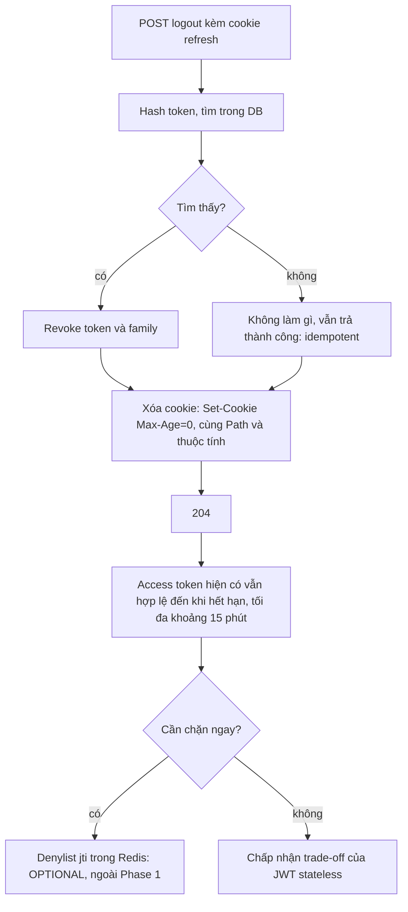
- Logout "thật sự làm gì" trong hệ JWT stateless: **chỉ chặn việc tạo access token mới** (refresh), không thu hồi access token đang sống.
- Phải ghi rõ trade-off này vào ADR và `docs/learning` (câu hỏi phỏng vấn của Phase 1).

## Mục 8. RBAC và method-level authorization

### PH1-D14 — Từ DB đến quyết định cho phép
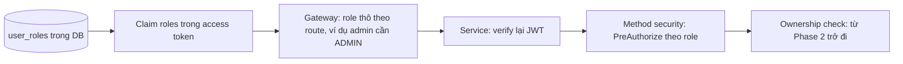

### PH1-D15 — Quyết định khi ADMIN đổi role
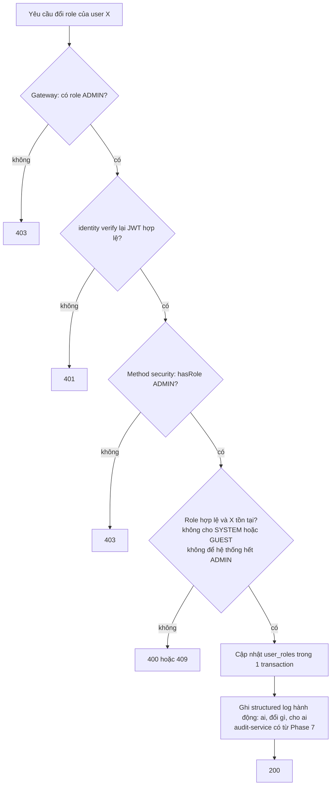
- Role dùng trong Phase 1: `ATTENDEE`, `ORGANIZER`, `EVENT_STAFF`, `MODERATOR`, `ADMIN` (S01). `GUEST` không lưu DB; `SYSTEM` là service account, chưa dùng ở Phase 1 (xem mục 19).
- Ánh xạ claim `roles` sang authority của Spring (thêm tiền tố `ROLE_`) là chỗ hay sai: kiểm bằng test.
- Role không bao giờ lấy từ body hoặc header do client gửi.
- Đổi role chỉ ADMIN và **phải được ghi lại** (S07).

## Mục 9. Organizer profile

### PH1-D16 — Trạng thái hồ sơ organizer
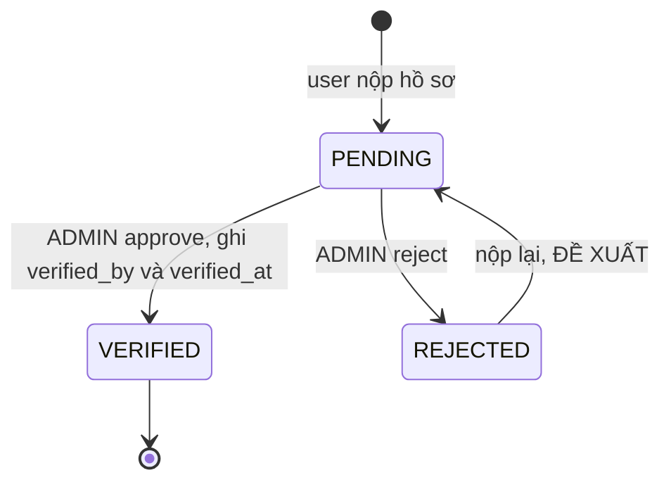
### PH1-D17 — Nộp và duyệt
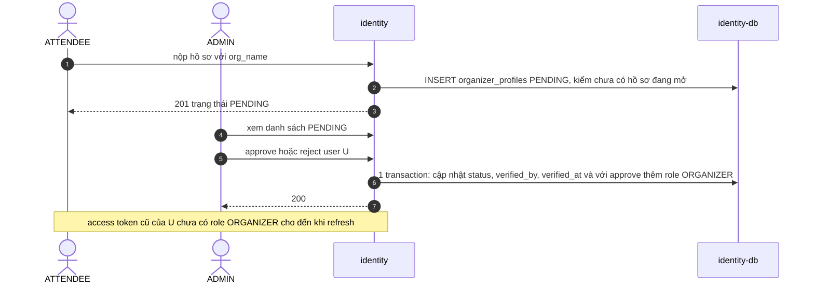
- Source chỉ cho: bảng `organizer_profiles(user_id, org_name, status PENDING|VERIFIED|REJECTED, verified_by, verified_at)` và "ADMIN verify". Phần còn lại (nộp lại, lý do từ chối, thời điểm cấp role ORGANIZER) là **đề xuất / quyết định 5**.
- Ràng buộc nghiệp vụ liên quan Phase 2: submit sự kiện yêu cầu organizer đã VERIFIED (S04); **không** kiểm ở Phase 1.
- ADMIN không tự verify cho chính mình nếu là organizer (separation of duties, S01): ĐỀ XUẤT.

## Mục 10. Rate limit login

### PH1-D18 — Hai lớp chặn
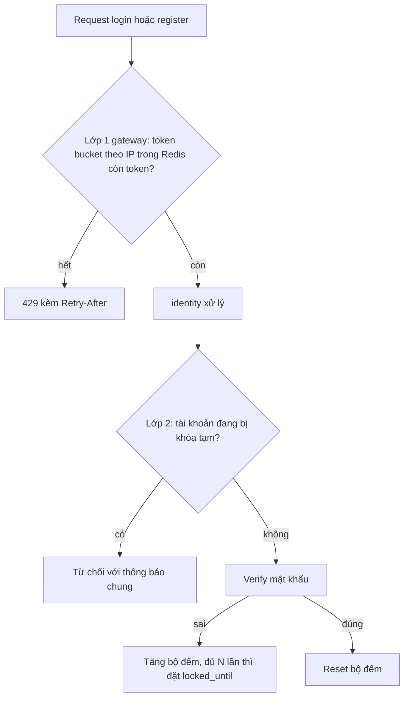
- Hai lớp bổ trợ nhau: IP chặn tấn công **một nguồn nhiều tài khoản**; khóa tạm theo tài khoản chặn **nhiều nguồn một tài khoản**.
- **Trade-off:** khóa tài khoản cho phép kẻ xấu cố ý khóa người khác ⇒ khóa chỉ **tạm thời**, thông báo chung, và kết hợp lớp IP.
- **SOURCE CHƯA QUY ĐỊNH:** dung lượng bucket, tốc độ nạp, N, thời gian khóa; bạn đặt giá trị, đưa vào cấu hình và ghi lý do.

## E. Những điều phải nhớ (toàn file)
- Mọi lỗi auth dùng cùng error model problem+json của Phase 0; không lộ stack trace, không phân biệt "sai email" và "sai mật khẩu".
- Không log: mật khẩu, access token, refresh token, hash; userId nên được băm trong log (S09).
- Mọi giá trị chưa chốt ở source phải thành **cấu hình** + ghi trong ADR.
