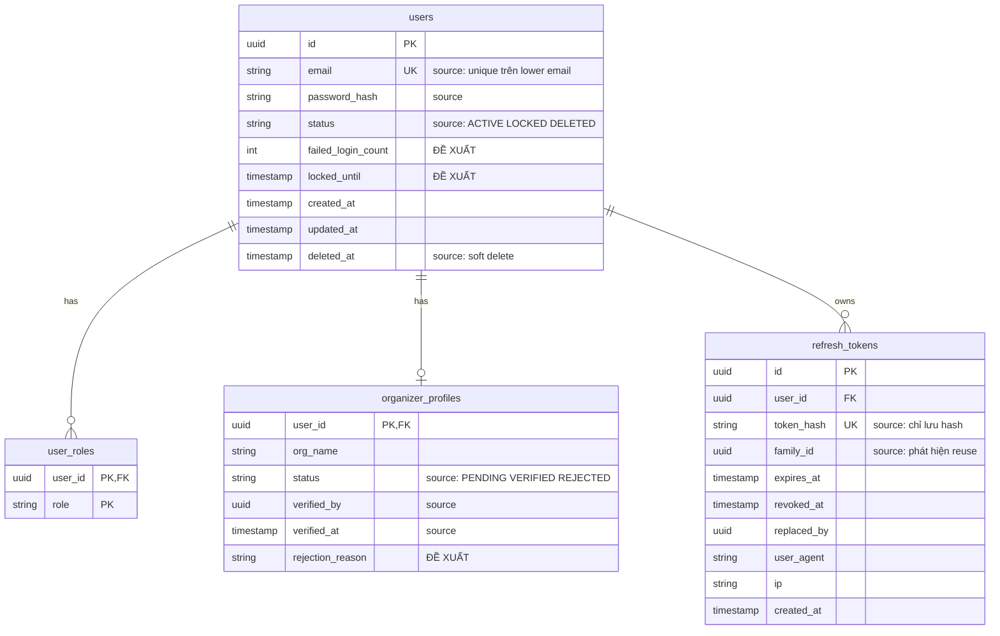
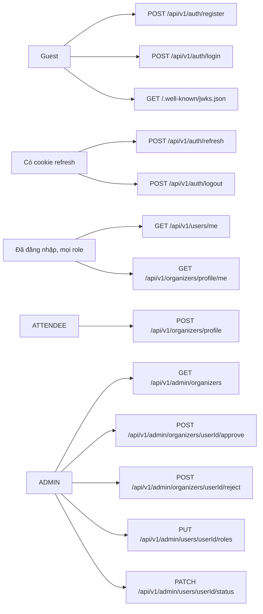

# PHASE 1 — Data model và API contract (Mục 11–12)

> Cột/bảng có trong source (S05 §5.1) được ghi là *source*. Mọi thứ khác là **ĐỀ XUẤT BỔ SUNG**. Source **không** định nghĩa endpoint nào cho identity: toàn bộ endpoint dưới đây là đề xuất.

## Mục 11. Data model và thiết kế token family

### PH1-D19 — ERD identity-db (đánh dấu phần đề xuất trong chú thích)

### 11.1 Ràng buộc và index
| Đối tượng | Nội dung | Nguồn |
|---|---|---|
| `users.email` | UNIQUE trên `lower(email)` | source |
| `user_roles` | PRIMARY KEY `(user_id, role)` | source |
| `refresh_tokens.token_hash` | UNIQUE | source |
| `refresh_tokens` | `INDEX(user_id)`, `INDEX(family_id)` | source |
| `organizer_profiles` | `user_id` là PK ⇒ mỗi user tối đa **một** hồ sơ | source (suy ra từ PK) |
| Giá trị `status`, `role` | CHECK hoặc enum | đề xuất |
| `users.failed_login_count`, `locked_until` | cột mới cho khóa tạm | **đề xuất** (quyết định 6) |
| `organizer_profiles.rejection_reason` | lý do từ chối | **đề xuất** |
| Dọn token hết hạn | job định kỳ xóa token quá hạn đã lâu | **đề xuất**, source chưa nêu |

### 11.2 Vì sao thiết kế như vậy
- **Chỉ lưu hash refresh token**: lộ DB không lộ token dùng được.
- **`family_id` + `replaced_by`** tạo chuỗi xoay token, đủ để phát hiện reuse và thu hồi cả chuỗi (xem PH1-D11).
- **Không xóa dòng token khi revoke**: dòng đã revoke chính là bằng chứng để nhận ra token cũ bị dùng lại.
- **Soft delete user** vì audit/order sau này cần tham chiếu `user_id`.
- Không có cross-service FK: các service khác chỉ lưu `userId` (uuid) lấy từ claim `sub`.

### 11.3 Ranh giới transaction
| Thao tác | Trong một transaction | Lý do |
|---|---|---|
| Register | INSERT `users` + INSERT `user_roles` | không để user không có role |
| Login thành công | INSERT `refresh_tokens` + reset `failed_login_count` | |
| Refresh | UPDATE revoke token cũ có điều kiện + INSERT token mới | **atomic**, không nhận 2 token từ 1 token |
| Reuse detected | UPDATE revoke cả family | |
| Logout | UPDATE revoke family | idempotent |
| ADMIN approve organizer | UPDATE `organizer_profiles` + INSERT `user_roles ORGANIZER` | hồ sơ và role luôn khớp nhau |
| ADMIN đổi role | thay đổi `user_roles` | |

### 11.4 Migration (Flyway)
- `V1__identity_baseline.sql`: bốn bảng, ràng buộc, index nêu trên (ĐỀ XUẤT tên file).
- Migration phải **backward compatible** (S21: expand → migrate → contract).
- **SOURCE CHƯA QUY ĐỊNH:** loại khóa chính (UUIDv7 nếu thư viện hỗ trợ, theo quy ước chung S05), thời gian giữ token đã revoke.

## Mục 12. API contract và error cases

### PH1-D20 — Bản đồ endpoint theo người gọi
> **ĐỀ XUẤT BỔ SUNG:** đường dẫn và hình dạng request/response là đề xuất (versioning `/api/v1` lấy từ S13).

### 12.1 Bảng endpoint (tất cả: ĐỀ XUẤT)
| # | Method và đường dẫn | Actor | Xác thực | Request | Response thành công | Lỗi |
|---|---|---|---|---|---|---|
| 1 | `POST /api/v1/auth/register` | Guest | không | `email`, `password` | 201 `id`, `email`, `roles` | 400, 409, 429 |
| 2 | `POST /api/v1/auth/login` | Guest | không | `email`, `password` | 200 `accessToken`, `tokenType`, `expiresIn` + `Set-Cookie` refresh | 400, 401, 429 |
| 3 | `POST /api/v1/auth/refresh` | Client có cookie | cookie refresh + chống CSRF | không body | 200 như login, cookie mới | 401, 403 |
| 4 | `POST /api/v1/auth/logout` | Client có cookie | cookie refresh + chống CSRF | không body | 204, xóa cookie (idempotent) | 403 |
| 5 | `GET /.well-known/jwks.json` | Gateway, service | không | — | 200 JWKS (chỉ khóa public) | — |
| 6 | `GET /api/v1/users/me` | Mọi role | Bearer | — | 200 `id`, `email`, `roles`, `status` | 401 |
| 7 | `POST /api/v1/organizers/profile` | ATTENDEE | Bearer | `orgName` | 201 `status=PENDING` | 400, 401, 403, 409 |
| 8 | `GET /api/v1/organizers/profile/me` | Mọi role | Bearer | — | 200 hoặc 404 | 401, 404 |
| 9 | `GET /api/v1/admin/organizers?status=PENDING` | ADMIN | Bearer | query lọc, phân trang | 200 danh sách | 401, 403 |
| 10 | `POST /api/v1/admin/organizers/{userId}/approve` | ADMIN | Bearer | — | 200 | 401, 403, 404, 409 |
| 11 | `POST /api/v1/admin/organizers/{userId}/reject` | ADMIN | Bearer | `reason` | 200 | 400, 401, 403, 404, 409 |
| 12 | `PUT /api/v1/admin/users/{userId}/roles` | ADMIN | Bearer | `roles[]` | 200 | 400, 401, 403, 404, 409 |
| 13 | `PATCH /api/v1/admin/users/{userId}/status` | ADMIN | Bearer | `status` ACTIVE hoặc LOCKED | 200 | 400, 401, 403, 404 |

Route công khai ở gateway (không cần Bearer): #1, #2, #3, #4, #5. Mọi route còn lại cần JWT hợp lệ; nhóm `/admin/**` cần role `ADMIN` ở **cả gateway lẫn method security**.

### 12.2 Validation (ĐỀ XUẤT)
| Trường | Quy tắc |
|---|---|
| `email` | định dạng hợp lệ, độ dài tối đa hợp lý, chuẩn hóa lower-case trước khi lưu và so sánh |
| `password` | độ dài tối thiểu theo chính sách (bạn chốt), **tối đa có giới hạn** (BCrypt chỉ dùng 72 byte đầu; hash chậm tốn CPU nên giới hạn để tránh DoS) |
| `orgName` | không rỗng, độ dài tối đa, chống HTML/script khi hiển thị về sau |
| `roles[]` | chỉ nhận giá trị hợp lệ; không cho `GUEST`, `SYSTEM` |

### 12.3 Danh mục lỗi (problem+json, ĐỀ XUẤT mã `type`)
Dùng error model Phase 0 (RFC 7807: `type`, `title`, `status`, `detail`, `instance`; thêm `errors[]` cho lỗi từng field và `correlationId`).

| HTTP | `type` đề xuất | Khi nào |
|---|---|---|
| 400 | `validation-error` | sai định dạng, thiếu field; kèm `errors[]` |
| 401 | `invalid-credentials` | sai email hoặc mật khẩu, hoặc tài khoản bị khóa (thông báo chung) |
| 401 | `invalid-token` / `token-expired` | JWT sai chữ ký, sai `alg`/`iss`/`aud`, hết hạn |
| 401 | `refresh-token-invalid` | thiếu, hết hạn, đã revoke, reuse |
| 403 | `forbidden` | không đủ role hoặc không sở hữu resource |
| 403 | `csrf-rejected` | Origin không hợp lệ hoặc thiếu header tùy biến |
| 404 | `not-found` | user hoặc hồ sơ không tồn tại |
| 409 | `email-already-registered` | trùng email |
| 409 | `invalid-state-transition` | duyệt hồ sơ không ở PENDING, nộp khi đã có hồ sơ mở |
| 429 | `too-many-requests` | rate limit, có header `Retry-After` |
| 5xx | `internal-error` | lỗi không lường; **không** lộ chi tiết nội bộ |

### 12.4 Timeout, retry, idempotency
| Endpoint | Idempotent? | Ghi chú |
|---|---|---|
| register | không (nhưng UNIQUE email chặn trùng) | double-click nhận 409 ở lần 2 |
| login | không | có rate limit |
| refresh | **không** (mỗi lần xoay token) | client dùng single-flight; không tự động retry mù |
| logout | có | gọi lại vẫn 204 |
| đổi role / duyệt organizer | nên idempotent theo kết quả cuối | đề xuất |
- Timeout gateway → identity: **giá trị bạn đặt và ghi lý do** (S10 yêu cầu mọi timeout có giá trị rõ ràng).

### 12.5 Cookie refresh (ĐỀ XUẤT thông số)
`Set-Cookie: refresh_token=<opaque>; HttpOnly; Secure; SameSite=Strict; Path=<đúng đường dẫn refresh>; Max-Age=<TTL refresh>`
- Trong dev qua HTTP cục bộ, `Secure` có thể cần cấu hình riêng theo profile; **không** tắt `Secure` ở môi trường thật.

### 12.6 OpenAPI
- Mỗi endpoint có: schema request/response, mô tả lỗi 4xx theo bảng 12.3, `securitySchemes` (bearer JWT) và mô tả cookie refresh.
- DoD: spec lint không lỗi, và test hợp đồng đơn giản (response thật khớp schema) nằm trong CI.

## E. Những điều phải nhớ
- Không bao giờ trả `password_hash`, `token_hash`, hay chi tiết lock cho client.
- Phản hồi lỗi login phải đồng nhất giữa "không có user" và "sai mật khẩu".
- `GET /users/me` đọc từ DB hay từ JWT: **SOURCE CHƯA QUY ĐỊNH**; đọc DB cho dữ liệu mới nhất, đọc JWT nếu chấp nhận dữ liệu tối đa trễ bằng TTL access.
- **SOURCE CHƯA QUY ĐỊNH:** toàn bộ endpoint, schema request/response, phân trang cho danh sách admin.
