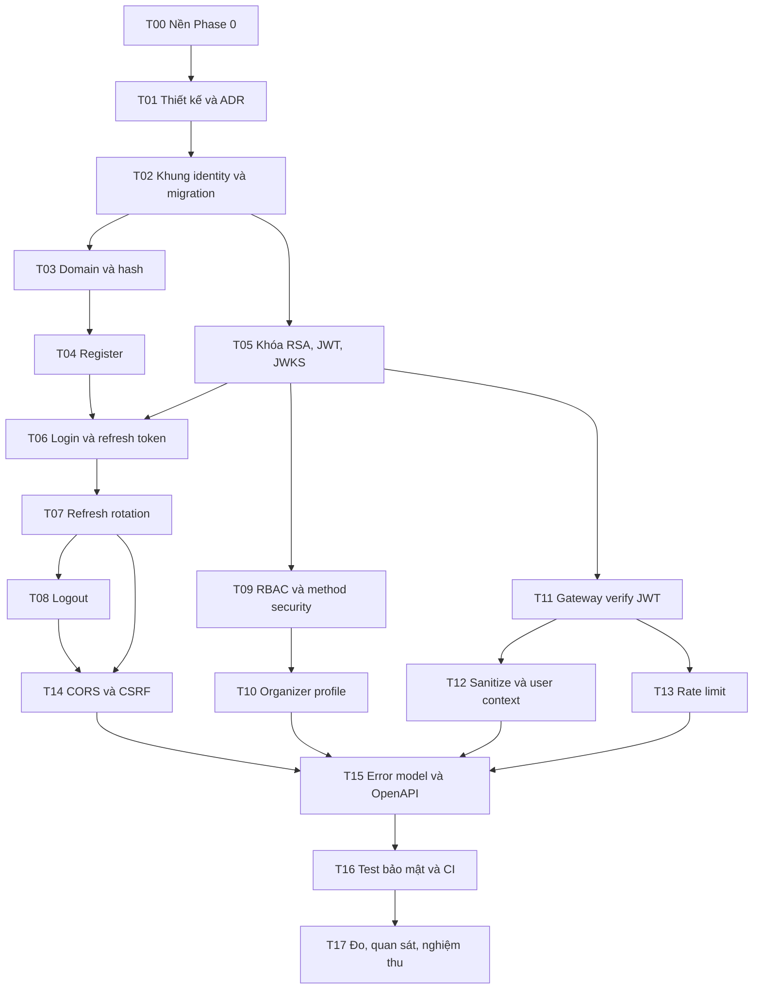

# PHASE 1 — Trình tự triển khai theo task (Mục 13)

> Mọi đường dẫn file/module là **ĐỀ XUẤT BỔ SUNG** (source không quy định cấu trúc code chi tiết; chỉ có hexagonal-nhẹ ở S03). Mỗi task có: Mục tiêu, Kiến thức cần hiểu, Input/Output, File/module dự kiến, Các bước, Test cases, Điều kiện pass/fail, Dependency, Lỗi dễ gặp.

## 13.0 Dependency giữa các task

### PH1-D21 — Đồ thị phụ thuộc

**Thứ tự gợi ý một người làm:** T00 → T01 → T02 → T03 → T04 → T05 → T06 → T07 → T08 → T09 → T10 → T11 → T12 → T13 → T14 → T15 → T16 → T17. Nhánh gateway (T11–T13) có thể làm xen kẽ sau T05.

> **Nguyên tắc:** mỗi task phải có test xanh **trước khi** sang task kế tiếp; không gộp task.

## T00 — Kiểm tra nền Phase 0
- **Mục tiêu:** Bảo đảm repo, compose, CI, error model và gateway skeleton đã đủ để bắt đầu.
- **Kiến thức cần hiểu:** 12-factor; Docker Compose; Flyway baseline; problem+json; correlation id.
- **Input / Output:** Input: DoD Phase 0. Output: danh sách smoke test xanh.
- **File/module dự kiến (đề xuất):** `infra/compose, services/gateway, service hello, libs/common-web`
- **Dependency:** Phase 0 DoD
- **Các bước:**
  1. Chạy `docker compose up`, xác nhận Postgres (DB và user riêng cho identity), Redis, Kafka chạy
  2. Gọi service hello qua gateway, thấy `X-Correlation-Id` trong response và log JSON
  3. Gây một lỗi, xác nhận response là problem+json
  4. CI build xanh
- **Test cases:**
  - Smoke: health của gateway và hello
  - Smoke: log có correlationId
  - Smoke: lỗi trả problem+json
- **Điều kiện pass/fail:** Pass: cả 3 smoke xanh. Fail: bất kỳ cái nào đỏ ⇒ sửa Phase 0 trước, không bắt đầu Phase 1.
- **Lỗi dễ gặp:**
  - Dùng chung 1 DB user cho mọi service
  - Chưa có DB riêng cho identity

## T01 — Chốt thiết kế, ADR, OpenAPI nháp
- **Mục tiêu:** Chốt 11 quyết định ở file 01 mục 2b trước khi viết code; có hợp đồng API nháp.
- **Kiến thức cần hiểu:** ADR (Context, Decision, Alternatives, Trade-offs, Consequences); JWT claims; thuộc tính cookie; chính sách mật khẩu.
- **Input / Output:** Input: file 01, 02, 03. Output: ADR-011 (refresh rotation, source) + ADR cho các quyết định 1–10; OpenAPI skeleton.
- **File/module dự kiến (đề xuất):** `docs/decisions/, docs/api/`
- **Dependency:** T00
- **Các bước:**
  1. Viết mỗi quyết định thành ADR ngắn, nêu ít nhất 2 phương án và trade-off
  2. Vẽ lại sequence login và refresh bằng lời của bạn, so với PH1-D6 và PH1-D10
  3. Viết OpenAPI nháp: paths, schemas, lỗi, bảo mật
  4. Tự kiểm: cookie Path có khớp đường dẫn refresh đã chọn không?
- **Test cases:**
  - Review: mỗi ADR có alternatives và trade-offs
  - Lint OpenAPI không lỗi
- **Điều kiện pass/fail:** Pass: 100% quyết định có ADR, spec lint sạch. Fail: còn quyết định chưa chốt hoặc mâu thuẫn (ví dụ Path cookie).
- **Lỗi dễ gặp:**
  - Chọn TTL mà không ghi lý do
  - Bỏ qua quyết định về cookie Path và versioning

## T02 — Khung identity-service, migration, Testcontainers
- **Mục tiêu:** Có service chạy được với DB riêng, migration V1 và hạ tầng test với Postgres thật.
- **Kiến thức cần hiểu:** Spring Boot profiles, Flyway, JPA mapping cơ bản, Testcontainers.
- **Input / Output:** Input: ADR, ERD PH1-D19. Output: service khởi động, bảng đã tạo, test tích hợp mẫu chạy với Postgres container.
- **File/module dự kiến (đề xuất):** `services/identity: config/, domain/, infrastructure/persistence/, resources/db/migration/V1__identity_baseline.sql`
- **Dependency:** T01
- **Các bước:**
  1. Tạo module theo cấu trúc PH1-D4
  2. Viết migration V1 đủ bảng, UNIQUE trên lower(email), UNIQUE token_hash, index theo mục 11.1
  3. Cấu hình profile dev và test, nạp cấu hình bằng biến môi trường
  4. Viết 1 test tích hợp kiểm migration chạy và ràng buộc UNIQUE hoạt động
- **Test cases:**
  - IT: migration chạy sạch trên DB trống
  - IT: chèn 2 email chỉ khác hoa thường bị từ chối
  - IT: chèn token_hash trùng bị từ chối
- **Điều kiện pass/fail:** Pass: test xanh, `GET /actuator/health` UP. Fail: ràng buộc UNIQUE chỉ nằm ở code mà không ở DB.
- **Lỗi dễ gặp:**
  - Dùng H2 thay cho Postgres thật (che lỗi)
  - Quên UNIQUE theo lower(email)
  - Để Hibernate tự sinh schema thay vì Flyway

## T03 — Domain, chính sách mật khẩu, hash
- **Mục tiêu:** Có miền người dùng và cơ chế hash mật khẩu đúng chuẩn.
- **Kiến thức cần hiểu:** Argon2id hoặc BCrypt (cost ≥ 12), PasswordEncoder, chuẩn hóa email, giới hạn độ dài mật khẩu.
- **Input / Output:** Input: quyết định 1 và chính sách mật khẩu. Output: PasswordHasher, chuẩn hóa email, value object, unit test.
- **File/module dự kiến (đề xuất):** `domain/User, domain/Email, infrastructure/security/PasswordHasher`
- **Dependency:** T02
- **Các bước:**
  1. Viết value object Email chuẩn hóa lower-case
  2. Viết lớp bọc PasswordEncoder, cấu hình cost và giới hạn độ dài
  3. Viết unit test: hash khác nhau cho cùng mật khẩu (salt), verify đúng/sai, mật khẩu quá dài bị từ chối
- **Test cases:**
  - UT: hash 2 lần khác nhau, verify đúng
  - UT: mật khẩu vượt giới hạn bị từ chối
  - UT: email chuẩn hóa
- **Điều kiện pass/fail:** Pass: test xanh, đo thời gian một lần hash nằm trong khoảng bạn đặt (và ghi vào ADR). Fail: lưu mật khẩu dạng khác hash chậm.
- **Lỗi dễ gặp:**
  - BCrypt cắt ở 72 byte mà không biết
  - Cost quá thấp hoặc quá cao gây DoS
  - Log mật khẩu khi lỗi validation

## T04 — Endpoint register
- **Mục tiêu:** Đăng ký tài khoản an toàn, chống trùng email ở DB, không mass assignment.
- **Kiến thức cần hiểu:** Bean Validation, transaction, xử lý unique violation, DTO tách khỏi entity.
- **Input / Output:** Input: T03. Output: `POST register` hoạt động theo bảng 12.1 #1.
- **File/module dự kiến (đề xuất):** `api/AuthController, api/dto/RegisterRequest, application/RegisterUser, infrastructure/persistence/UserRepository`
- **Dependency:** T03
- **Các bước:**
  1. Validate request, chuẩn hóa email
  2. Mở transaction: tạo user + role ATTENDEE
  3. Bắt unique violation, trả 409 problem+json
  4. Trả 201 không kèm hash
  5. Bỏ qua mọi field `roles` mà client gửi
- **Test cases:**
  - IT: đăng ký thành công, DB có user và role ATTENDEE
  - IT: trùng email khác hoa thường ⇒ 409
  - IT: body có roles=[ADMIN] ⇒ vẫn chỉ ATTENDEE
  - IT: 2 request đăng ký đồng thời cùng email ⇒ đúng 1 thành công
  - UT: các lỗi validation
- **Điều kiện pass/fail:** Pass: toàn bộ test xanh. Fail: có thể tạo user với role từ client hoặc trùng email bằng cách đổi hoa/thường.
- **Lỗi dễ gặp:**
  - Kiểm tồn tại email bằng SELECT rồi INSERT (race)
  - Trả entity trực tiếp lộ hash
  - Trả thông tin khác nhau giữa các lỗi

## T05 — Quản lý khóa RSA, phát hành JWT, JWKS
- **Mục tiêu:** Ký access token bằng RS256 và công bố khóa public qua JWKS.
- **Kiến thức cần hiểu:** RSA, JWT claims, `kid`, JWKS, nạp secret ngoài repo, TTL.
- **Input / Output:** Input: quyết định 2 và 8. Output: JwtIssuer, endpoint JWKS, khóa nạp từ secret.
- **File/module dự kiến (đề xuất):** `infrastructure/security/JwtIssuer, config/KeyProperties, api/JwksController`
- **Dependency:** T02
- **Các bước:**
  1. Nạp khóa private từ file/secret (đường dẫn qua biến môi trường), gán `kid`
  2. Phát hành token với `sub`, `roles`, `jti`, `iat`, `exp`, `iss`, `aud`
  3. Công bố JWKS chỉ chứa phần public
  4. Hỗ trợ ≥ 2 khóa theo `kid` (đề xuất)
  5. Tạo khóa dev bằng script, **không commit**
- **Test cases:**
  - UT: token chứa đủ claim, `exp` = `iat` + TTL
  - IT: JWKS không chứa phần private (không có thành phần `d`)
  - UT: token ký bằng khóa A không verify được bằng khóa B
  - IT: JWKS có đúng `kid`
- **Điều kiện pass/fail:** Pass: test xanh; repo không chứa khóa private (quét secret xanh). Fail: có file `.pem` private trong git.
- **Lỗi dễ gặp:**
  - Commit khóa private
  - Quên `kid` khiến không xoay khóa được
  - Đặt TTL quá dài
  - Để `iss`/`aud` trống

## T06 — Endpoint login, khóa tạm, cấp refresh token
- **Mục tiêu:** Đăng nhập, phát access token và refresh token (cookie), có chống dò.
- **Kiến thức cần hiểu:** Xác thực mật khẩu, thông báo lỗi chung, bộ đếm sai, sinh token ngẫu nhiên 256-bit, cookie httpOnly.
- **Input / Output:** Input: T04, T05. Output: `POST login` theo PH1-D6; refresh token lưu dạng hash cùng family mới.
- **File/module dự kiến (đề xuất):** `application/Authenticate, domain/RefreshToken, infrastructure/security/RefreshTokenGenerator`
- **Dependency:** T04, T05
- **Các bước:**
  1. Tìm user theo lower(email); nếu không có vẫn chạy 1 phép hash giả
  2. Kiểm status/locked_until; sai mật khẩu thì tăng bộ đếm, đủ N lần đặt locked_until
  3. Thành công: reset bộ đếm, tạo family_id mới, sinh token bằng nguồn ngẫu nhiên an toàn, lưu hash, đặt cookie đúng thuộc tính
  4. Trả access token trong body
- **Test cases:**
  - IT: login đúng ⇒ 200, cookie có HttpOnly, Secure, SameSite=Strict, Path khớp, Max-Age đúng
  - IT: sai mật khẩu và không tồn tại ⇒ cùng 401, cùng nội dung
  - IT: sai N lần ⇒ bị khóa tạm, đúng mật khẩu vẫn bị từ chối trong thời gian khóa
  - IT: DB chỉ chứa hash, không chứa token gốc
  - UT: token ngẫu nhiên đủ dài và không trùng
- **Điều kiện pass/fail:** Pass: test xanh. Fail: phản hồi phân biệt được email tồn tại hay không, hoặc DB chứa token gốc.
- **Lỗi dễ gặp:**
  - Dùng Random thay cho nguồn ngẫu nhiên an toàn
  - Trả refresh token trong body
  - Cookie Path không khớp đường dẫn refresh

## T07 — Refresh rotation và reuse detection
- **Mục tiêu:** Xoay token an toàn, phát hiện reuse và thu hồi family, chịu được race.
- **Kiến thức cần hiểu:** Atomic UPDATE có điều kiện, family_id, replaced_by, transaction, race condition.
- **Input / Output:** Input: T06. Output: `POST refresh` theo PH1-D10.
- **File/module dự kiến (đề xuất):** `application/RefreshSession, infrastructure/persistence/RefreshTokenRepository (UPDATE có điều kiện, revoke theo family)`
- **Dependency:** T06
- **Các bước:**
  1. Hash token từ cookie, tìm bản ghi
  2. Không có hoặc quá hạn ⇒ 401
  3. Đã revoked ⇒ revoke cả family và 401
  4. Hợp lệ ⇒ kiểm user ACTIVE, đọc lại roles, `UPDATE ... WHERE id=? AND revoked_at IS NULL`, kiểm số dòng; 1 dòng thì INSERT token mới cùng family
  5. 0 dòng ⇒ xử lý như reuse theo quyết định 7
- **Test cases:**
  - IT: refresh đúng ⇒ token mới, token cũ bị revoke, replaced_by trỏ đúng
  - IT: dùng lại token cũ ⇒ 401 và token mới nhất cũng bị revoke
  - IT: 2 thread cùng dùng 1 token ⇒ đúng 1 thành công
  - IT: token quá hạn ⇒ 401
  - IT: user bị LOCKED ⇒ refresh thất bại
  - IT: sau khi ADMIN đổi role, access token mới có role mới
- **Điều kiện pass/fail:** Pass: toàn bộ xanh, test race chạy lặp 20 lần không flaky. Fail: có khả năng hai request cùng nhận token mới.
- **Lỗi dễ gặp:**
  - SELECT rồi UPDATE không điều kiện
  - Xóa dòng token thay vì revoke
  - Quên kiểm user còn ACTIVE
  - Quên xóa cookie khi 401

## T08 — Endpoint logout
- **Mục tiêu:** Thu hồi phiên, idempotent.
- **Kiến thức cần hiểu:** Revoke family, xóa cookie đúng thuộc tính, trade-off của JWT stateless.
- **Input / Output:** Input: T07. Output: `POST logout` theo PH1-D13.
- **File/module dự kiến (đề xuất):** `application/Logout, api/AuthController`
- **Dependency:** T07
- **Các bước:**
  1. Tìm token theo hash, revoke family nếu có
  2. Luôn trả 204, xóa cookie bằng cùng Path và thuộc tính
  3. Ghi vào ADR: access token vẫn sống đến khi hết hạn
- **Test cases:**
  - IT: logout rồi refresh ⇒ 401
  - IT: logout 2 lần ⇒ cả hai 204
  - IT: logout với token không tồn tại ⇒ 204
  - IT: cookie bị xóa đúng Path
- **Điều kiện pass/fail:** Pass: test xanh. Fail: logout không chặn được refresh.
- **Lỗi dễ gặp:**
  - Xóa cookie sai Path nên cookie vẫn còn
  - Cố gắng 'thu hồi' access token mà không có denylist

## T09 — Resource server, RBAC, method security, /me, admin role
- **Mục tiêu:** identity tự verify JWT, ánh xạ role đúng, bảo vệ endpoint bằng method security.
- **Kiến thức cần hiểu:** Spring Security filter chain, resource server, JwtAuthenticationConverter, tiền tố ROLE_, @PreAuthorize.
- **Input / Output:** Input: T05. Output: `GET me`, `PUT roles`, `PATCH status` bảo vệ đúng.
- **File/module dự kiến (đề xuất):** `config/SecurityConfig, api/UserController, api/AdminController, application/ManageRoles`
- **Dependency:** T05
- **Các bước:**
  1. Cấu hình resource server verify RS256 theo JWKS/khóa nội bộ, ép `alg`
  2. Ánh xạ claim `roles` sang authority có tiền tố `ROLE_`
  3. Bật method security, gắn `hasRole('ADMIN')` cho endpoint admin
  4. Rule: không đổi role thành SYSTEM/GUEST, không để hệ thống hết ADMIN
  5. Ghi structured log mọi thay đổi role
- **Test cases:**
  - IT: không token ⇒ 401
  - IT: ATTENDEE gọi endpoint admin ⇒ 403
  - IT: ADMIN đổi role thành công và có log
  - IT: token ký sai hoặc `alg=none` ⇒ 401
  - IT: tự nâng quyền bằng PUT roles cho chính mình khi không phải ADMIN ⇒ 403
  - UT: ánh xạ roles sang authority
- **Điều kiện pass/fail:** Pass: test xanh. Fail: có đường để non-ADMIN đổi role.
- **Lỗi dễ gặp:**
  - Quên `ROLE_`
  - Chỉ kiểm role ở gateway
  - Tin `roles` trong body

## T10 — Organizer profile
- **Mục tiêu:** Nộp hồ sơ và ADMIN duyệt.
- **Kiến thức cần hiểu:** State machine nhỏ, transaction đa bảng, separation of duties, hiệu lực role sau refresh.
- **Input / Output:** Input: T09. Output: endpoint #7–#11 theo PH1-D16, D17.
- **File/module dự kiến (đề xuất):** `domain/OrganizerProfile, application/OrganizerApplication, api/OrganizerController, api/AdminController`
- **Dependency:** T09
- **Các bước:**
  1. Nộp hồ sơ: chặn nộp khi đã có hồ sơ mở
  2. Approve: 1 transaction cập nhật hồ sơ, verified_by/at và thêm role ORGANIZER
  3. Reject: lưu lý do; cho nộp lại
  4. Cấm duyệt khi trạng thái không phải PENDING
- **Test cases:**
  - IT: nộp, approve ⇒ VERIFIED và có role ORGANIZER
  - IT: approve lần 2 ⇒ 409
  - IT: ATTENDEE gọi approve ⇒ 403
  - IT: sau approve, access token cũ chưa có ORGANIZER, sau refresh thì có
  - IT: reject ⇒ REJECTED và có thể nộp lại
- **Điều kiện pass/fail:** Pass: test xanh. Fail: có role ORGANIZER mà hồ sơ chưa VERIFIED.
- **Lỗi dễ gặp:**
  - Cập nhật hồ sơ và role ở 2 transaction
  - Quên rằng role chỉ vào token mới sau refresh

## T11 — Gateway: verify JWT bằng JWKS, route công khai/bảo vệ, role thô
- **Mục tiêu:** Gateway từ chối request không hợp lệ trước khi tới service.
- **Kiến thức cần hiểu:** Spring Cloud Gateway filter, JWKS cache, RS256, route config.
- **Input / Output:** Input: T05. Output: filter verify JWT, bảng route công khai, quy tắc role thô.
- **File/module dự kiến (đề xuất):** `services/gateway: config/Routes, filter/JwtAuthFilter, config/JwksClient`
- **Dependency:** T05
- **Các bước:**
  1. Lấy JWKS từ identity, cache theo TTL, refetch có giới hạn khi `kid` lạ
  2. Verify chữ ký, exp, iss, aud, ép alg RS256
  3. Danh sách route công khai; còn lại cần JWT
  4. Quy tắc role thô: `/admin/**` cần ADMIN
  5. Trả 401/403 bằng problem+json
- **Test cases:**
  - IT: token hợp lệ đi qua
  - IT: hết hạn ⇒ 401
  - IT: sai chữ ký ⇒ 401
  - IT: alg khác RS256 ⇒ 401
  - IT: `kid` lạ ⇒ refetch rồi 401
  - IT: thiếu role cho route admin ⇒ 403
  - IT: identity tạm thời không trả JWKS ⇒ vẫn dùng cache còn hạn
- **Điều kiện pass/fail:** Pass: test xanh. Fail: gateway nhận token alg khác RS256.
- **Lỗi dễ gặp:**
  - Gọi JWKS ở mỗi request
  - Quên giới hạn refetch khi gặp `kid` giả liên tục (tự gây DoS)
  - Chấp nhận `alg` từ token

## T12 — Gateway: xóa header giả mạo, truyền user context
- **Mục tiêu:** Không ai ngoài gateway đặt được danh tính.
- **Kiến thức cần hiểu:** Header spoofing, thứ tự filter, trust boundary.
- **Input / Output:** Input: T11. Output: filter sanitize + gắn header sau verify (PH1-D3).
- **File/module dự kiến (đề xuất):** `services/gateway: filter/SanitizeHeadersFilter, filter/UserContextFilter`
- **Dependency:** T11
- **Các bước:**
  1. Xóa `X-User-Id` và mọi header danh tính nội bộ có trong request đến từ ngoài
  2. Sau verify, gắn header user context do chính gateway tạo
  3. Đặt filter sanitize trước mọi filter đọc header
  4. Service hello đọc user context và/hoặc tự verify JWT
- **Test cases:**
  - IT: client gửi `X-User-Id: admin` ⇒ service nhận giá trị do gateway gắn (hoặc không có), không phải giá trị giả
  - IT: route công khai cũng không cho header giả lọt qua
  - IT: service hello từ chối request không có JWT hợp lệ khi gọi thẳng (không qua gateway)
- **Điều kiện pass/fail:** Pass: test xanh. Fail: header giả tới được service.
- **Lỗi dễ gặp:**
  - Đặt sanitize sau filter đã đọc header
  - Chỉ xóa ở route bảo vệ mà quên route công khai

## T13 — Gateway: rate limit login/register
- **Mục tiêu:** Chặn brute force theo IP bằng Redis và trả 429.
- **Kiến thức cần hiểu:** Token bucket / sliding window, Redis, key resolver, Retry-After, fail-open vs fail-closed.
- **Input / Output:** Input: T11. Output: rate limit lớp 1 theo PH1-D18.
- **File/module dự kiến (đề xuất):** `services/gateway: config/RateLimiter, key resolver theo IP`
- **Dependency:** T11
- **Các bước:**
  1. Giới hạn riêng `login` và `register` theo IP
  2. Trả 429 problem+json kèm `Retry-After`
  3. Quyết định và ghi ADR: Redis chết thì chặn hay cho qua cho route này
  4. Cấu hình ngưỡng bằng biến môi trường
- **Test cases:**
  - IT: vượt ngưỡng ⇒ 429 có Retry-After
  - IT: sau khi đợi ⇒ lại cho phép
  - IT: IP khác không bị ảnh hưởng
  - IT: tắt Redis ⇒ hành vi đúng như ADR đã chọn
  - IT: IP lấy đúng phía sau reverse proxy (X-Forwarded-For tin cậy)
- **Điều kiện pass/fail:** Pass: test xanh. Fail: dùng IP giả qua X-Forwarded-For để né giới hạn.
- **Lỗi dễ gặp:**
  - Tin X-Forwarded-For từ client
  - Dùng chung 1 bucket cho mọi route
  - Không có Retry-After

## T14 — CORS và chống CSRF cho endpoint dùng cookie
- **Mục tiêu:** Chỉ origin được phép mới gọi được refresh/logout bằng cookie.
- **Kiến thức cần hiểu:** CORS preflight, allowlist origin, SameSite, header tùy biến, Origin check.
- **Input / Output:** Input: T07, T08. Output: cấu hình CORS + kiểm tra CSRF theo PH1-D12.
- **File/module dự kiến (đề xuất):** `services/gateway: config/Cors; identity: filter/CsrfOriginFilter`
- **Dependency:** T07, T08
- **Các bước:**
  1. Allowlist origin của web (cấu hình), cho phép credentials, cấm wildcard
  2. Refresh/logout yêu cầu Origin hợp lệ và header tùy biến
  3. Cookie `SameSite=Strict`
- **Test cases:**
  - IT: preflight từ origin hợp lệ ⇒ đúng header Allow-*
  - IT: origin lạ ⇒ không có Allow-Origin
  - IT: refresh thiếu header tùy biến ⇒ 403
  - IT: refresh với Origin lạ ⇒ 403
- **Điều kiện pass/fail:** Pass: test xanh. Fail: `Allow-Origin: *` đi cùng credentials.
- **Lỗi dễ gặp:**
  - Dùng wildcard cùng credentials
  - Quên preflight cho header tùy biến
  - Web và API khác site nên cookie SameSite=Strict không bao giờ được gửi

## T15 — Hoàn thiện error model và OpenAPI
- **Mục tiêu:** Mọi lỗi auth nhất quán và có tài liệu đúng.
- **Kiến thức cần hiểu:** RFC 7807, OpenAPI, contract test.
- **Input / Output:** Input: mọi endpoint. Output: spec đầy đủ, lỗi thống nhất.
- **File/module dự kiến (đề xuất):** `api/exception, docs/api/openapi.yaml`
- **Dependency:** T04–T14
- **Các bước:**
  1. Rà từng endpoint với bảng 12.1 và 12.3
  2. Không để lộ stack trace, SQL hay thông tin nội bộ
  3. Lint spec; viết test so response thật với schema
- **Test cases:**
  - IT: mỗi mã lỗi trong 12.3 có ít nhất 1 test
  - Lint OpenAPI không lỗi
  - Contract: response khớp schema
- **Điều kiện pass/fail:** Pass: lint sạch, test xanh. Fail: có endpoint không có trong spec hoặc lỗi 5xx lộ chi tiết.
- **Lỗi dễ gặp:**
  - Spec lệch với code
  - Thông báo lỗi lộ tồn tại email

## T16 — Bộ test bảo mật, abuse case, CI, quét secret
- **Mục tiêu:** Biến DoD 'test bảo mật pass' và 'không secret trong repo' thành kiểm chứng tự động.
- **Kiến thức cần hiểu:** Security testing, Testcontainers, secret scanning, CI.
- **Input / Output:** Input: file 05. Output: SEC-01…SEC-20 trong CI, quét secret trong CI.
- **File/module dự kiến (đề xuất):** `services/*/src/test, .github/workflows`
- **Dependency:** T15
- **Các bước:**
  1. Hiện thực các test SEC trong file 05
  2. Thêm quét secret vào CI
  3. Chạy toàn bộ bằng một lệnh ở local và trong CI
- **Test cases:**
  - Toàn bộ SEC-xx, NEG-xx, ABU-xx
- **Điều kiện pass/fail:** Pass: CI xanh, quét secret xanh. Fail: bất kỳ SEC nào bỏ qua hoặc bị tắt.
- **Lỗi dễ gặp:**
  - Test chỉ kiểm happy path
  - Tắt test flaky thay vì sửa

## T17 — Tối ưu nhẹ, quan sát cơ bản, chạy thử, nghiệm thu DoD
- **Mục tiêu:** Đo chi phí verify/JWKS, bật health/metrics cơ bản, rà DoD và tự kiểm tra kiến thức.
- **Kiến thức cần hiểu:** Cache JWKS có TTL, đo bằng metric, health/readiness, log không chứa bí mật.
- **Input / Output:** Input: T16. Output: số đo của bạn, checklist DoD đã tích, câu trả lời tự kiểm.
- **File/module dự kiến (đề xuất):** `docs/learning/perf-journal.md, docs/learning/interview-notes/`
- **Dependency:** T16
- **Các bước:**
  1. Đo chi phí verify JWT ở gateway trước/sau cache JWKS (ghi cấu hình máy)
  2. Bật health + metrics cơ bản, kiểm log không có token/mật khẩu
  3. Chạy checklist local (file 06 mục 18) và rà DoD
  4. Trả lời 20 câu tự kiểm ở file 06 mục 20 bằng lời của bạn
- **Test cases:**
  - Checklist local
  - Rà soát log
  - Không bịa số đo: chỉ ghi số bạn đo
- **Điều kiện pass/fail:** Pass: DoD 3 mục đạt có bằng chứng, perf journal có ít nhất 1 mục. Fail: DoD đạt theo cảm giác không có bằng chứng.
- **Lỗi dễ gặp:**
  - Đo mà không cố định điều kiện
  - Quên bật health

## 13.1 Skeleton (chỉ chữ ký, chưa có logic) — ĐỀ XUẤT BỔ SUNG
Chỉ đưa sau khi thiết kế đã rõ. Bạn tự viết phần thân; các interface dưới đây là gợi ý tên và ranh giới.

```java
// application
interface RegisterUser   { UserView register(String email, String rawPassword); }
interface Authenticate   { AuthResult login(String email, String rawPassword, ClientInfo client); }
interface RefreshSession { AuthResult refresh(String rawRefreshToken, ClientInfo client); }
interface Logout         { void logout(String rawRefreshToken); }
interface ManageRoles    { void replaceRoles(UUID actorId, UUID userId, Set<Role> roles); }
interface OrganizerApplication {
  void apply(UUID userId, String orgName);
  void approve(UUID adminId, UUID userId);
  void reject(UUID adminId, UUID userId, String reason);
}
// infrastructure
interface AccessTokenIssuer  { String issue(UUID userId, Set<Role> roles); }
interface PasswordHasher     { String hash(String raw); boolean matches(String raw, String hash); }
interface RefreshTokenStore  {
  Optional<RefreshTokenRecord> findByHash(String hash);
  boolean revokeIfActive(UUID id, UUID replacedBy);     // UPDATE có điều kiện, trả true nếu đúng 1 dòng
  void revokeFamily(UUID familyId);
}
```
Ranh giới cần giữ: **`RefreshSession` không tự viết SQL**; phần "revoke nếu còn active" nằm trong `RefreshTokenStore` để tính nguyên tử nằm ở tầng DB.
