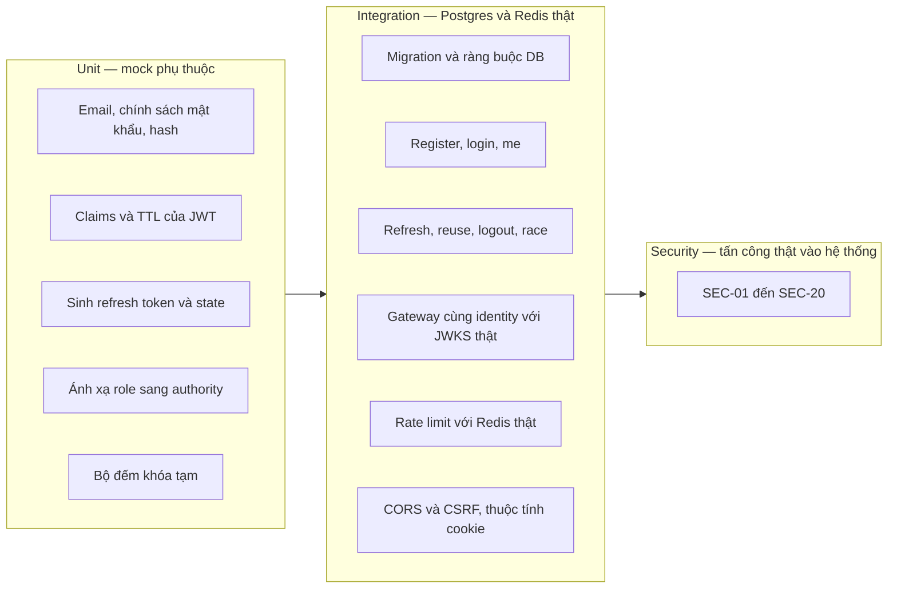
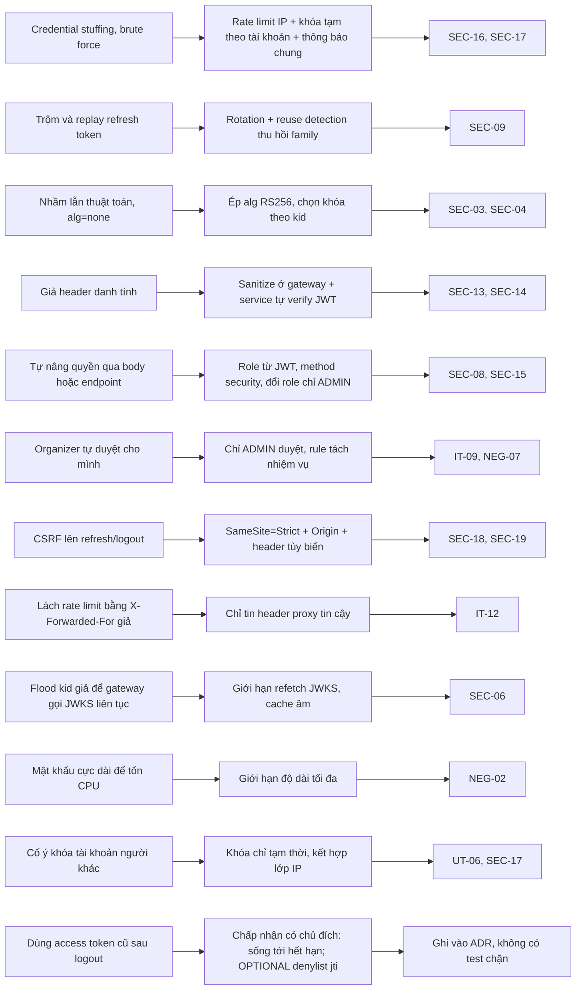
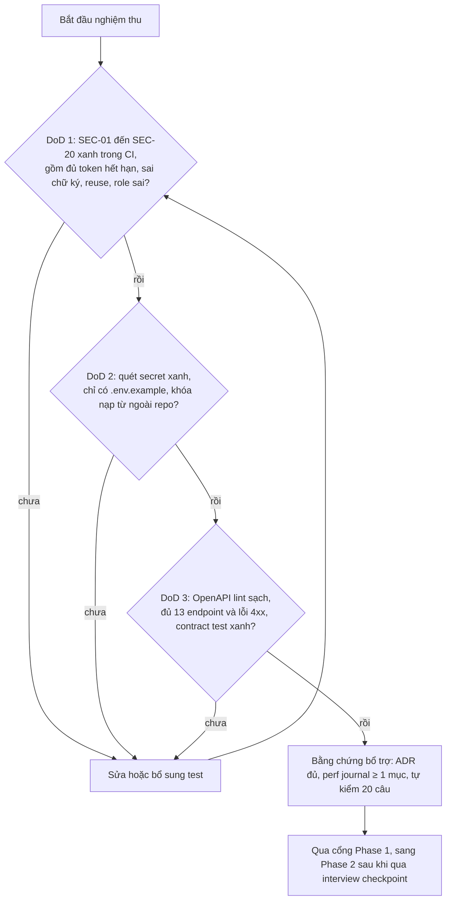

# PHASE 1 — Kiểm thử (Mục 14, 15, 16)

> DoD của source: *"Test bảo mật pass (token hết hạn, sai chữ ký, reuse, role sai); không có secret trong repo; OpenAPI."* Các ID test dưới đây là **ĐỀ XUẤT BỔ SUNG** để biến DoD thành thứ kiểm chứng được. Nguyên tắc từ S11: integration test dùng **Postgres/Redis thật** (Testcontainers), không mock DB.

## Mục 14. Unit, Integration, Security test

### PH1-D22 — Tầng test cho từng khối chức năng

### 14.1 Unit test
| ID | Kiểm tra | Task |
|---|---|---|
| UT-01 | Chuẩn hóa email lower-case; từ chối định dạng sai | T03 |
| UT-02 | Mật khẩu quá ngắn/quá dài bị từ chối; hash 2 lần khác nhau; verify đúng/sai | T03 |
| UT-03 | Token JWT có `sub`, `roles`, `jti`, `iat`, `exp`, `iss`, `aud`; `exp = iat + TTL` | T05 |
| UT-04 | Token ký khóa A không verify được bằng khóa B | T05 |
| UT-05 | Refresh token sinh ra đủ 256-bit và không trùng trong N lần sinh | T06 |
| UT-06 | Bộ đếm sai: đủ N lần thì đặt `locked_until`; thành công thì reset | T06 |
| UT-07 | Ánh xạ `roles` claim sang authority có tiền tố `ROLE_` | T09 |
| UT-08 | Rule: không đổi sang SYSTEM/GUEST; không để hệ thống hết ADMIN | T09 |
| UT-09 | Chuyển trạng thái hồ sơ organizer hợp lệ/không hợp lệ | T10 |
| UT-10 | Key resolver rate limit lấy đúng IP | T13 |
| UT-11 | Logic cache JWKS: hết TTL, `kid` lạ, giới hạn refetch | T11 |

### 14.2 Integration test (Testcontainers)
| ID | Kiểm tra | Task |
|---|---|---|
| IT-01 | Flyway chạy sạch; UNIQUE `lower(email)`; UNIQUE `token_hash` | T02 |
| IT-02 | Register thành công và có role ATTENDEE; trùng email khác hoa/thường ⇒ 409 | T04 |
| IT-03 | 2 request register đồng thời cùng email ⇒ đúng 1 thành công | T04 |
| IT-04 | Login đúng ⇒ 200 + cookie; DB chỉ lưu hash | T06 |
| IT-05 | `GET me` với token hợp lệ ⇒ 200; không token ⇒ 401 | T09 |
| IT-06 | Refresh rotation: token cũ revoked, `replaced_by` đúng, cùng `family_id` | T07 |
| IT-07 | Sau khi ADMIN đổi role, access token mới có role mới | T07, T09 |
| IT-08 | Logout rồi refresh ⇒ 401; logout lặp ⇒ 204 | T08 |
| IT-09 | Approve organizer ⇒ VERIFIED + role ORGANIZER trong cùng transaction | T10 |
| IT-10 | Gateway cho qua token hợp lệ; chặn token hết hạn/sai | T11 |
| IT-11 | Gateway dùng cache khi identity tạm thời không trả JWKS | T11 |
| IT-12 | Rate limit: vượt ngưỡng ⇒ 429 + `Retry-After`; hành vi khi Redis tắt đúng ADR | T13 |
| IT-13 | Preflight CORS đúng/sai origin | T14 |
| IT-14 | Contract: response thật khớp OpenAPI | T15 |

### 14.3 Security test (đây là phần "DoD 1")
| ID | Kịch bản | Kết quả mong đợi |
|---|---|---|
| SEC-01 | Token **hết hạn** | 401 `token-expired` ở gateway và ở service gọi trực tiếp |
| SEC-02 | Token **sai chữ ký** | 401 |
| SEC-03 | Token `alg=none` | 401 |
| SEC-04 | Token ký HS256 bằng chính khóa public làm secret (nhầm lẫn thuật toán) | 401 |
| SEC-05 | Sai `iss` hoặc `aud` | 401 |
| SEC-06 | `kid` không tồn tại | 401; gateway chỉ refetch JWKS có giới hạn |
| SEC-07 | Sửa claim `roles` trong payload, giữ nguyên chữ ký | 401 |
| SEC-08 | **Role sai**: ATTENDEE gọi endpoint ADMIN | 403 ở gateway **và** khi gọi thẳng identity |
| SEC-09 | **Reuse** refresh token cũ | 401; token mới nhất của family cũng bị revoke |
| SEC-10 | 2 request refresh đồng thời cùng token | Đúng 1 thành công |
| SEC-11 | Refresh sau logout | 401 |
| SEC-12 | Refresh khi user bị LOCKED | 401 |
| SEC-13 | Client gửi `X-User-Id` giả | Bị xóa hoặc không có tác dụng |
| SEC-14 | Gọi thẳng service nội bộ (bỏ qua gateway) với token giả/không token | 401 |
| SEC-15 | Register kèm `roles=[ADMIN]` | Vẫn chỉ ATTENDEE |
| SEC-16 | Login với email không tồn tại và email tồn tại sai mật khẩu | Cùng mã, cùng nội dung; thời gian xấp xỉ |
| SEC-17 | Brute force đăng nhập | 429 từ gateway và/hoặc khóa tạm theo tài khoản |
| SEC-18 | Refresh/logout thiếu header tùy biến hoặc Origin lạ | 403 `csrf-rejected` |
| SEC-19 | Thuộc tính cookie refresh | `HttpOnly`, `Secure`, `SameSite=Strict`, `Path` đúng, `Max-Age` đúng |
| SEC-20 | JWKS và log/response | JWKS không có phần private; log/response không chứa mật khẩu, token, hash; DB không chứa token gốc |

Quét secret là **kiểm tra CI riêng** (không phải SEC): thất bại nếu có khóa/mật khẩu trong lịch sử commit.

## Mục 15. Negative case và abuse case

### 15.1 Negative cases (đầu vào sai, hành vi sai hợp lệ)
| ID | Tình huống | Kỳ vọng |
|---|---|---|
| NEG-01 | Email sai định dạng | 400 + `errors[]` |
| NEG-02 | Mật khẩu quá ngắn / quá dài | 400 |
| NEG-03 | Thiếu field bắt buộc / JSON hỏng / sai content-type | 400 hoặc 415, không 500 |
| NEG-04 | Cookie refresh rỗng hoặc chuỗi rác | 401, không 500 |
| NEG-05 | `Authorization` sai định dạng (không `Bearer`) hoặc quá dài | 401 hoặc 400, không 500 |
| NEG-06 | Nộp hồ sơ organizer khi đã có hồ sơ PENDING | 409 |
| NEG-07 | Approve hồ sơ không ở PENDING | 409 |
| NEG-08 | PUT roles chứa giá trị không tồn tại / SYSTEM / GUEST | 400 |
| NEG-09 | Gỡ role ADMIN của admin cuối cùng | 409 |
| NEG-10 | Login khi user LOCKED | 401 thông báo chung |
| NEG-11 | Đổi role/duyệt cho user không tồn tại | 404 |
| NEG-12 | Gọi endpoint không tồn tại / method sai | 404 / 405 problem+json |

### 15.2 Abuse cases (kẻ tấn công chủ động)
### PH1-D23 — Abuse case → biện pháp → test

- Dòng cuối là **rủi ro được chấp nhận** (không phải lỗi): phải xuất hiện trong ADR để bạn giải thích được ở phỏng vấn.

## Mục 16. Definition of Done có thể kiểm chứng

### PH1-D24 — Quy trình nghiệm thu

| Hạng mục | Bằng chứng cần có |
|---|---|
| Test bảo mật pass | Báo cáo CI, danh sách SEC-01…SEC-20 và không có test bị `@Disabled` |
| Không có secret trong repo | Log quét secret xanh; `.gitignore` có khóa; `.env.example` |
| OpenAPI | File spec trong `docs/api/`, lint xanh, contract test xanh |
| ADR | Đủ ADR-011 (source) và các quyết định 1–10 |
| Tự kiểm tra | Câu trả lời 20 câu ở file 06 |

## E. Những điều phải nhớ
- Mọi test race (SEC-10, IT-03) phải chạy lặp nhiều lần để chắc không flaky; flaky nghĩa là có bug thật.
- Không mock DB trong integration; không dùng `@Transactional` trên test class khi đang kiểm hành vi commit/race (S11).
- **SOURCE CHƯA QUY ĐỊNH:** ngưỡng độ phủ test; mức "thời gian xấp xỉ" cho SEC-16 (bạn tự đặt dung sai).
